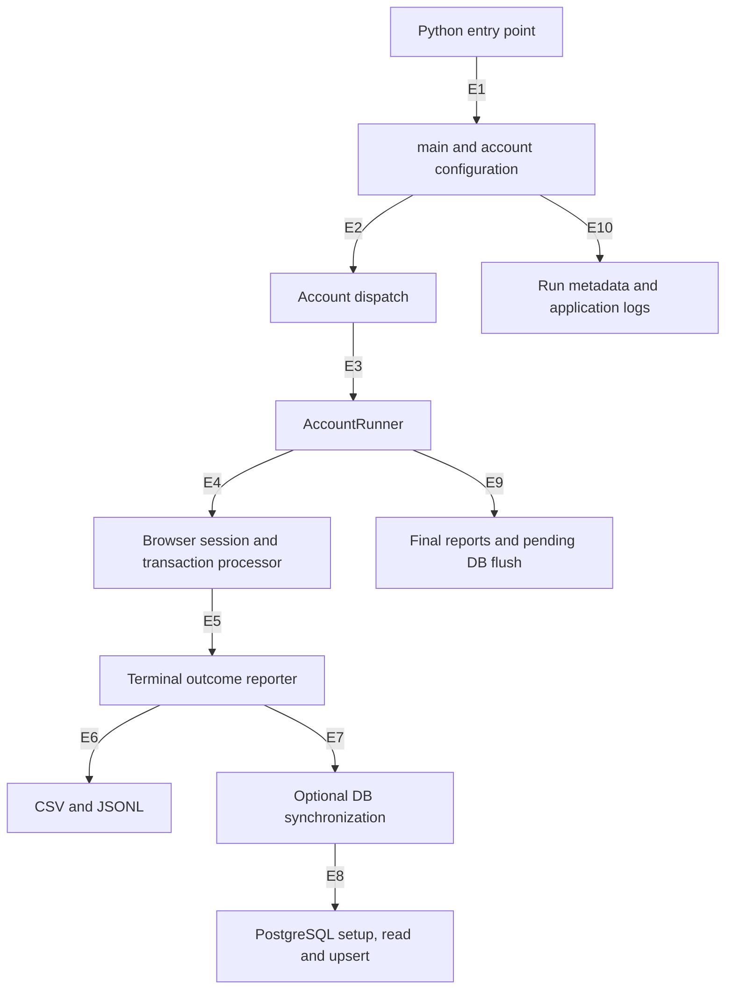

# TaskBot modernization plan

- **Phases 1–5 are complete for the local dummy-shop scope.** On November 25 the owner confirmed that the revised operator guide is clear. [Owner acceptance, F125](2026-11-25-operator-quick-guide.md#f125--verified--the-owner-accepted-the-revised-guide) · [Phase 5 technical checks](2026-11-24-phase-5-reader-guide.md)
- **Next decision.** Use six imaginary customers to agree on who goes first tomorrow. Separately, try a one-page guide to where the code lives. [Database plan](2026-11-25-database-plan.md) · [Project structure plan](2026-11-25-project-structure-plan.md)
- **Still open.** Customer selection, schema and index changes, new interfaces, compatibility with outside tools and deployment measurements belong to future work.

## Questions and answers

1. **M-Q1. What closes the original plan?** **A. Answered.** The owner accepted the revised guide: “yes. the guide is clear for me now.” The local test evidence and the reader’s answer close Phase 5. The owner also reported successful daily runs. Production version, live schema, independently verified live sale outcomes and production peak memory remain **UNVERIFIED**. No practice shop is available according to the owner. Keep local and operational results labeled separately.
2. **M-Q2. Who should be selected tomorrow?** **A. Partly answered.** The owner identified the Operator 1 Lowokwaru recipe and stock/monthly retry priorities. Still open: outside-area behavior per operator, who waits or re-enters, exact ties, unfinished customers, quotas at 5/6, date and restart rules. Suggest answering the dummy examples first. [DB-Q1–Q5](2026-11-25-database-plan.md#questions-and-answers)
3. **M-Q3. What must keep working for other people?** **A. Open.** Identify users of old schemas, SQL utilities, CLI/import paths, report files, session/profile/trace/log outputs and recovery commands. Decide what history must be retained before removing or unifying anything. [DB-Q6–Q7](2026-11-25-database-plan.md#questions-and-answers) · [S-Q2–Q3](2026-11-25-project-structure-plan.md#questions-and-answers)
4. **M-Q4. What should become easier first?** **A. Open.** Choose the first reader of the code map, and later the first task for a GUI or API. Suggested starting points are finding a sale decision and reading a finished run’s totals. Decide audience and access before exposing customer-level data. [S-Q1, S-Q4–Q6](2026-11-25-project-structure-plan.md#questions-and-answers)
5. **M-Q5. What evidence would justify more performance or tooling work?** **A. Partly answered.** The owner approved tooling and CI for later. Still open: representative dummy data sizes, time/memory targets, external checks, CI environment and which stricter checks bring enough benefit. Keep runtime guards and compare measured results before adopting a change. [Phase 5 tooling evidence](2026-11-24-phase-5-reader-guide.md#f117--verified--which-pyproject-settings-earned-their-place) · [DB-Q8](2026-11-25-database-plan.md#questions-and-answers)

## Earlier phase results

Phase 1 established the baseline, Phase 2 clarified retry reporting, and Phase 3 separated operator SQL from database connections. Phase 4 reduced the median time to produce a 1,036-row report by 31.2% with masking on and 41.5% with it off. Seven paired runs matched on all 56 business files, both operator tables and the receipts. The whole-shop time ranges overlapped. [Phase 1 evidence](2026-11-23-phase-1-behavior-baseline.md#12-phase-1-acceptance) · [Phase 2 evidence](2026-11-23-phase-2-reporting.md) · [Phase 3 evidence](2026-11-24-phase-3-customer-input-and-quota.md) · [Phase 4 measurements and diagnostic results](2026-11-24-phase-4-reporting-performance.md)

**Original audit scope.** Branch `modernize`, revision `2e781dc`. The audit used source, Git, installed program versions, aggregate run summaries, the SQL notebooks, and the owner-supplied [schema backup](<../db_query/schema backup.sql>). The owner identified `.env.test` as mostly dummy/example data. It illustrates the input layout. The saved export supplies the database structure. No database connection, application run, or SQL execution was needed for this update. At that point the audit had no whole-app run or peak-memory measurement. The dated Phase 1 notes provide the later local evidence.

- [TaskBot modernization plan](#taskbot-modernization-plan)
  - [Read this first](#read-this-first)
    - [What a customer run does](#what-a-customer-run-does)
    - [How many customer paths are there?](#how-many-customer-paths-are-there)
    - [What C7 and a fixture mean](#what-c7-and-a-fixture-mean)
    - [What the run history says](#what-the-run-history-says)
    - [What happened on November 21](#what-happened-on-november-21)
    - [Which code and files are used](#which-code-and-files-are-used)
  - [0. Owner’s claims](#0-owners-claims)
  - [1. System map and output contracts](#1-system-map-and-output-contracts)
    - [Purpose and execution flow](#purpose-and-execution-flow)
    - [Environment variables](#environment-variables)
    - [Output inventory](#output-inventory)
    - [PostgreSQL writes and reads](#postgresql-writes-and-reads)
    - [SQL guide and database dictionary](#sql-guide-and-database-dictionary)
      - [What the main query means](#what-the-main-query-means)
      - [SQL catalogue](#sql-catalogue)
      - [The two lists in the dummy file](#the-two-lists-in-the-dummy-file)
      - [What an operator table stores](#what-an-operator-table-stores)
    - [Dependencies, tests and documentation](#dependencies-tests-and-documentation)
  - [2. Quality assessment](#2-quality-assessment)
  - [3. Modernization options](#3-modernization-options)
  - [4. Phases and acceptance gates](#4-phases-and-acceptance-gates)
    - [Phase 1 acceptance procedure](#phase-1-acceptance-procedure)
      - [Original readiness check](#original-readiness-check)
    - [Future features](#future-features)
    - [Documentation plan for future changes](#documentation-plan-for-future-changes)
  - [5. Risks and owner questions](#5-risks-and-owner-questions)
  - [Appendix. Command evidence](#appendix-command-evidence)
    - [Codebase-memory queries](#codebase-memory-queries)
    - [Delivery verification](#delivery-verification)
  - [Revision evidence](#revision-evidence)
  - [SQL and November 21 evidence](#sql-and-november-21-evidence)
  - [Schema backup evidence](#schema-backup-evidence)
  - [Customer path evidence](#customer-path-evidence)

## Read this first

For current source locations and the three operator lookups, start with the [reader guide](../README.md#find-an-operators-input-result-and-quota) and [Phase 5 branch checks](2026-11-24-phase-5-reader-guide.md#branch-checks). The line references below record the original audit revision.

### What a customer run does

**F28 — VERIFIED in the code.** Think of one operator with a list of customer numbers. TaskBot takes the next number, checks whether a sale can continue, and records what happened. A finished puzzle alone does **not** count as a sale. The program needs a completed result with evidence from the sales page. The code also has a stop rule when stock runs out. [Customer loop](../src/orchestration/transaction_processor.py) · [Sale result](../src/application/models/transaction_outcome.py)

| What happened to the customer? | What happens next? | Evidence |
| --- | --- | --- |
| The sale is confirmed. | Record completion and continue with the list. The same confirmed number is guarded against another submission in this run. | `src/application/models/transaction_outcome.py:L18-L19` checks `status == "completed"` and nonempty evidence. `src/orchestration/transaction_processor.py:L116-L120,L419-L445` checks the guard and calls `self.reporter.complete(...)`. |
| A business rule says skip. | Finish that customer as a skip. Some skips need the page restored before the next customer. A customer-data update can instead trigger a bounded recheck of the same customer. | `src/orchestration/transaction_processor.py:L177-L186` distinguishes `SKIP`, `SKIP_REQUIRES_RECOVERY` and `RESTART_AFTER_UPDATE`. See F16 for the README omission. |
| The result is unclear or something fails. | An unconfirmed result cannot be counted as completed. A known blocker may have its own outcome. An unknown result can produce an error. The outer loop attempts recovery for an unexpected exception. | `src/orchestration/transaction_processor.py:L105-L112,L419-L425,L508-L535`; `tests/integration/test_transaction_confirmation.py:L28-L38` specifies a separate confirmation assertion. |
| The operator runs out of sellable stock. | Stop this operator’s list. Later numbers may have no report row. Other operators have their own runners. | `src/orchestration/transaction_processor.py:L95-L105` catches `OutOfSellableStockError` and executes `break`. `src/application/use_cases/process_account.py:L42-L53` submits each account separately. |

**Where OpenCV fits.** OpenCV is the image-processing library in this project. A simple example reads a picture, draws a rectangle and saves a copy: `src/vision/overlay.py:L16-L30` uses `cv2.imread`, `cv2.rectangle` and `cv2.imwrite`. The image step and the sales confirmation answer different questions. To understand the business result, follow the confirmation and report calls above. You can refactor reporting without changing the image code. **VERIFIED** for the code paths (F1, F28).

**F29 — VERIFIED for the code.** The customer list and the quota table do different jobs. The list says **who is scheduled for this run, and in what order**. Today the program gets it from `NIK` or `NIK_{n}` in the environment or dotenv file. The database keeps **what TaskBot recorded for a customer**. Each operator table has a customer-number primary key. A subsequent write can update that row. The code assigns a quota increment of one to success and zero to other outcomes. For an existing row it also checks time and month. The detailed sequence of terminal events is available in the local report files. Evidence: `src/infrastructure/config/settings.py:L80-L87,L116-L118,L190-L191`, `src/orchestration/transaction_processor.py:L95-L97`, `src/infrastructure/database/operator_store.py:L293-L310,L853-L866,L974,L1113-L1124,L1206` and F12.

The owner identified a saved SQL recipe for picking customers. Its main Lowokwaru query matches the posted SQL, but two alternate blocks have headings opposite to their predicates. The app still reads the configured list. Which query was used to prepare that list for a particular run, and whether all customers are in the DB, remain **UNVERIFIED**. See the [SQL guide](#sql-guide-and-database-dictionary) before designing a new input source.

### How many customer paths are there?

**F42 — VERIFIED. The README gives six examples in the overview and ten rows in the full happy-flow table.** Here a “happy flow” means the customer can carry on toward a sale. Start at the customer number (NIK). Read each row from left to right. “Same NIK” means TaskBot starts that customer again after saving an update. [Six examples, README.md:L61–L69](../README.md#customer-workflow-overview) · [Ten rows, README.md:L91–L102](../README.md#happy-flows) · [Command evidence, W17](#customer-path-evidence)

| What can happen after entering the NIK | Where it appears | What proves it in the code or tests |
| --- | --- | --- |
| 1. Go straight to the transaction | Overview 1 · README L93 | The first test case supplies `TRANSACTION_READY` and expects `CONTINUE`. `tests/unit/test_customer_workflow.py:L376-L380` |
| 2. Choose customer type → transaction | Overview 2 · L94 | `CUSTOMER_TYPE, … TRANSACTION_READY`. Same test file, L380–385. |
| 3. Give consent → transaction | Overview 3 · L95 | `CONSENT, … TRANSACTION_READY`. Same file, L386–391. |
| 4. Choose type → consent → transaction | Overview 4 · L96 | `CUSTOMER_TYPE`, then `CONSENT`. Same file, L355–373 and L392–401. |
| 5. Choose type → consent → update → same NIK | Overview 5 · L102 | The case expects `RESTART_AFTER_UPDATE`. Same file, L402–414. The second visit is checked separately below. |
| 6. Consent → update → same NIK | Overview 6 · L101 | The next case omits type and still expects `RESTART_AFTER_UPDATE`. Same file, L415–440. |
| 7. NIB reminder → transaction | Additional · L97 | The fake dashboard shows the business-registration reminder. The test asserts `nib_reminder_calls == 1` and `action is PrecheckAction.CONTINUE`. Same file, L603–621. |
| 8. Choose type, give consent, or do both → NIB reminder → transaction | Additional · L98 | This is one README row covering several orders. The service checks again after each optional screen. `src/application/services/transaction_prechecks.py:L185-L201,L213-L238`. W24 exercised all three variations. |
| 9. Update immediately → same NIK | Additional · L99 | The test starts at `UPDATE_REQUIRED` and asserts `RESTART_AFTER_UPDATE`, with no type or consent screen first. `tests/unit/test_customer_workflow.py:L443-L465`. |
| 10. Choose type → update → same NIK | Additional · L100 | The type handler gets the next state; the update handler can then return `RESTART_AFTER_UPDATE`. `src/application/services/transaction_prechecks.py:L185-L200,L238-L256,L340-L354`. W24 exercised this combination. |

**F43 — VERIFIED with fake screens.** TaskBot checks which screen is showing, takes one action and looks again. The loop in `src/application/services/transaction_prechecks.py:L154-L172,L197-L201` contains `state = self._resolve_after_action(nik, state)`. That explains how a few handlers can support more than ten screen orders.

- **What we ran.** Nine existing customer-workflow test cases passed, including all six overview cases, an immediate update, a continued NIB reminder and a closed NIB reminder. A separate existing test passed for restarting the same customer. Its assertions check two visits to that NIK, one completion and zero ordinary retries. `tests/unit/test_customer_workflow.py:L376-L440,L443-L465,L603-L626,L655-L675`; `tests/contract/test_transaction_processor.py:L1403-L1410,L1452-L1468` (`len(reporter.complete_calls) == 1`). [W22 and W25](#customer-path-evidence)
- **What we counted in a controlled example.** We showed the real precheck service fake screens for customer type, consent and NIB, each at most once. There are 16 possible orders including showing none (1 empty, 3 single, 6 pairs, 6 triples). Each order ran twice. **16 reached “continue to transaction” and 16 reached “restart the same NIK after update.”** One example beyond the six is consent → NIB → transaction. Each check asserted the exact order of the actions taken. This measures the service before a sale. Which of those 32 combinations the live portal can actually show is **UNVERIFIED**. [Test doubles, tests/unit/test_customer_workflow.py:L165–L187](../tests/unit/test_customer_workflow.py) · [W24, exact check and output](#customer-path-evidence)
- **Where a sale ends.** A customer can still be skipped, run out of stock, or have an unconfirmed sale. After the customer check, the code can continue, skip, skip with recovery, or restart the same NIK after an update. An empty stock signal breaks the current operator's customer loop. The sale check requires `self.status == "completed" and bool(self.evidence.strip())`. `src/application/models/customer_workflow.py:L10-L14`; `src/orchestration/transaction_processor.py:L95-L105,L177-L199,L419-L429`; `src/application/models/transaction_outcome.py:L13-L19`. See F16 and F28.
- **How to count the other README branches.** Its four tables have **40 entries** (10 happy flows, 11 business or sale problems, 8 update failures and 11 recovery situations). The six overview examples already appear in the ten. A recovery entry can happen during another flow. A single exact count of all live start-to-finish paths is **UNVERIFIED**. [README.md:L86–L193](../README.md#complete-workflow-catalogue) · [W17](#customer-path-evidence)

**F44 — VERIFIED in the saved November 21, 2026 reports.** The two operators recorded **200 completions and 14 skips**. The table groups those records by the optional actions TaskBot logged for each customer, in their recorded order. It shows **six paths among the completions**. Two of these six paths include a NIB reminder. The report contains no customer-update or same-NIK-restart event. [W30–W32](#customer-path-evidence)

| Optional actions logged for that customer | Recorded completions | Recorded skips |
| --- | ---: | ---: |
| No optional action recorded | 26 | 2 |
| Customer type | 14 | 2 |
| Consent | 146 | 10 |
| Customer type → consent | 12 | 0 |
| NIB reminder | 1 | 0 |
| Consent → NIB reminder | 1 | 0 |
| **Total** | **200** | **14** |

W31 matched the saved workflow events to terminal records within the same run and operator, using the stored customer key. It found zero missing keys, zero duplicate terminal keys and zero unmatched action keys. All 398 events were recognized as detections or actions. The reporter describes a workflow event as “one business milestone” at `src/web/reporter.py:L578-L593,L599-L600`. An empty event history tells us only that no optional action was **logged**. These counts describe one saved run. Independent confirmation from the sales system remains open under C7.

**Phase 1 acceptance addition (F42–F44).** Keep one dummy example for each of the ten rows. Give the grouped NIB row separate cases for type, consent and both. Include one NIB close/skip and one unconfirmed sale. For an update, check that the same dummy customer comes back once and gets one final record. At the sale boundary, compare the expected result with the terminal report and the test database row as described in [Phase 1](#phase-1-acceptance-procedure). The November 21 counts provide examples for choosing fixtures. A future test run can use any documented input mix.

### What C7 and a fixture mean

**F30 — VERIFIED installed tools, UNVERIFIED live system.** The local Python interpreter returned `3.14.2`. The installed PostgreSQL server and client executables report version `18.4`. A pgAdmin 4 executable is also installed (R21, R37). PostgreSQL stores the records. pgAdmin 4 is a program a person can use to look at them. TaskBot’s DB code calls `psycopg2.connect(...)` at `src/infrastructure/database/operator_store.py:L903-L910`. No server connection was made to check which version the deployed service is running.

**C7 means “can we see a pretend sale actually finish?”** Imagine a practice shop. Give it a made-up customer. Have the practice shop confirm one sale. Check three things: the shop shows the expected result, TaskBot writes exactly one completed row, and the test customer’s quota changes as expected. For a skipped customer, look for the expected skip and zero quota increase. If stock runs out, the next customer should stay unprocessed. For an ambiguous result, there should be no completed row. Phase 1 exercised these cases with Python 3.14.2, a local dummy shop and a separate PostgreSQL 18 instance. A live merchant sale remains **UNVERIFIED**. [Phase 1 closeout](2026-11-23-phase-1-behavior-baseline.md#12-phase-1-acceptance)

A **fixture** is just a small, repeatable example with an answer we already know. These are the inputs we need decisions about. The engineer can generate the dummy IDs and files. Real identifiers, passwords, screenshots, or `.env` are unnecessary.

| Example | Dummy input or decision needed | Example expected answer |
| --- | --- | --- |
| One clean sale | One test operator, customer A, a success message or receipt recognized by the practice shop, and a starting quota. | If A starts at 2 and the event is newer in the same month, A ends at 3. One completed terminal row. |
| One skip and one stop | Customers B and C in order. Choose a recognized business skip for B. Separately simulate no stock for B. | With a skip, B’s quota does not increase and C can be processed. With no stock, C remains unprocessed for that operator. |
| Unclear outcome | One dummy customer whose sale receives no clear confirmation. | No completed sale or success quota increase. Capture the actual error/block outcome as the baseline. |
| Existing data and reports | Use the supplied schema backup for the existing layout (F39/F41). Use made-up before/after quota rows and any still-used report formats. | Compare fields by name. Check positional outputs separately. Retain the existing and fresh-table layouts in compatibility tests. |

### What the run history says

**F31 — VERIFIED for the local archive; PARTIAL as a production baseline.** In 161 standard `run_meta.json` files, 145 had a terminal status and usable start/end timestamps. Sixteen still said `running` and were excluded. The duration is wall-clock time from `ended_at - started_at`. It includes time spent waiting. It does not measure CPU use. `main.py:L172-L185` writes these fields. R25 gives the extraction command and output.

| Run group | Finished records | Median elapsed | Within 15 minutes to 2 hours, inclusive |
| --- | ---: | ---: | ---: |
| All finished records | 145 | 26 min 7 sec | 95 |
| Marked `completed` | 27 | 56 min 1 sec | 21 |
| Marked `completed_with_errors` | 98 | 26 min 32.5 sec | 66 |
| Marked `failed` | 20 | 3 min 59.5 sec | 8 |

The owner’s **15-minute to 2-hour** estimate covers most of this archive. Of the 145 finished records, 49 were shorter and one was longer. The longest was **2 hr 1 min 18 sec**. A zero-second record is possible at the report’s one-second precision. Which historical runs were production and which revision created them is **UNVERIFIED**. A `completed` label alone does not establish C7 for the current software.

**Recorded workload.** Finished records list one or two operators. Exactly 87 of 145 contain complete requested/processed counts for every listed operator. Within those 87 the median requested count was 1,976 and the median processed count was 224. Counts are distinct within each operator and then summed. The largest processed count was 1,036. The two medians describe the sample separately. They cannot establish why work remained in any particular run. R39; `src/application/services/account_runner.py:L184-L198`. For a later *report-only* benchmark, start with the small correctness examples, then try 224 and 1,036 synthetic output rows as archive-informed size estimates. Record the actual emitted rows for each benchmark.

**Historical peak memory is UNVERIFIED.** R25 found zero matching memory fields in 161 saved run summaries. The Phase 1 two-customer dummy benchmark later measured median sampled peaks of 735.46 MiB for the app and browser tree and 256.92 MiB for PostgreSQL. [Timing and sample ranges](2026-11-23-phase-1-behavior-baseline.md#how-long-it-took-and-how-much-memory-it-used)

### What happened on November 21

**F40 — VERIFIED as a historical report.** The latest standard run-summary date in this checkout is **November 21, 2026**, with one run that day. It started at **10:50:30 WIB** and ended at **11:29:35 WIB**, an elapsed **39 minutes 5 seconds**. Both operators recorded completed execution and successful persistence. The overall label was **`completed_with_errors`**.

| Requested | Processed | Completed rows | Skipped rows | Remaining | Transaction errors |
| ---: | ---: | ---: | ---: | ---: | ---: |
| 1,752 | 214 | 200 | 14 | 1,538 | 0 |

The 214 processed customers are accounted for by 200 completions and 14 skips. Two of the skips were out of stock, one per operator (S04, S15). The code stops that operator’s list on out-of-stock. It gives a clean `completed` transaction status only when nobody remains and every terminal row is completed. Its transaction-error count is narrower and counts only `error` and `failed_puzzle_solve`. These rules explain why the report can have zero transaction errors and still say `completed_with_errors`. Evidence: `src/orchestration/transaction_processor.py:L95-L105`; `src/application/services/account_runner.py:L181-L198`; S22 run-summary readback.

This is evidence that the workflow ran and recorded sales that day. It does not independently verify each sale, a database write, or the current checkout against the live service. For **November 23, 2026**, the proposed follow-up is one authorized practice sale and one skip with dummy data. Compare the practice shop’s confirmation, the saved output, and the test quota record (F7, F30). No run was started or scheduled.

### Which code and files are used

**F32 — VERIFIED paths; external use is UNVERIFIED.** A file can be optional, or run through a different command, and still be useful.

| Kind | What it is for | Proof |
| --- | --- | --- |
| Normal sale run | `main.py` starts the account work. Operator CSV/JSONL, summaries and run logs describe what happened. DB sync is optional. | `main.py:L273-L318,L338-L351`, `src/application/services/account_runner.py:L58-L86`, F12. |
| Conditional part of that run | Log rotation is configured on the normal logging sinks. Debug tracing writes a ZIP when diagnostics are active and tracing has started. A rotated file or debug trace need not exist in every run. | `src/logging_utils.py:L179-L216`; `src/infrastructure/browser/playwright_session.py:L149-L172`; `src/infrastructure/interaction_diagnostics.py:L317-L329,L356-L361`. |
| Separate command | `user_sessions.py` exports a session. Its profile directory and session JSONs belong to that command. It performs a different job from the routine sale report. | `user_sessions.py:L17-L18`, `src/application/use_cases/export_session.py:L65-L70`, `src/infrastructure/sessions/export_service.py:L423-L438`. |
| DB maintenance or import | `scripts/db_management.py` can prepare the DB or import a report. The local `db_query` files include reads and changes to data. Their scheduled or manual use is unknown. | `scripts/db_management.py:L42-L74`, `src/infrastructure/database/operator_store.py:L450,L1008-L1026`, R29 and original command 76. |

**F33 — PARTIAL dead-code assessment.** An offline scan of all **137 tracked Python files** counted **687 non-test function and method definitions**. It found 595 with a name reference in application code, 15 referenced by name only in tests, two with string references only, 54 special methods or `main` definitions, and **21 with no matching name reference**. This is a name-based scan: two different methods can share a name, and external callers or dynamic dispatch can escape it (R26). These numbers are leads for review, not deletion approval.

| Example | What the evidence shows | Decision |
| --- | --- | --- |
| `TransactionProcessor.process_all_niks` | The graph’s inbound trace returned zero. Source explicitly calls `processor.process_all_niks()` at `src/application/services/account_runner.py:L70`. The real processor factory is supplied at `main.py:L106-L108`. | **VERIFIED normal path.** Keep. |
| `main._sync_report_to_database` | The function exists at `main.py:L64-L89`. The ordinary runner receives `DatabaseReportSyncer()` at line 108. Tests directly call the wrapper at `tests/contract/test_db_sync_lifecycle.py:L35-L38,L141-L143`. | **VERIFIED test-covered helper.** Keep its contract. |
| `TransactionReporter.get_rows_by_status` | `src/web/reporter.py:L706-L708` defines the method. The repository search returned its definition alone and the graph found zero callers (R40, RG10). | **UNVERIFIED outside the tracked code.** Review as a possible cleanup. No deletion proposed. |

**F34 — PARTIAL interface inventory.** `README.md:L359-L363` documents `uv run main.py`, and `main.py:L354-L355` calls `main()`. R22–R23 found no tracked web frontend manifest or matches for the common GUI/API frameworks searched. That leaves external launchers unverified. A visible browser controlled by TaskBot and pgAdmin’s window serve different purposes from an operator-facing TaskBot screen.

**F35 — VERIFIED documentation exists; the practical gap is a short guide.** `README.md:L32-L76,L359-L367,L453-L471` already covers the workflow, CLI, reports and architecture. F16 shows where details have drifted. Begin here with the list, branch outcomes, file ownership and dummy cases. Keep the long technical inventory below for anyone changing code.

## 0. Owner’s claims

| Claim | Status | Evidence | Notes |
| --- | --- | --- | --- |
| **C1 / F1** — The project is pure Python. | **CONTRADICTED** as stated | `src/infrastructure/interaction_diagnostics.py:L42-L49` contains JavaScript, including `const nodeId = (element) =>`. `src/infrastructure/database/operator_store.py:L1186-L1206` embeds PostgreSQL `INSERT ... ON CONFLICT`. `pyproject.toml:L8-L14` declares NumPy, OpenCV, Playwright and psycopg2-binary. | Python is the main implementation language. The application also uses browser JavaScript, SQL, and native dependencies. |
| **C2 / F2** — Recently migrated from pip to uv. | **PARTIAL** | The first recorded commit was `70c5647` on October 17, 2025 (R15). The first recorded `uv.lock` commit was `242c83d` on January 17, 2026 (R05). The previous README says `pip install -r requirements.txt` (original command 37). The migration commit removed `requirements.txt` and added `uv.lock` (original command 16). | The migration and its date are verified. The idea that the repo used uv from the start is **CONTRADICTED** by the tracked history. No cutoff for “recently” is needed to act on the plan. |
| **C3 / F3** — Read input from `.env`, process it, then write to PostgreSQL. | **PARTIAL** | `main.py:L273-L318` calls `load_environment(...)`, `config.account_configs()` and `process_accounts(...)`. `src/infrastructure/config/environment.py:L52-L54` returns `{**values, **os.environ}`. `src/infrastructure/database/report_syncer.py:L44-L47` returns when the manager is absent. | The process environment takes precedence. The normal work queue comes from account settings. Some paths read a region mapping. Local report files are written independently of optional DB synchronization. |
| **C4 / F4** — The DB is write-only. | **CONTRADICTED** | `src/infrastructure/database/operator_store.py:L863-L877` executes `SELECT {last_transaction_time}, {updated_time}, {kuota} ... WHERE {nik} = %s`. Lines 783–809 use the previous record while constructing upsert parameters. | Prior DB state is an input to persistence. The work queue comes from `for nik in self.config.nik` in `src/orchestration/transaction_processor.py:L93-L95`. |
| **C5 / F5** — Outputs mix JSON, CSV and log files. | **VERIFIED** | `src/web/reporter.py:L922-L928` names seven operator files. `src/logging_utils.py:L151-L153` names the text and JSONL log paths. `main.py:L187-L193` writes `run_meta.json`. | Also account for JSONL events, optional DB writes, conditional diagnostic artifacts and the separate session exporter. |
| **C6 / F6** — Existing documentation describes the project. | **VERIFIED** | `README.md:L453-L469` describes the account runner, browser, transaction processor and reporter. `main.py:L92-L108` supplies the corresponding factories and syncer. | Accuracy is **PARTIAL**. F16 gives concrete differences between the documentation and implementation. |
| **C7 / F7** — The app currently works. | **PARTIAL** | Independent dummy-shop receipts, saved files and PostgreSQL readbacks verified local sale, skip, restart and failure cases. The interrupted JSONL case reproduced a confirmed sale with a missing JSONL record and no quota increase (F72). | The local baseline is accepted. A live sale still needs separate merchant-side evidence. [Phase 1 closeout](2026-11-23-phase-1-behavior-baseline.md#12-phase-1-acceptance) |

## 1. System map and output contracts

### Purpose and execution flow

**F8 — VERIFIED from source.** TaskBot processes LPG customer-sale work for configured operators and records customer-level outcomes. `src/application/services/account_runner.py:L58-L70` opens a browser session and calls `processor.process_all_niks()`. `src/orchestration/transaction_processor.py:L95,L266,L287,L445` contains the input loop and distinct skip, error, and completion calls. `README.md:L3` supplies the business description.



| Edge | VERIFIED call site |
| --- | --- |
| E1 | `main.py:L354-L355` — `if __name__ == "__main__"` calls `main()`. |
| E2 | `main.py:L275-L318` — `load_environment(...)`, `config.account_configs()` and `process_accounts(...)`. `src/config.py:L35-L48` resolves settings and the run context. |
| E3 | `src/application/use_cases/process_account.py:L30-L53` calls `run_account(configs[0])` or `executor.submit(run_account, account_config)`. `main.py:L114-L130` calls `process_account(...)`. `src/application/use_cases/process_account.py:L6-L8` returns `account_runner.run(config)`. |
| E4 | `src/application/services/account_runner.py:L60-L70` — `session.initialize_session()` and `processor.process_all_niks()`. `main.py:L101-L108` supplies the factories. |
| E5 | `src/orchestration/transaction_processor.py:L266,L287,L445` — `self.reporter.skip_out_of_stock(...)`, `.error(...)`, `.complete(...)`. `src/web/reporter.py:L199,L225,L512` calls `self._add_row(...)`. |
| E6 | `src/web/reporter.py:L1095-L1104` calls `self.file_writer.append_row(row)`. `src/infrastructure/reporting/file_writer.py:L57-L60` appends CSV before JSONL. |
| E7 | `src/web/reporter.py:L1103-L1105,L1147-L1156` calls `_queue_row_for_batch_sync(row)` and appends to `_pending_batch_rows`. `main.py:L108` supplies `DatabaseReportSyncer()`. |
| E8 | `src/infrastructure/database/report_syncer.py:L57-L80` calls `_ensure_database(manager)` and `manager.sync_report_payloads(...)`. `src/infrastructure/database/operator_store.py:L367-L370,L783-L796` performs setup and reads the prior record before the upsert. |
| E9 | `src/application/services/account_runner.py:L81-L132` calls `reporter.write_files()`, `reporter.flush_pending_batches()` or the sync callback, closes the syncer, and calls `reporter.print_summary()`. |
| E10 | `main.py:L283-L303,L324-L351` — `configure_logging(...)`, `_write_run_meta(...)`, and `logger.complete()`. |

**F9 — VERIFIED. Other entry points affect the inventory.** `scripts/db_management.py:L60-L74` calls `ensure_database_and_tables()` and can call `sync_report_file(...)`. `user_sessions.py:L17-L18` calls `run_user_session_export()`. `inspect_env.py:L5-L18` reads the dotenv file at module scope and prints key names and lengths. Only its source was inspected. `nik_parser.py:L13,L77-L91,L104` resolves and reads `nik_region_mapping.json` on a mapping cache miss. `src/application/services/transaction_prechecks.py:L267` calls `self.parse_nik(nik)`.

### Environment variables

**F10 — VERIFIED for explicit application-owned reads in the searched source.** `{n}` denotes a numeric account suffix. “Input data” is the requested customer workload. Credentials, operator identity, routing and runtime controls are classified as configuration. Variable names come from code. Example-file searches collected assignment names only.

| Variable | Class and purpose | Read site and evidence |
| --- | --- | --- |
| `NIK`, `NIK_{n}` | **Input data** — comma-separated customer identifiers | `src/infrastructure/config/settings.py:L87,L118,L190-L191` — `_parse_nik_list(...)` and `raw_nik.split(",")`. |
| `EMAIL`, `PIN`, `EMAIL_{n}`, `PIN_{n}` | Configuration — account authentication | `src/infrastructure/config/settings.py:L85-L86,L116-L117` — `environ.get(...)`. `src/infrastructure/database/operator_store.py:L186-L209` also inspects account keys when resolving a target. |
| `OPERATOR_ID`, `OPERATOR_{n}_ID` | Configuration — public operator identity | `src/infrastructure/config/settings.py:L91,L128-L131` — `operator_setting = f"OPERATOR_{suffix}_ID"`. |
| `NAME_OPERATORS_{n}` | Configuration — DB operator mapping | `src/infrastructure/database/operator_store.py:L194-L217` — `source.get(f"NAME_OPERATORS_{suffix}", "")`. Table naming is separate. |
| `URL_APPLICATION` | Configuration — application URL | `src/infrastructure/config/settings.py:L43` — `source.get("URL_APPLICATION", "")`. |
| `HEADLESS`, `MASK` | Configuration — browser visibility and NIK display | `src/infrastructure/config/settings.py:L49-L50,L194-L213` — `_parse_headless(...)` and `_parse_mask(...)`. |
| `MAX_CONCURRENT_ACCOUNTS` | Configuration — optional worker cap | `src/infrastructure/config/settings.py:L51-L52,L71-L76` reads and parses it. `src/application/use_cases/process_account.py:L33` computes `min(len(configs), max_concurrent_accounts or len(configs))`. |
| `CUSTOMER_UPDATE_MIN_INTERVAL_SECONDS`, `CUSTOMER_UPDATE_JITTER_SECONDS` | Configuration — update pacing | `main.py:L41-L60` — `os.getenv(name, "")` and the two named callers. |
| `LOG_LEVEL`, `LOG_FILE_LEVEL`, `LOG_ROTATION`, `LOG_RETENTION`, `LOG_COMPRESSION` | Configuration — console/file thresholds, rotation, retention and compression | `src/logging_utils.py:L155-L159` — five named `os.getenv(...)` calls. |
| `DB_HOST`, `DB_PORT`, `DB_NAME`, `DB_USER`, `DB_PASSWORD` | Configuration — PostgreSQL host, port, target database and login | `src/infrastructure/database/operator_store.py:L123-L147` — required-key check, `int(source["DB_PORT"])` and named connection fields. |
| `DB_MAINTENANCE_NAME` | Configuration — maintenance database for setup | `src/infrastructure/database/operator_store.py:L147` — `source.get("DB_MAINTENANCE_NAME", "postgres")`. |
| `PYTHON_DOTENV_DISABLED` | Configuration — dotenv loading switch | `src/infrastructure/config/environment.py:L27` — `os.getenv("PYTHON_DOTENV_DISABLED", "")`. |
| `TASKBOT_INTERACTION_DEBUG`, `TASKBOT_INTERACTION_PAUSE` | Configuration — diagnostic capture and pause | `src/infrastructure/interaction_diagnostics.py:L16-L17,L188-L204` — both constants flow into `source.get(name, "")`. |

**F11 — VERIFIED.** `src/infrastructure/config/environment.py:L39-L54` processes arbitrary dotenv entries, selectively calls `os.environ.setdefault(key, value)`, and merges process variables. NIK keys and values over 32,767 UTF-16 code units have special export handling. `src/infrastructure/config/settings.py:L80-L87` returns numbered accounts in preference to legacy single-account settings. `inspect_env.py:L8-L14` iterates arbitrary `values.items()`. Tests also read fixture-only keys, including `SMALL` and `AT_LIMIT` at `tests/unit/test_environment.py:L104,L110` (command 83). The named application settings above do not enumerate arbitrary inherited variables or third-party library settings.

### Output inventory

**F12 — VERIFIED at the writer sites.** `R` denotes the normal run root, `reports/YYYY/MM/DD/YYYYMMDD_HHMMSS_<four hex characters>`. `O` denotes `R/operators/<public operator ID>`. `src/application/dto/run_context.py:L68-L97` builds the timestamp, suffix, and root. `src/web/reporter.py:L903-L928` constructs operator paths and supports a context-free fallback. Programmatic overrides are separate golden scenarios.

| Path | Format, trigger and writer |
| --- | --- |
| `R/run_meta.json` and transient `R/run_meta.json.tmp` | Run-level JSON. `main.py:L187-L193` writes the temporary path and calls `temporary_path.replace(meta_path)`. |
| `R/application.log`, `R/application.jsonl`, `R/database/database_events.jsonl` | Text and two structured Loguru streams. `src/logging_utils.py:L151-L159,L170-L216` defines paths, rotation settings, queued file sinks, `serialize=True`, and DB/application filters. Console output is a separate sink. Rotated filenames depend on settings and runtime. |
| `O/items.csv`, `O/items.jsonl` | UTF-8 terminal records. `src/infrastructure/reporting/file_writer.py:L50-L60,L73-L92` writes the CSV header when needed, appends one CSV row, then one JSON object and newline. |
| `O/workflow_events.jsonl`, `O/retries.jsonl` | Event streams. `src/web/reporter.py:L143-L148,L562-L564,L599-L600,L1382-L1389` creates the files and appends events. Empty-file presence belongs in the manifest. |
| `O/summary.json`, `O/items_snapshot.json`, `O/analytics.json` | Public JSON projections. `src/web/reporter.py:L652-L670,L922-L926,L1367` selects their data and paths. `src/infrastructure/reporting/file_writer.py:L62-L69` uses `sanitize_public_value(data)`, `indent=2` and `ensure_ascii=False`. |
| `R/artifacts/screenshots/<operator>/…`, `R/artifacts/traces/<operator>/…` | Conditional PNGs, trace ZIP, attempt images and attempt `meta.json`. `src/orchestration/transaction_processor.py:L612-L616,L784-L791` selects roots. `src/infrastructure/interaction_diagnostics.py:L298-L299,L361,L475-L483` writes trace/screenshot artifacts. `src/pipelines/slider/solver.py:L109-L121,L174` and `src/pipelines/slider/artifacts.py:L33-L34,L216` identify attempt artifacts. `src/web/helpers.py:L154-L157` includes a `data_puzzle/…` fallback. |
| Session-export directory | Separate command. Under `R/artifacts/sessions/<operator slug>` with a run context, a supplied output directory, or the dated `reports/sessions` fallback, the exporter defines `cookies_enriched.json`, `cookies_playwright.json`, `cookies_cdp.json`, `cookies_sqlite.json`, `storage_state.json`, `web_storage.json`, `network_xhr.json`, `session_summary.json`, and a browser profile. `src/application/use_cases/export_session.py:L23-L29,L65-L70` and `src/infrastructure/sessions/export_service.py:L423-L438,L525-L532` show the roots and JSON writes. Browser-managed profile contents are **UNVERIFIED**. Use synthetic fixtures only. |
| Console | Run and account summaries, logs, and the standalone utility’s key-length listing. `main.py:L207-L249`, `src/application/services/account_runner.py:L132`, `src/logging_utils.py:L170-L178`, `inspect_env.py:L16-L18`. |

### PostgreSQL writes and reads

**F13 — VERIFIED from SQL construction and call sites.** The target table is `OPERATOR_<numeric suffix>`. `src/infrastructure/database/operator_store.py:L194` defines `table_name = f"OPERATOR_{suffix}"`. Lines 972–986 declare `NIK BIGINT PRIMARY KEY` via composed identifiers. Lines 1096–1111 and 1186–1206 map all 14 insert columns:

`OPERATOR`, `NIK`, `NAMA_KONSUMER`, `JENIS_PENGGUNA`, `KUOTA`, `MAX_KUOTA`, `CONFLICT`, `STATUS_CODE`, `STATUS_CODE_DESCRIPTION`, `PROBLEM`, `LAST_TRANSACTION_TIME`, `PREVIOUS_TRANSACTION_TIME`, `UPDATED_TIME`, `CREATED_TIME`.

| Operation | SQL or call-site evidence in `src/infrastructure/database/operator_store.py` |
| --- | --- |
| Database discovery and creation | Lines 397–408 — `SELECT 1 FROM pg_database WHERE datname = %s` and conditional `CREATE DATABASE {}`. |
| Table creation, migration, backfill | Lines 972–986, 1012–1026, 1067–1083 — `CREATE TABLE IF NOT EXISTS`, `SELECT column_name`, `RENAME COLUMN`, `ADD COLUMN` and `SET {last_transaction_time} = {updated_time}`. |
| Monthly reset | Lines 496–508 — `UPDATE {table} SET {kuota} = 0` for qualifying records from earlier months. Lines 367–370 invoke the reset during setup. Existing rows beyond the current input list can change. |
| Per-record read and upsert | Lines 783–809 call the history helper and bind values. At lines 853–866, `if record.kuota_delta <= 0: return None` skips the history query. For positive deltas, the helper queries the previous customer row. Lines 1186–1206 contain `INSERT INTO {table} AS target (...) VALUES (...) ON CONFLICT ({nik}) DO UPDATE SET`. Lines 1113–1124 and 1207–1234 show how time, month and the incoming delta affect updates. |
| Report import | Lines 542–558 and 1277–1310 — `read_report_payloads(path)` dispatches JSONL, CSV or JSON into synchronization. JSON reads the full document. |

**PARTIAL inventory boundary.** Graph coverage reported excluded directories and changed file metadata. Direct source inspection supports the findings above. Command 66 found four local SQL files among the utility directories examined. Command 76 found SQL keywords in `db_query`, including `SELECT` and `UPDATE`. Keyword counts do not establish execution or application reachability. Actual database state and externally installed jobs remain **UNVERIFIED**.

### SQL guide and database dictionary

**F36 — VERIFIED from the saved SQL.** The query supplied by the owner matches the first query in [basic query.sql](<../db_query/basic query.sql>) when comments and whitespace are ignored. The Operator 2 copy has identical SQL after substituting the table name. The Python source search found no reference to the `db_query` folder. Consequently the query is verified as a saved selection recipe. Whether an operator actually used its result for a particular run is **UNVERIFIED**. The application itself loops over `self.config.nik`. Evidence: `db_query/basic query.sql:L4-L52,L201-L249`, `src/orchestration/transaction_processor.py:L93-L97` and S14.

#### What the main query means

Imagine putting customer cards into four piles. The `WHERE` clause decides which cards enter the piles; the `ORDER BY` clause decides which cards you see first.

- **Filter.** Use Operator 1’s table, keep customer numbers beginning with `357305`, exclude the five named status descriptions, and allow `KUOTA` up to **and including 5**. The excluded descriptions correspond to an invalid registered NIK, an unregistered customer, an under-17 customer, a customer who cannot transact at this base, and a customer needing a data update. The query checks the description text. `nik_parser.py:L104-L114` formats the first six digits as a district code; the local mapping identifies `35.73.05` as Lowokwaru (S11–S12). Evidence: `db_query/basic query.sql:L16-L26`.
- **Order.** First come “Max kuota reached” rows last updated before the current month (rank 0). Next come “Sellable stock unavailable” rows last updated before today (rank 1). Other surviving descriptions follow (rank 2). Remaining max-quota or stock-unavailable rows come last (rank 3). Within each rank, smaller `MAX_KUOTA` comes first, nulls last, then older `UPDATED_TIME`. The comparisons use PostgreSQL’s `CURRENT_DATE`. Evidence: `db_query/basic query.sql:L28-L52`.
- **What “today” means here.** It is a priority list evaluated today. There is no overall “must be due today” date filter. A same-day stock-unavailable row can still appear at rank 3. Two rows with identical rank, `MAX_KUOTA` and `UPDATED_TIME` have no specified relative order. The projection repeats columns because it selects named columns and then `*`. Evidence: `db_query/basic query.sql:L5-L52`. None of these rows is proof that a sale is authorized or will succeed.

#### SQL catalogue

**F37 — VERIFIED file inventory.** `db_query` contains three files in this review (B02). `basic query.sql` is the query notebook, `deduplicate.sql` is the maintenance script, and [schema backup.sql](<../db_query/schema backup.sql>) is the exported table layout documented in F39/F41. S01 and S08 cover the two notebook/maintenance files inspected earlier. Each file was read as text.

| File and lines | What the SQL actually does |
| --- | --- |
| `basic query.sql:L4-L52,L201-L249` | The Lowokwaru priority lists for Operator 1 and Operator 2 described above. |
| `basic query.sql:L57-L88` | Combines both operator tables with a source-table label, then filters for Lowokwaru. The status and quota filters at lines 72–79 are commented out. This list can be broader than either main list; `MAX_KUOTA` is its first sort key. |
| `basic query.sql:L92-L106,L253-L257,L349-L356` | Operator 1 has a fixed-date inspection and a single-customer lookup. Operator 2 has a newest-update-first inspection and a single-customer lookup. The last block searches a literal customer list across both tables with `UNION ALL`. Personal literals are omitted here. |
| `basic query.sql:L108-L138,L259-L289` | **CONTRADICTED labels.** Operator 1’s “BUKAN LOWOKWARU” block uses equality at line 122 and therefore selects **inside**. Operator 2’s “LOWOKWARU” block uses inequality at line 273 and selects **outside**. Both prioritize older stock-unavailable records. Neither uses the main query’s four ranks. |
| `basic query.sql:L142-L158,L291-L307` | Lists for either operator **without a district filter**. They retain the five description exclusions and the quota threshold, then order prior-day stock cases before other rows. A region-neutral list includes both regions. |
| `basic query.sql:L160-L165,L309-L314` | Two exploratory variants per table. One excludes code 422 and the specific combination of code 409 with the max-quota description. The other checks `KUOTA <= MAX_KUOTA` and excludes code 422. These express different selection rules. |
| `basic query.sql:L167-L177,L316-L326` | Quota checks. Operator 1 uses 1 through 4 inclusive, then `KUOTA > 1` despite a “> 4” heading. Operator 2 uses strictly between 1 and 4, then `KUOTA > 4`. Both also check `MAX_KUOTA > 1`. |
| `basic query.sql:L179-L197,L328-L346` | Checks repeated customer keys within each table, total rows, grouped status counts, and rows with codes 409 or 422. Those codes cover multiple descriptions in `src/infrastructure/database/operator_store.py:L75-L84`. The headings name only some of the results. |
| `deduplicate.sql:L1-L48` | Reads column types, foreign keys referencing the operator tables, and non-internal triggers. These are schema checks. |
| `deduplicate.sql:L49-L155` | Counts overlap and within-table anomalies, checks equal update times, and previews up to 100 keep/remove decisions based on the newer timestamp. The same NIK may occur in two operator tables even with a primary key in each. |
| `deduplicate.sql:L156-L523` | **Data-changing maintenance.** Opens a transaction, locks both tables, creates temporary plan/audit tables, checks an expected duplicate-pair count, deletes older rows, checks the results, and commits. The expected count is hard-coded at line 236. This block is outside a SELECT-only review. |
| `deduplicate.sql:L525-L546` | A rollback snippet and a final counts/overlap check. A rollback issued after a successful commit cannot undo that commit. |

Evidence snippets: `LEFT("NIK"::text, 6) = '357305'` at line 122 versus `<>` at line 273; `WHERE "KUOTA" > 1` at line 173; `DELETE FROM` at `deduplicate.sql:L292,L324`. Some neighboring lookup snippets have no separating semicolon (for example `basic query.sql:L103-L105,L158-L161`). The catalogue describes each snippet individually.

#### The two lists in the dummy file

**F38 — VERIFIED for the inspected example and source.** The owner confirms that most values in `.env.test` are dummy/example data. In the inspected example, each of `NIK_1` and `NIK_2` had one active assignment below an “= LOWOKWARU” comment and one commented assignment below “!= LOWOKWARU” (`.env.test:L52-L55,L60-L63`; S19). These comments describe choices a person can make. The application reads the enabled list for each operator. `main.py:L275` loads `.env`, and `src/infrastructure/config/settings.py:L116-L118,L190-L191` parses the list. Use the supplied schema backup for the DB layout.

Both active lists contain two dummy 16-digit entries. **Zero of the four active entries match the Lowokwaru prefix.** The commented alternatives likewise have zero matches (S19). The file demonstrates the layout but does not exercise the positive district match. A future test needs one synthetic matching row and one synthetic nonmatching row. Keep their identifiers local to the fixture. No file or list was edited.

#### What an operator table stores

**F39 — VERIFIED for the supplied schema snapshot.** Both `public."OPERATOR_1"` and `public."OPERATOR_2"` have 14 columns. Each uses `NIK` as its own primary key, so a customer number can occur once in each table. The export identifies PostgreSQL **18.4** and `pg_dump` **18.4**. The dictionary below describes the exported tables. Column meanings come from the writer. [Schema backup](<../db_query/schema backup.sql>) (`L7-L8,L33-L48,L58-L73,L83-L84,L92-L93`); `src/infrastructure/database/operator_store.py:L293-L316,L972-L986`.

| Column(s) | Type and default in the backup | Meaning in the writer |
| --- | --- | --- |
| `NIK` | `BIGINT PRIMARY KEY` | One customer key within an operator table. Repeated writes can update that customer’s record. |
| `OPERATOR` | `TEXT NOT NULL`, **no default** | Configured operator name. TaskBot binds it explicitly on insert (`src/infrastructure/database/operator_store.py:L307,L795-L800,L1186-L1189`). |
| `NAMA_KONSUMER`, `JENIS_PENGGUNA` | `TEXT NOT NULL DEFAULT ''` each | Customer name and customer type taken from the report payload when available. |
| `KUOTA` | `INTEGER NOT NULL DEFAULT 0` | Current recorded quota count. A successful outcome contributes one; earlier/equal timestamps and month changes have separate rules. |
| `MAX_KUOTA` | `INTEGER NOT NULL DEFAULT 0` | Highest recorded quota maintained by the upsert’s `GREATEST(...)` comparisons. The notebook’s `KUOTA <= 5` rule compares the current count to the literal 5. |
| `CONFLICT` | `BOOLEAN NOT NULL DEFAULT FALSE` | The writer sets this from `bool(problem)`. |
| `STATUS_CODE`, `STATUS_CODE_DESCRIPTION` | `INTEGER NOT NULL DEFAULT 0`; `TEXT NOT NULL DEFAULT ''` | Code and description mapped from the recorded outcome. Several outcomes can share a code. |
| `PROBLEM` | `TEXT NOT NULL DEFAULT ''` | Problem text derived from the report for an unsuccessful outcome. |
| `LAST_TRANSACTION_TIME`, `PREVIOUS_TRANSACTION_TIME` | Nullable `TIMESTAMP WITHOUT TIME ZONE`, no explicit default | Latest and preceding transaction times maintained by the write logic. The history lookup is conditional on a positive quota increment. |
| `UPDATED_TIME`, `CREATED_TIME` | `TIMESTAMP WITHOUT TIME ZONE NOT NULL DEFAULT CURRENT_TIMESTAMP` each | The insert normally supplies the parsed event time for both. The upsert retains the greater update timestamp. |

Writer evidence: `src/infrastructure/database/operator_store.py:L293-L316,L783-L811,L853-L891,L1113-L1136,L1240-L1252`. The SQL folder is ignored by Git (`.gitignore:L170`). Whether other people have identical saved queries or use additional tables is **UNVERIFIED**.

**F41 — VERIFIED differences between the backup and a freshly created table.** B11 compared both exported tables with the Python definition by column name. All names, types, nullability rules and primary-key columns match. Two details matter when testing a refactor:

- **Required operator name.** Both exported tables require `OPERATOR` and have no default. Each has an explicitly named `NOT NULL` constraint ending in `_NAMA_not_null`. The Python definition gives `OPERATOR` an empty-string default. An insert that omits this field would fail on the exported layout and receive an empty string on a fresh code-defined table. TaskBot’s normal insert names the field and supplies it. `db_query/schema backup.sql:L35,L60`; `src/infrastructure/database/operator_store.py:L307,L798,L973,L1186-L1189`. The remaining 13 column defaults match after accounting for the dump’s explicit `::text` cast on empty strings (B11).
- **Column order.** In both exported tables the first two columns are `NIK, OPERATOR` and the last is `JENIS_PENGGUNA`. The fresh Python definition starts with `OPERATOR, NIK` and ends with `CREATED_TIME`. A consumer reading `SELECT *` by position can see a different layout. Compare by **column name** for row equality and check **column order separately** for positional consumers. `db_query/schema backup.sql:L33-L48,L58-L73`; `src/infrastructure/database/operator_store.py:L972-L986`; `db_query/basic query.sql:L5-L16`.

The export declares the two primary keys. Its 103 lines contain no separate `CREATE INDEX` statement, foreign-key or trigger definition, or `COPY`/`INSERT` table data (B06/B10). The primary keys still imply their supporting indexes. Database contents and changes made after the export are **UNVERIFIED**. The supplied file is sufficient for documenting this snapshot.

### Dependencies, tests and documentation

**F14 — VERIFIED.** `pyproject.toml:L6-L21` requires Python `>=3.14`. `.python-version:L1` selects `3.14`, and `uv.lock:L3` repeats the floor. Commands 38–39 returned `uv 0.9.26` and `Python 3.14.2`.

| Group | Declared minimum and lock resolution |
| --- | --- |
| Runtime | `loguru` 0.7.3, `numpy` 2.4.1, `opencv-python` 4.11.0.86, `pillow` 12.1.0, `playwright` 1.57.0, `psycopg2-binary` 2.9.12, `python-dotenv` 1.2.1. Each resolves to its declared minimum. `uv.lock:L95-L96,L108-L109,L137-L138,L163-L164,L196-L197,L224-L225,L308-L309`. |
| Development | `pytest` 9.0.2, `pytest-base-url` 2.1.0, `pytest-playwright` 0.7.2. `uv.lock:L264-L265,L280-L281,L293-L294`. |

**F15 — VERIFIED for inventory. The original audit did not run the suite.** `pytest.ini:L2-L6` selects unit, contract and integration tests. Command 36 found **27 unit, 9 contract and 5 integration modules**. `tests/contract/test_reporter_aggregation.py:L131-L142,L226` defines `test_legacy_outputs` and `test_file_failure_does_not_advance_cache`. `tests/contract/test_reporting_and_main.py:L65` defines `test_terminal_row_persists_then_syncs_before_summary`. `tests/contract/test_db_sync_lifecycle.py:L170` defines `test_partial_success_can_commit_before_strict_batch_check_raises`. A DB lifecycle fixture replaces the driver connection at `tests/contract/test_database_setup_lifecycle.py:L112`. The inspected golden compares selected reporter outputs. The later test results, whole-run comparisons and measurements are in the [Phase 1 closeout](2026-11-23-phase-1-behavior-baseline.md#12-phase-1-acceptance).

**F16 — VERIFIED documentation discrepancies and omissions.**

[Phase 5 F115 supersedes F16 for the current README, terminal-file sync and installed tools.](2026-11-24-phase-5-reader-guide.md#current-guide-corrections)

| Documentation | Comparison with code |
| --- | --- |
| `README.md:L76-L84` calls the workflow catalogue complete and lists three precheck results. | `src/application/models/customer_workflow.py:L10-L14` also defines `SKIP_REQUIRES_RECOVERY`. `src/orchestration/transaction_processor.py:L177-L181` handles it distinctly. |
| `README.md:L191,L357` describes terminal files as fsynced. | `src/infrastructure/reporting/file_writer.py:L87-L94` flushes and attempts `os.fsync(...)`, then catches `OSError`. `src/web/reporter.py:L1382-L1389` uses best-effort fsync for event files. |
| `AGENTS.md:L81-L86` and `CLAUDE.md:L81-L86` prescribe `uv run ruff` and `uv run mypy`. `README.md:L473-L477` uses `uvx ruff`. | `pyproject.toml:L17-L22` declares only pytest-related dev packages. Neither Ruff nor mypy appears in the lock package inventory (commands 15 and 49). Reproducible availability of the prescribed commands is **UNVERIFIED**. Commands 12 and 74 found no tracked GitHub workflow or pre-commit configuration. |
| `README.md:L367-L398` describes the normal run report tree. | `src/infrastructure/sessions/export_service.py:L431-L438` and `src/application/use_cases/export_session.py:L23-L29` add a separate export tree and fallback root. The README list is incomplete as a repository-wide output inventory. |
| `.env.example` documents application switches and DB connection keys. | Command 27 lists its assignment names. Two optional readers outside that list are `DB_MAINTENANCE_NAME` at `src/infrastructure/database/operator_store.py:L147` and `PYTHON_DOTENV_DISABLED` at `src/infrastructure/config/environment.py:L27`. |

**PARTIAL:** these are the mismatches established in the audited documentation. Live UI descriptions, deployment permissions and browser-created files require runtime observations to settle.

## 2. Quality assessment

Severity estimates describe the consequence of changing the behavior. Static complexity observations are **suspected performance costs** until measured.

| ID | Status / severity | Finding and evidence |
| --- | --- | --- |
| **F17** | **VERIFIED / high** | Terminal persistence crosses multiple failure boundaries. `src/web/reporter.py:L1095-L1117` appends to memory, calls `self.file_writer.append_row(row)`, queues DB work, updates cached aggregates and writes metadata. `src/infrastructure/reporting/file_writer.py:L57-L60` writes CSV before JSONL. An exception after CSV but before JSONL can leave different committed prefixes. |
| **F18** | **VERIFIED / high** | Finalization affects business results. `src/application/services/account_runner.py:L81-L139` attempts report writing, pending DB work, syncer close, and summary printing through separate error paths. Lines 145–168 derive status and `return operator_id, status == "completed"`. Changing exception precedence can change both recorded status and the result returned to callers. |
| **F19** | **VERIFIED / medium** | Two large components span several responsibilities. `src/web/reporter.py:L627,L1023,L1295` defines `write_files`, `_add_row` and `_write_meta`. `src/infrastructure/database/operator_store.py:L361,L542,L846,L1008,L1096` handles provisioning, file import, row reads, schema migration, and upsert construction. The existing writer and syncer provide extraction boundaries. |
| **F20** | **VERIFIED pattern / medium** | Reporter memory grows with terminal history. `src/web/reporter.py:L113,L630,L652` retains `self.rows` and builds `[self.file_writer.public_row_payload(r) for r in self.rows]`. `src/infrastructure/reporting/file_writer.py:L97-L113` calls `asdict(row)` and rebuilds field order. **Suspected:** peak-memory and serialization costs during finalization. |
| **F21** | **VERIFIED pattern / medium** | Normal DB batch size is one at `src/application/services/account_runner.py:L11`. `src/infrastructure/database/operator_store.py:L605-L606,L783-L796,L853-L866` loops over payloads and checks prior state for positive quota deltas. **Suspected:** DB round trips contribute to elapsed time. Larger batches would change when writes become visible and what survives a failure. |
| **F22** | **VERIFIED pattern / medium** | `src/privacy.py:L14-L38` defines process-wide `_mask_nik` and `_private_values`. Line 61 sorts registered values inside `sanitize_text`. `src/config.py:L38-L48` applies masking while constructing a config. **Suspected:** repeated redaction work. Use separate test processes to compare different privacy settings. |
| **F23** | **VERIFIED / medium** | `src/application/dto/run_context.py:L68-L83` uses local time and `uuid.uuid4()`. `src/web/rate_limiter.py:L96-L97` uses a monotonic clock and random jitter. `src/application/use_cases/process_account.py:L53-L66` appends concurrent results in completion order. `src/infrastructure/database/operator_store.py:L479-L503` uses the reference month. Equal input strings alone do not fix these values. |
| **F24** | **VERIFIED pattern / medium** | `src/infrastructure/config/settings.py:L190-L191` splits the complete NIK input into a tuple. `src/application/use_cases/process_account.py:L26-L50` materializes configs and submits each account. The worker limit bounds active workers, while configured inputs, submitted work and retained reports still grow. **Suspected:** higher memory use for large inputs. |
| **F25** | **VERIFIED / low** | On the Python 3.14 floor, `src/infrastructure/reporting/analytics.py:L6,L105` still imports `typing.DefaultDict` beside `collections.defaultdict`. This is a localized annotation cleanup. No runtime speed benefit has been established. |
| **F26** | **VERIFIED / medium** | Similar-looking writes have different visibility contracts. `main.py:L187-L193` publishes by `temporary_path.replace(meta_path)`. `src/infrastructure/reporting/file_writer.py:L62-L69` writes JSON directly. Both the writer (lines 87–94) and `src/web/reporter.py:L1382-L1389` contain flush/fsync handling. Any shared helper must retain the caller’s formatting and exception policy. |
| **F27** | **VERIFIED / medium** | `tests/contract/test_reporter_aggregation.py:L160,L247,L292,L312,L397` already covers history visits, incremental indexing, prefix equivalence, fallback and initialization scans. `src/web/reporter.py:L1295-L1302` selects the cached calculator when valid. Adding a second cache requires evidence that the existing one misses a measured cost. |

**Top five findings.** Prior DB state affects writes (F4). Terminal outputs have distinct, observable write boundaries (F17). Current whole-system behavior lacks execution evidence (F7/F15). Cleanup affects account status and return values (F18). Retained rows and per-row DB writes are measurable candidates with unknown costs (F20/F21).

## 3. Modernization options

Effort and risk are estimates. Recommendations apply to the current compatibility constraint.

| Decision | Options, trade-offs, effort and risk | Recommendation |
| --- | --- | --- |
| Behavior-preservation safety net | **A. Extend mocked contracts** — small effort, low setup risk, misses real PostgreSQL semantics. **B. Combine existing contracts, deterministic file goldens, disposable PostgreSQL and a local test workflow** — medium/large effort, moderate fixture risk, covers both persistence destinations. **C. Compare existing operational reports** — small effort, high privacy and reproducibility risk, unknown prior DB state. | **B.** F4, F7, F15, F17 and F23 show why mocks or historical reports alone cannot establish equivalence. |
| Structure and layering | **A. Extract one responsibility behind an existing entry point** — medium effort, low/medium risk, preserves callers but takes several reviewable steps. **B. Reorganize the package tree at once** — large effort, high import, logging and recovery risk, gives a uniform layout sooner. | **A.** Keep `AccountRunner`, `TransactionReporter`, `DatabaseReportSyncer` and current import paths. Start with reporting projection. Extract SQL construction only where it yields a maintenance or measured benefit. F18, F19, F26. |
| Prepare for future DB input | **A. Characterize current parsed inputs and ordering at the existing account boundary** — small effort, low risk, defers source selection. **B. Add a DB-backed reader and source-selection switch now** — large effort and high behavioral risk, enables a second source sooner. | **A.** Freeze the current workload contract. Keep work acquisition separate from DB reads used by persistence. F3, F4, F10, F24. |
| Prepare for unified reporting | **A. Assert each current projection of a synthetic internal row** — medium effort, low risk, multiple formats remain. **B. Use one public schema for every destination immediately** — medium/large effort, high compatibility and privacy risk, fewer projection definitions. | **A.** The public writer masks fields, while DB sync projects the internal row. Assert both independently. F5, F12, F17. |
| Lint, format, types, CI and pre-commit | **A. Use existing pytest/uv tooling** — small effort and low setup risk, limited enforcement. **B. Pin dev tools and run stable checks in CI** — medium effort and setup risk, reproducible results on each proposed change. **C. Apply strict types and formatting to the full repo at once** — large effort and high review risk. | Keep **A** for the baseline. The owner approved **B for later**. See Future features. F14–F16, F25. |

## 4. Phases and acceptance gates

**F88 follow-up.** The confirmed-sale reporting repair runs before Phase 3. F89–F91 record the one-time and persistent file failure cases, including shop receipts and quota. [Repair evidence](2026-11-23-terminal-file-recovery.md)

**Crash recovery for pending quota.** F92–F94 cover the private journal, the PostgreSQL receipt and recovery after a hard stop. The operator guide includes the commands for confirmed and uncertain sales. [Quota recovery](2026-11-23-quota-crash-recovery.md)

**Phase 2 passed the local acceptance checks.** F84–F88 record the code change, test results, database and file comparisons, and one known partial-write risk. The reader guide’s README corrections (F16) belong in the documentation phase. [Phase 2 closeout](2026-11-23-phase-2-reporting.md)

For each implementation phase, capture the full suite before and after, including the exact command, named relevant tests, output, and exit status. Compare the baseline and candidate DB rows and report files, and include `git diff --stat`. Record pre-existing failures against their revision. An unexplained or unapproved difference blocks acceptance. Apply the owner-approved rule below to each comparison. [Phase 1 closeout](2026-11-23-phase-1-behavior-baseline.md#12-phase-1-acceptance)

| Phase | Goal, scope and tasks | Behavior change | Proof required to accept | Risk, mitigation and rollback | Size |
| --- | --- | --- | --- | --- | --- |
| **1. Establish the safety net (complete)** | Run the unmodified baseline in an isolated test checkout. Build synthetic fixtures, a loopback test workflow, disposable PostgreSQL, a strict comparator and the benchmark below. Production code is out of scope. | **No** | Full suite before/after. Verify independent workflow outcome, account/run status, DB state, output files and partial failures. Repeat the baseline twice. Prove the comparator detects a deliberate one-column DB difference and one-byte file difference. Record time and peak memory. | False goldens or accidental operational configuration. Use fresh processes, a checkout without operational dotenv files, loopback services and explicit fixture destinations. Revert the harness commit and dispose only of its test resources. | **L** |
| **2. Clarify report responsibilities (complete)** | Extract one projection or repeated writer operation after characterizing its byte layout and exceptions. Preserve entry points, row lists, file creation and intermediate writes. DB cadence and schemas are out. | **No** | Common gate plus `test_legacy_outputs`, `test_file_failure_does_not_advance_cache`, `test_terminal_row_persists_then_syncs_before_summary` and interrupted writes. Require identical file inventories, business-report bytes and DB rows. Apply the diagnostic checks below. | A helper might change masking, ordering or the primary error. Isolate one extraction per commit and revert on mismatch. F17, F19, F26. | **M** |
| **3. Isolate persistence and input boundaries (complete)** | Move operator table creation and quota SQL into a private module. Keep the manager responsible for provisioning, migration, monthly reset, prior-state lookup and commits. Test existing customer-list parsing, order and isolation. | **No** | Full suite, paired files and database rows, legacy migration, replay, older events, disabled DB and close failures. [Phase 3 results, F104–F107](2026-11-24-phase-3-customer-input-and-quota.md) | A change might commit a different subset or use a different month boundary. Seed previous rows, inject failures and revert the extraction as one commit. F4, F13, F18, F21. | **M** |
| **4. Make one measured improvement (complete)** | Measured report finalization, public-row projection and redaction. Changed one redaction function to skip impossible searches. | **No** | Full suites, byte and DB comparisons, recovery readback, and paired wall-time and peak-memory samples for reports and the whole dummy shop. [Phase 4 results, F108–F113](2026-11-24-phase-4-reporting-performance.md) | A report speedup may be too small to see in the whole shop. F110 records both process trees. F112 documents the extra browser-close event and its controlled repeat. Revert `9f1933d` to roll back. F20–F24, F27. | **M** |
| **5. Check the guide against the refactored code** ([complete; technical checks passed and owner accepted the guide](2026-11-25-operator-quick-guide.md)) | Re-run the examples from the reader guide, recheck references, and update any moved call sites. New tools, CI, a GUI, an API and DB-backed input belong in Future features. | **No** | Common gate. For every documented branch, retain a test or source reference and the recorded result. Have a reader use the guide to find the input list, terminal outcome and quota fields. | A refactor can leave correct code with incorrect instructions. Keep guide corrections with the matching phase evidence. Revert the documentation change independently if needed. F16, F28–F35. | **S** |

### Phase 1 acceptance procedure

1. **Prove the practice sale.** Run the unchanged entry point in an authorized training shop or a local test app with dummy data and disposable PostgreSQL 18. Use Python 3.14.2 for the first baseline. Verify the shop result independently, then check TaskBot’s status, file row, and quota row. Include a skip, unclear result, and out-of-stock run. Record exact versions and the tested revision. A local HTML branch test proves only that branch. F28–F30.
2. **Compare PostgreSQL, business files and paths exactly.** Restore the same starting data and use the same fixture settings, shop URL, clock, run ID and output root. Compare both tables’ column order, types, nullability, defaults, primary keys and every row. Require the complete relative-path inventory, including empty files. Compare every business-report byte, including `run_meta.json`, `workflow_events.jsonl` and `retries.jsonl`. Preserve URL values, filenames, delimiters and line endings. Report the first differing field or byte.
3. **Check what each diagnostic records.** The owner approved this rule on November 23, 2026 for `application.log`, `application.jsonl`, `database/database_events.jsonl` and failure screenshots. Require the expected log events, severity, count, run/operator/customer association, outcome and meaningful sequence, including retry order and the observed worker finish order. Clock readings, process IDs and the interleaving of independent workers may vary. For each expected screenshot, link the saved-artifact event to its failure, operator and customer, then inspect the image for the expected screen. A file-write error after a confirmed sale can leave the dashboard on screen. Verify the error in the log and the missing write in the files or DB. Missing events or screenshots, wrong screens and misplaced artifacts fail. Retain the original diagnostics. Other artifacts keep their existing comparison rules. F67, F72, F76–F83.
4. **Capture intermediate failure states.** Include disabled DB, no work, completion, terminal skip, processing error, worker failure, CSV-success/JSONL-failure, DB failure after local append, final flush failure and cleanup failure. Seed duplicate NIKs and earlier/equal/later event times, prior-month rows and a legacy schema. Compare what persisted *at the point of failure* as well as at finalization. F4, F13, F17, F18.
5. **Measure time and memory.** Start with the small correctness examples. For reporting alone, benchmark 224 and 1,036 synthetic terminal rows as archive-informed sizes. Optionally add 10,000 rows as a stress test labeled separately. Run one warm-up and five measured repetitions per size on the same machine with the same DB starting state. Record wall time, output bytes, row count, raw samples, median and range. Measure the local workflow separately. Sample the simultaneous memory use of Python and its browser/driver children throughout the run, record the sampling interval and counter, and report DB memory separately. Keep history from F31 as context. It supplies no before/after speed comparison or peak-memory baseline.

#### Original readiness check

**November 23 starting point.** The table below records what was known before Phase 1 ran. The [Phase 1 closeout](2026-11-23-phase-1-behavior-baseline.md#12-phase-1-acceptance) gives the results and final decision.

| Question at the start of Phase 1 | Evidence available at that time |
| --- | --- |
| **F45 — VERIFIED in code. Which settings will a practice run use?** | The normal entry point calls `load_environment(dotenv_path=Path(__file__).resolve().with_name(".env"))` at `main.py:L273-L275`. The loader checks `PYTHON_DOTENV_DISABLED` before parsing that file and merges process variables last at `src/infrastructure/config/environment.py:L27-L35,L52-L54`. The browser opens `self.config.url_application` at startup and on recovery. See `src/infrastructure/config/settings.py:L40-L47`, `src/infrastructure/browser/playwright_session.py:L122-L131` and `src/application/services/session_recovery.py:L53-L70`. For the later practice run, start a clean process with file loading disabled, pass only dummy settings, and verify the practice-shop address, disposable DB and fresh output/profile directories before opening the browser. Merely having a file named `.env.test` does not select it. |
| **F46 — PARTIAL. Do we have a result to compare against?** | The existing reporter test reads a saved JSON example and checks selected values, e.g. `assert actual == json.loads(GOLDEN.read_text(encoding="utf-8"))[key]` at `tests/contract/test_reporter_aggregation.py:L131-L142`. The local browser test checks `outcome.success_confirmed` against a prepared page at `tests/integration/test_transaction_confirmation.py:L28-L38`. F43 records ten passing focused cases. The full test suite result, an independent practice-shop sale, matching DB rows and report files for a whole run, and a repeatable time and peak memory measurement are still **UNVERIFIED** for revision `2e781dc`. Capture them on this version before changing the application. |
| **F47 — VERIFIED for saved run summaries. Is there newer evidence?** | P08 counted one standard run summary dated November 21 and zero dated November 22 or 23 in this checkout. November 21 recorded 200 completions and 14 skips (F44). Whether anyone ran a different copy later is **UNVERIFIED**. The existing report supplies examples for the practice run. |

**Test environment chosen.** The owner had no practice shop. Phase 1 used the local dummy shop’s own receipts and a separate PostgreSQL instance. Independent confirmation of a live sale remains **UNVERIFIED**. [Phase 1 closeout](2026-11-23-phase-1-behavior-baseline.md#12-phase-1-acceptance)

**When to change the application.** On the reference revision, run the full test suite and record any existing failures. Run the same dummy cases twice from identical starting data. Check that one confirmed sale gives one terminal report row and the expected quota change, a skip gives zero quota increase, and an update revisits the same customer with just one final result. Compare the DB rows and file contents from both runs, and record elapsed time and peak memory. Investigate unexplained differences before using those results to judge a refactor. See F7, F13, F15, F42–F46 and the five steps above.

<details>
<summary>November 23 readiness checks, exact commands and selected output</summary>

**P01**

```powershell
Get-Content -LiteralPath AGENTS.md -Encoding UTF8
```

```text
**No claim without proof.**
```

**P02**

```powershell
git status --short --branch --untracked-files=all
```

```text
## modernize
 M .gitignore
?? docs/MODERNIZATION_PLAN.md
```

**P03**

```powershell
git rev-parse --short HEAD
```

```text
2e781dc
```

**P04**

```powershell
rg -n -A 14 '^### Phase 1 acceptance procedure|^## 5\. Risks and owner questions|^### What C7 and a fixture mean' docs/MODERNIZATION_PLAN.md
```

```text
398:### Phase 1 acceptance procedure
400-1. **Prove the practice sale.** Run the unchanged entry point in an authorized training shop or a local test app with dummy data and disposable PostgreSQL 18. Use Python 3.14.2 for the first baseline. Verify the shop result independently, then check TaskBot’s status, file row, and quota row. Include a skip, unclear result, and out-of-stock run. Record exact versions and the tested revision. A local HTML branch test proves only that branch. F28–F30.
404-5. **Measure time and memory.** Start with the small correctness examples. For reporting alone, benchmark 224 and 1,036 synthetic terminal rows as archive-informed sizes. Optionally add 10,000 rows as a stress test labeled separately. Run one warm-up and five measured repetitions per size on the same machine with the same DB starting state. Record wall time, output bytes, row count, raw samples, median and range. Measure the local workflow separately. Sample the simultaneous memory use of Python and its browser/driver children throughout the run, record the sampling interval and counter, and report DB memory separately. Keep history from F31 as context. It supplies no before/after speed comparison or peak-memory baseline.
```

**P05**

```powershell
rg -n -i 'phase 1|TaskBot' 'C:\Users\user\.codex\memories\MEMORY.md' | Select-String -Pattern 'safety net|current checkout|modernization plan|golden.master|phase 1 acceptance' | Select-Object -First 3
```

```text
(no output)
```

**P06**

```powershell
rg --files tests | rg -i 'golden|baseline|benchmark|fixture|test_transaction_confirmation'
```

```text
tests\integration\test_transaction_confirmation.py
```

**P07**

```powershell
rg -n '^\[|requires-python|pytest' pyproject.toml pytest.ini
```

```text
pyproject.toml:6:requires-python = ">=3.14"
pytest.ini:1:[pytest]
```

**P08**

```powershell
@'
from collections import Counter
from pathlib import Path
import re
days = Counter(m.parent.name[:8] for m in Path("reports").glob("*/*/*/*/run_meta.json")
               if re.fullmatch(r"\d{8}_\d{6}_[0-9a-f]{4}", m.parent.name))
print("latest saved run date", max(days, default="none"))
for day in ("20261121", "20261122", "20261123"):
    print(day, "run summaries", days[day])
'@ | .\.venv\Scripts\python.exe -I -B -S -
```

```text
latest saved run date 20261121
20261121 run summaries 1
20261122 run summaries 0
20261123 run summaries 0
```

**P09**

```powershell
git ls-files -- '*golden*' '*benchmark*' '*baseline*' '*junit*' '*compose*.yml' '*compose*.yaml'
```

```text
(no output)
```

**P10**

```powershell
rg -n -i 'golden|test_legacy_outputs|def .*benchmark' tests/contract/test_reporter_aggregation.py
```

```text
19:GOLDEN = Path(__file__).with_name("reporter_aggregation_legacy.json")
142:    assert actual == json.loads(GOLDEN.read_text(encoding="utf-8"))[key]
```

**P11**

```powershell
rg -n -i 'https?://|base_url|login_url|dashboard_url|env_file|dotenv|storage_state' main.py src/infrastructure/config src/orchestration/account_runner.py | ForEach-Object { $_ -replace 'https?://[^\s"\x27]+', '[URL]' } | Select-Object -First 45
```

```text
rg: src/orchestration/account_runner.py: The system cannot find the file specified. (os error 2)
main.py:275:    load_environment(dotenv_path=Path(__file__).resolve().with_name(".env"))
```

**P12**

```powershell
rg -n -i --glob '*.py' 'https?://|\bBASE_URL\b|\bLOGIN_URL\b|\bDASHBOARD_URL\b' src | ForEach-Object { $_ -replace 'https?://[^\s"\x27]+', '[URL]' } | Select-Object -First 50
```

```text
(no output)
```

**P13**

```powershell
rg --files src | rg 'account_runner|browser_session|login_page|session_recovery'
```

```text
src\application\services\account_runner.py
```

**P14**

```powershell
rg -n 'class |def test_|set_content\(|wait_for_transaction_outcome|success_confirmed' tests/integration/test_transaction_confirmation.py | Select-Object -Last 7
```

```text
35:    outcome = CekPenjualan(page).wait_for_transaction_outcome(timeout_ms=200)
38:    assert outcome.success_confirmed is (status == "completed")
```

**P15**

```powershell
rg -n -i 'static|golden|unverified|training shop' docs/MODERNIZATION_PLAN.md | Select-String -Pattern '^44[1-9]:' | ForEach-Object { $_.Line.Substring(0, [Math]::Min(350, $_.Line.Length)) }
```

```text
447:**Later decisions.** The owner identified the primary Lowokwaru recipe. The intended outside-region query per operator, treatment of waiting rows, and order of exact ties still need a business decision. Before removing a file, SQL utility or old schema support, identify its users. Peak memory, deployed version, live schema, DB membership and C7
```

**P16**

```powershell
rg -n -i 'goto|\burl\b|storage_state|profile|\.login\(' src/infrastructure/browser/page_objects/login_page.py src/infrastructure/browser/playwright_session.py src/application/services/session_recovery.py src/application/services/account_runner.py | Select-Object -First 52
```

```text
src/application/services/session_recovery.py:68:        self.page.goto(self.config.url_application)
src/infrastructure/browser/playwright_session.py:122:        page.goto(self.config.url_application)
```

**P17**

```powershell
rg -n -i 'URL|WEBSITE|DOMAIN|HOST|DB_NAME|USER_DATA' src/infrastructure/config/settings.py main.py
```

```text
src/infrastructure/config/settings.py:43:        url_application = source.get("URL_APPLICATION", "").strip()
```

**P18**

```powershell
rg -n 'PYTHON_DOTENV_DISABLED|if load_env_file|os.environ|dotenv_path=Path' src/infrastructure/config/environment.py main.py | Select-Object -First 14
```

```text
src/infrastructure/config/environment.py:27:    disabled = os.getenv("PYTHON_DOTENV_DISABLED", "").casefold() in {
src/infrastructure/config/environment.py:30:    if load_env_file and not disabled:
main.py:275:    load_environment(dotenv_path=Path(__file__).resolve().with_name(".env"))
```

P09 searched tracked filenames. P10 found the saved JSON comparison by its use in a test. P11 also reported a missing source path. P13 located the account runner and P16 inspected the relevant browser paths.

The graph was used to locate the session and configuration code. The coverage check reported changed source metadata and excluded report files. The numbered reads above verified the cited source lines and the saved-run dates directly.

```text
search_graph({"project":"D-MyProject-TaskBot","name_pattern":"^(load_environment|main|login)$","limit":18})
  load_environment Function 15-54 11 9
```

```text
trace_path({"project":"D-MyProject-TaskBot","function_name":"D-MyProject-TaskBot.src.infrastructure.browser.page_objects.login_page.Login.login","direction":"inbound","depth":1,"limit":10})
  initialize_session 1
```

```text
get_code_snippet({"project":"D-MyProject-TaskBot","qualified_name":"D-MyProject-TaskBot.src.infrastructure.config.environment.load_environment"})
"start_line":15,"end_line":54
```

```text
check_index_coverage({"project":"D-MyProject-TaskBot","paths":["AGENTS.md","docs/MODERNIZATION_PLAN.md","main.py","src/infrastructure/config/environment.py","src/infrastructure/config/settings.py","src/infrastructure/browser/playwright_session.py","src/application/services/session_recovery.py","tests/integration/test_transaction_confirmation.py","tests/contract/test_reporter_aggregation.py","reports/2026/11/21/20261121_105030_7a95/run_meta.json"],"scopes":["tests","reports"],"scope_limit":8})
"freshness":"metadata_changed"
```

**P19**

```powershell
@'
from pathlib import Path
p = Path("docs/MODERNIZATION_PLAN.md")
s = p.read_text(encoding="utf-8-sig")
heading = "#### Ready to start implementation?"
assert s.count("\n" + heading + "\n") == 1
part = s.split("\n" + heading + "\n", 1)[1].split("\n### Future features\n", 1)[0]
for item in ("F45", "F46", "F47", "practice shop", "full test suite", "peak memory", "URL_APPLICATION"):
    assert item in part, item
assert 'source.get("URL_APPLICATION"' in Path("src/infrastructure/config/settings.py").read_text(encoding="utf-8")
assert 'with_name(".env")' in Path("main.py").read_text(encoding="utf-8")
assert 'os.getenv("PYTHON_DOTENV_DISABLED"' in Path("src/infrastructure/config/environment.py").read_text(encoding="utf-8")
print("Readiness section, three findings, baseline checks and three configuration references verified.")
'@ | .\.venv\Scripts\python.exe -I -B -S -
```

```text
Readiness section, three findings, baseline checks and three configuration references verified.
```

**P20**

```powershell
git diff --stat
```

```text
 .gitignore | 6 +++++-
 1 file changed, 5 insertions(+), 1 deletion(-)
```

P02 gave the same working-tree status before and after the documentation edit. The tracked diff above is the existing `.gitignore` change. Git lists the plan as untracked.

**P21**

```powershell
rg -n '^#### Ready to start implementation\?|^\*\*Owner input for the end-to-end check|^\*\*When to change the application|^\*\*P19\*\*|^## 0\. Owner' docs/MODERNIZATION_PLAN.md | ForEach-Object { $_.Substring(0, [Math]::Min(78, $_.Length)) }
```

```text
407:#### Ready to start implementation?
417:**Owner input for the end-to-end check.** Is there a practice shop where a
419:**When to change the application.** On the reference revision, run the ful
```

</details>

### Future features

The [database plan](2026-11-25-database-plan.md) and [project structure plan](2026-11-25-project-structure-plan.md) take the following proposals into separate, reviewable phases. The owner approved pinning development tools and adding CI in a future phase. The current revision changes documentation only.

| Idea | First small version | What must be true before adoption |
|---|---|---|
| **Choose customers from the DB** | Document the existing operator-specific selection recipes first (F36–F38). Resolve the reversed headers, decide what the lowest priority means and which operator/region was intended, then trial a synthetic assigned list. | Compare membership, order, same-priority ties, duplicates, two regions, quota boundary and stop/skip behavior with the current configured list. Require separate approval before changing the source used by the runner. F4, F13, F23, F29, F36–F39. |
| **Make daily use easier** | Lowest-effort option: a desktop shortcut to a **local report viewer** so the operator can open a status/summary without opening the project. A small local GUI can later let an operator choose a practice workspace, review the list and open an operator-led workflow from one screen. Start with viewing finished runs and remaining work. A shortcut is simpler; a GUI is easier to browse but adds maintenance. | Ask an operator to find the last result and distinguish completed, skipped, failed and unfinished work. Use existing public report files. A write-capable operator workflow is a separate product decision. F12, F18, F31, F34. |
| **Separate database, backend API and UI** | If several people or machines need shared access, start with read-only summaries: the UI asks the backend for status and totals; the backend reads the approved data. Keep DB credentials on the backend and customer-level details out of summary responses. A hosted API adds access control, deployment and support work that a local viewer avoids. | Establish who can see which operator’s data and which reports are authoritative. Compare the API’s values with existing public reports for the same synthetic run. Keep raw session exports out of the API. F5, F12, F29, F32, F34. |
| **Pin dev tools and run checks automatically** | Later, pin approved Ruff and type-checker versions in the dev group; have CI run the existing tests and check changed modules. Optionally reuse those checks before commits. | Reproduce from a clean test checkout. Keep formatting separate from logic changes. Record commands, suite results and golden comparisons. F14–F16, F25. |
| **Unify reports or change durability** | Inventory the people and tools using each format first. Propose a versioned schema or new write policy separately. | Owner-approved migration, tests for partial writes, privacy checks and a rollback path. F5, F12, F17–F18, F21. |

### Documentation plan for future changes

| Deliverable | First version in this document | How a later revision earns acceptance |
|---|---|---|
| **Query guide** | F36–F37 map every query family to a file and line, distinguish reads from maintenance writes, and record the two reversed region labels. | The owner identifies the intended inside/outside blocks per operator and whether rank 3 is selectable or merely displayed. Compare dummy cases for both regions, quota 5/6, month/day boundaries and tied sort keys. Record observed order and unresolved ties. Any SQL correction is a separate approved change. |
| **DB dictionary** | F39/F41 document the supplied PostgreSQL 18.4 snapshot and its two differences from fresh-table creation. | When the schema changes, compare a new schema-only export against B04/B11. Check names, types, defaults, nullability, primary keys, additional objects and ordinal positions. For a later approved test run, cover both layouts with synthetic rows. |
| **Dummy-input guide** | F38 shows which assignments are enabled and which are examples. | Add an explicitly synthetic inside/outside pair in a future test-fixture change. Show that the chosen list preserves order and that the operator label agrees with its test data. |
| **Run-result guide** | F40 gives a dated, aggregate-only worked example. | For the next authorized practice check, record the tested revision, expected sale and skip, displayed outcome, terminal counts, quota difference, remaining count and elapsed time. Keep historical evidence distinct from new test results. |

## 5. Risks and owner questions

**Phase 5.** The owner accepted the revised operator 2 example, closing the reader check. [Owner confirmation](2026-11-25-operator-quick-guide.md#f125--verified--the-owner-accepted-the-revised-guide) The full proposed mypy configuration also flags five expressions, including runtime guards. [Evidence and open items](2026-11-24-phase-5-reader-guide.md#open-items)

Likelihood and impact are planning estimates, grounded in the cited findings.

| Risk | Evidence | Likelihood | Impact | Mitigation |
| --- | --- | --- | --- | --- |
| An empty DB hides an upsert or quota-reset regression. | F4, F13 | High | High | Seed prior state and compare every column, including unrelated rows affected by setup. |
| Final reports match while interruption or cleanup behavior changes. | F17, F18, F21 | High | High | Compare intermediate state and the primary exception at each failure boundary. |
| A permissive normalizer hides real output changes. | F12, F23 | High | High | Control volatile inputs, compare raw bytes, and document any residual gap. |
| Operational identity or session data enters a golden. | F9–F12, F22 | Medium | High | Generate synthetic inputs, session data and browser fixtures. Keep operational outputs out of the baseline. |
| A performance refactor breaks an existing incremental path. | F20, F27 | Medium | Medium | Retain fallback and history-visit tests, equality comparisons and whole-fixture benchmarks. |
| A green unit suite is presented as deployed workflow evidence. | F7, F15 | High | High | Publish separate outcomes for tests, local end-to-end execution and separately authorized deployed verification. |

**What the owner has already answered.** PostgreSQL 18 and Python 3.14.2 are the proposed test baseline. `.env.test` is mostly dummy/example data. The supplied PostgreSQL 18.4 schema export is the reference for the existing table layout (F39/F41). F31 records historical timing; F2 records the uv migration date. Tooling and CI are approved for later. Other historical layouts and external report consumers are still unknown.

**Questions recorded before Phase 1.** The chosen dummy shop and starting quotas appear in the [Phase 1 notes](2026-11-23-phase-1-behavior-baseline.md#9-whole-app-test-in-the-local-dummy-shop).

1. Is there a practice shop where a dummy sale is allowed? If there is, what does the operator see when a sale really finishes — for example, a success message or a receipt? A description is enough. If there is no practice shop, use a local mock and label its scope.
2. For a dummy customer starting at quota 2, are “confirmed sale → 3” and “business skip → 2” the answers you expect in the same month? Which one skip should the first practice example cover? The engineer can generate dummy operators and IDs from those answers.

**Later decisions.** The owner identified the primary Lowokwaru recipe. The intended outside-region query per operator, treatment of waiting rows, and order of exact ties still need a business decision. Before removing a file, SQL utility or old schema support, identify its users. Production peak memory, deployed version, live schema, DB membership and live sale confirmation remain **UNVERIFIED**.

**Audit history.** F39/F41 compared the supplied schema snapshot with the writer, and F31/F40 describe historical runs. Phase 1 later recorded the local benchmarks, row comparisons and independent dummy-shop receipts. [Phase 1 closeout](2026-11-23-phase-1-behavior-baseline.md#12-phase-1-acceptance)

## Appendix. Command evidence

The following PowerShell commands ran in `D:\MyProject\TaskBot`. Each entry gives the exact command and a trimmed output excerpt. Empty output is marked explicitly. Commands 01–90 belong to the audit, and 91–94 recheck the instructions, worktree, destination and revision before saving. Source inspection of a utility is distinct from invoking it. Command 03 located earlier context and is included for provenance. All repository findings above use current source or command output.

**01**

```powershell
Get-Content -LiteralPath AGENTS.md
```

```text
**No claim without proof.** Every statement about the code, its behavior, or the result of a
- Never read, print, or modify `.env`. Use `.env.example` / `.env.test` only.
```

**02**

```powershell
Get-Content -LiteralPath C:/Users/user/.agents/skills/codebase-memory/SKILL.md
```

```text
Get-Content : Access is denied
```

**03**

```powershell
rg -n -i "TaskBot|transaction_processor" C:/Users/user/.codex/memories/MEMORY.md | Select-Object -First 12
```

```text
1914:# Task Group: TaskBot NIK parsing, mismatch handling, reporting, and recovery semantics
```

**04**

```powershell
git status --short --branch
```

```text
## modernize
 M .gitignore
```

**05**

```powershell
git ls-files -- . ":(exclude).env*" ":(exclude)**/.env*"
```

```text
README.md
tests/contract/test_db_sync_lifecycle.py
uv.lock
```

**06**

```powershell
git log -10 --date=short --format="%h %ad %s"
```

```text
2e781dc 2026-11-22 Merge pull request #17 from refido/big_data
```

**07**

```powershell
Get-Content -LiteralPath C:/Users/user/.codex/skills/codebase-memory/SKILL.md
```

```text
Get-Content : Access is denied
```

**08**

```powershell
Get-ChildItem -Force -Name
```

```text
README.md
AGENTS.md
```

**09**

```powershell
rg --files --hidden --no-ignore docs -g "*.md"
```

```text
rg: docs: IO error for operation on docs: The system cannot find the file specified. (os error 2)
```

**10**

```powershell
git log --format="%h %ad %s" --date=short -- requirements.txt pyproject.toml | Select-Object -Last 18
```

```text
242c83d 2026-01-17 Migrate to UV
```

**11**

```powershell
git check-ignore -v AGENTS.md docs/MODERNIZATION_PLAN.md
```

```text
.gitignore:175:AGENTS.md	AGENTS.md
```

**12**

```powershell
git ls-files -- .github .pre-commit-config.yaml .python-version .env.example .env.test
```

```text
.env.example
.python-version
```

**13**

```powershell
Get-Content -LiteralPath C:/Users/user/.codex/skills/codebase-memory/SKILL.md
```

```text
## Evidence Tiers
```

**14**

```powershell
rg -n "^" pyproject.toml .python-version pytest.ini
```

```text
pyproject.toml:6:requires-python = ">=3.14"
pytest.ini:3:    tests/unit
.python-version:1:3.14
```

**15**

```powershell
rg -n "^(version = 1$|revision =|requires-python =|name =|\[package.metadata\]|\[package.dev-dependencies\])" uv.lock
```

```text
3:requires-python = ">=3.14"
357:[package.dev-dependencies]
```

**16**

```powershell
git show --format="%h %as %s" --name-status 242c83d -- requirements.txt pyproject.toml uv.lock .python-version README.md
```

```text
242c83d 2026-01-17 Migrate to UV
D	requirements.txt
A	uv.lock
```

**17**

```powershell
rg -n "getenv|environ\b|dotenv|env_(bool|int|float|str)|read_env" -g "*.py" src main.py user_sessions.py nik_parser.py inspect_env.py scripts
```

```text
src\infrastructure\config\environment.py:54:    return {**values, **os.environ}
main.py:275:    load_environment(dotenv_path=Path(__file__).resolve().with_name(".env"))
```

**18**

```powershell
rg -n "CREATE TABLE|ALTER TABLE|INSERT INTO|UPDATE |DELETE FROM|SELECT |TRUNCATE|DROP TABLE|ON CONFLICT|REFERENCES" src/infrastructure/database scripts/db_management.py
```

```text
src/infrastructure/database\operator_store.py:864:                SELECT {last_transaction_time}, {updated_time}, {kuota}
src/infrastructure/database\operator_store.py:1206:            ON CONFLICT ({nik}) DO UPDATE SET
```

**19**

```powershell
rg -n "\.write_text\(|\.write_bytes\(|\.open\(|\bopen\(|json\.dump\(|to_csv\(|DictWriter\(|logger\.add\(|\.imwrite\(|\.screenshot\(|\.save\(|storage_state\(|tracing\.stop\(|record_video" -g "*.py" main.py user_sessions.py nik_parser.py inspect_env.py src scripts
```

```text
src\infrastructure\reporting\file_writer.py:52:            writer = csv.DictWriter(file_handle, fieldnames=self.fieldnames)
main.py:189:    temporary_path.write_text(
```

**20**

```powershell
rg -n "^#|^[-*] |^\|[^|]+\|" README.md CLAUDE.md | ForEach-Object { $_ -replace '(?i)https?://\S+|[\w.+-]+@[\w.-]+|\d{8,}','[redacted]' }
```

```text
README.md:76:## Complete workflow catalogue
```

**21**

```powershell
rg -n "source\.get|source\[|_ENV ?=|DEFAULT_|_parse_|\benviron\.get|prefix|suffix|_nonnegative_env_float|[A-Z_]{5,}\"" src/infrastructure/config/settings.py src/infrastructure/config/environment.py src/infrastructure/database/operator_store.py src/infrastructure/interaction_diagnostics.py main.py | Select-String -Pattern "source\.get|source\[|_ENV ?=|environ\.get|CUSTOMER_UPDATE_|[A-Z_]{5,}\x22,?$|prefix in|operator_setting =|source,$"
```

```text
Missing ] at end of attribute or type literal.
```

**22**

```powershell
rg -n "^" src/infrastructure/reporting/file_writer.py src/application/dto/run_context.py src/path_utils.py
```

```text
src/infrastructure/reporting/file_writer.py:59:        self._append_to_csv(row)
src/infrastructure/reporting/file_writer.py:60:        self._append_to_jsonl(row)
```

**23**

```powershell
rg -n "path|\.json|\.csv|\.txt|\.log|prepare_files|write_|append_|ReportFileWriter" src/web/reporter.py src/logging_utils.py main.py src/infrastructure/sessions/export_service.py src/infrastructure/interaction_diagnostics.py | Select-String -Pattern " / |\.csv|\.json|\.txt|\.log(?!g)|\.zip|\.png|\.jpg|FileWriter|\.replace\(|write_failed|\.write_|logger\.add"
```

```text
main.py:187:    meta_path = run_dir / "run_meta.json"
src/logging_utils.py:151:    application_log_path = root / "application.log"
```

**24**

```powershell
rg -n "^class |^def |^    def |INSERT INTO|CREATE TABLE|CREATE DATABASE|DEFAULT|= sql.Identifier|current_schema|DELETE FROM|TRUNCATE|DROP " src/infrastructure/database/operator_store.py
```

```text
986:                {created_time} TIMESTAMP WITHOUT TIME ZONE NOT NULL DEFAULT CURRENT_TIMESTAMP
```

**25**

```powershell
rg -n "^(def |    def |if __name__)|run_account\(|\.run\(|get_.*quota|sync_|\.complete\(|\.finalize\(|TransactionReporter\(|\.close\(|process_nik|futures|ThreadPoolExecutor" main.py src/application/services/account_runner.py src/application/use_cases/process_account.py src/infrastructure/database/report_syncer.py user_sessions.py scripts/db_management.py
```

```text
src/application/services/account_runner.py:58:            batch_sync_configured = self._configure_batch_sync(reporter)
```

**26**

```powershell
rg -n 'source\.get|source\[|_ENV =|CUSTOMER_UPDATE_|operator_setting =|_collect_operator|startswith\(|environ\.get|^\s*"[A-Z_]+",?$' src/infrastructure/config/settings.py src/infrastructure/config/environment.py src/infrastructure/database/operator_store.py src/infrastructure/interaction_diagnostics.py main.py
```

```text
src/infrastructure/config/settings.py:43:        url_application = source.get("URL_APPLICATION", "").strip()
src/infrastructure/database/operator_store.py:139:        password = source["DB_PASSWORD"]
```

**27**

```powershell
rg -n '^(?:#\s*)?([A-Z][A-Z_0-9]+)\s*=' --only-matching .env.example
```

```text
2:URL_APPLICATION=
42:LOG_COMPRESSION=
55:NAME_OPERATORS_2=
```

**28**

```powershell
rg -n '(^\s+[^#].*(source|config\.|account\.|value|prefix|table_name|suffix|enabled)|^class |^def )' src/infrastructure/config/settings.py | Select-Object -First 115
```

```text
158:        return sorted(suffixes, key=lambda value: int(value))
```

**29**

```powershell
rg -n '(_path|_dir|db_sync|DB_|nik_mask|from_env|run_context|os\.|create\()' src/config.py src/application/dto/run_context.py src/path_utils.py src/privacy.py
```

```text
src/config.py:40:        set_nik_masking(self._settings.mask_nik)
```

**30**

```powershell
rg -n 'get_|setdefault|os\.environ|env\(|[A-Z]{2,}_[A-Z]+|dotenv_values\(' inspect_env.py src/infrastructure/config/environment.py src/infrastructure/config/settings.py src/infrastructure/database/operator_store.py | Select-String -Pattern 'source\.get|os\.environ|os\.getenv|DOTENV_|^[^:]+:(1[2-4][0-9]|1[89][0-9]|2[01][0-9]|[34][0-9]|[56][0-9]|7[0-9]):.*\b[A-Z]+_[A-Z_]+|inspect_env.py'
```

```text
src/infrastructure/database/operator_store.py:145:            user=source["DB_USER"].strip(),
```

**31**

```powershell
rg -n 'CREATE TABLE|\{nik\} BIGINT|TIMESTAMP|ON CONFLICT|_find_previous_transaction\(|previous_report|cursor\.execute\(|connection\.commit\(|reset_monthly_quotas\(|table_name=|table_pattern|DEFAULT_TABLE|DEFAULT_OPERATOR|legacy|INSERT INTO|_operator_table_names' src/infrastructure/database/operator_store.py | Select-Object -First 110
```

```text
783:        previous_transaction = self._find_previous_transaction(
1206:            ON CONFLICT ({nik}) DO UPDATE SET
```

**32**

```powershell
rg -n --no-heading --with-filename '^' src/application/dto/run_context.py src/infrastructure/config/environment.py src/application/services/account_runner.py src/application/use_cases/process_account.py
```

```text
src/application/use_cases/process_account.py:47:            executor.submit(run_account, account_config): getattr(
src/application/use_cases/process_account.py:53:        for future in as_completed(future_to_operator_id):
```

**33**

```powershell
rg -n --no-heading --with-filename 'write|_dir\s*=|strftime|fingerprint|before|batch_size|batch_sync|pending|self\.rows|self\..*append\(|def (finish|log_|record|finalize|_append)|TransactionReporter|_write_run_meta' src/web/reporter.py src/infrastructure/database/report_syncer.py main.py src/infrastructure/sessions/export_service.py
```

```text
src/web/reporter.py:1097:            self.file_writer.append_row(row)
```

**34**

```powershell
rg -n '^(?!\s*(?:DB_(?:HOST|PASSWORD|USER|NAME)|(?:EMAIL|PIN|NIK)(?:_\d+)?|URL_APPLICATION|NAME_OPERATORS_\d+)\s*=).*' --pcre2 README.md | Where-Object { [int]($_ -split ':',2)[0] -ge 209 } | ForEach-Object { $_ -replace 'https?://\S+|[\w.+-]+@[\w.-]+|\d{8,}','[redacted]' }
```

```text
357:At runtime, every terminal `TransactionRow` is appended and fsynced locally, then submitted as a one-row DB transaction through the account's persistent connection. A skipped or unresolved DB row is treated as a sync failure rather than acknowledged. The pending row remains available for final retry and the account is marked unsuccessful if persistence still fails. Consent, update, restart, workflow, and retry events never enter the transaction table.
```

**35**

```powershell
rg -n -o 'def test_[A-Za-z_0-9]+' tests/contract | Select-String -Pattern 'golden|legacy|sync|initialization|run_status|reporter|entrypoint|flush|commit|monthly|retry' | Select-Object -First 65
```

```text
tests/contract\test_reporter_aggregation.py:131:def test_legacy_outputs
tests/contract\test_reporter_aggregation.py:226:def test_file_failure_does_not_advance_cache
```

**36**

```powershell
git ls-files 'tests/*/test_*.py' | Group-Object { ($_ -split '/')[1] } | Select-Object Count,Name
```

```text
    9 contract   
    5 integration
   27 unit       
```

**37**

```powershell
git show 242c83d^:README.md | Select-String -Pattern 'pip install' | Select-Object -First 3
```

```text
pip install -r requirements.txt
```

**38**

```powershell
uv --version
```

```text
uv 0.9.26 (ee4f00362 2026-01-15)
```

**39**

```powershell
.\.venv\Scripts\python.exe -I -B -S --version
```

```text
Python 3.14.2
```

**40**

```powershell
rg -n 'table_name\s*=|except |\.commit\(|with conn|month_start|SET \{kuota\}|COALESCE\(|CASE WHEN|\.fetchone\(|\.fetchall\(' src/infrastructure/database/operator_store.py
```

```text
194:            table_name = f"OPERATOR_{suffix}"
```

**41**

```powershell
rg -n 'reports|sessions|output_dir|artifact_dir|\.json|\.zip|\.png|trace_path =|screenshot_dir =|operator_slug' src/application/use_cases/export_session.py src/infrastructure/sessions/export_service.py src/infrastructure/interaction_diagnostics.py src/pipelines/slider/artifacts.py src/orchestration/transaction_processor.py | Select-String -Pattern 'Path\(| / |\.zip|\.png|meta\.json|\.strftime|output_dir\s*=|operator_slug\s*='
```

```text
src/pipelines/slider/artifacts.py:216:        (output_dir / "meta.json").write_text(
```

**42**

```powershell
rg -n '^class |^\s*(self\.|with self\.|finally:|except |processor\.|session\.|close_|reporter\.)' src/application/services/account_runner.py | Select-Object -First 115
```

```text
70:                processor.process_all_niks()
101:                        reporter.flush_pending_batches()
```

**43**

```powershell
rg -n 'def run_account|def _build_account_runner|process_account\(|reporter_factory|browser_session_factory|transaction_processor_factory|report_syncer|run_account=|__main__|main\(\)$|_write_run_meta\(' main.py
```

```text
108:        report_syncer=DatabaseReportSyncer(),
```

**44**

```powershell
rg -n 'sqlite3|\.connect\(|with playwright|Fake|monkeypatch|golden|fixture|psycopg2\.connect|\.read_text\(|json\.loads|assert .*(expected|golden)|\.set_content\(' tests/contract/test_reporter_aggregation.py tests/contract/test_database_setup_lifecycle.py tests/integration/test_entrypoints.py | Select-Object -First 60
```

```text
tests/contract/test_reporter_aggregation.py:142:    assert actual == json.loads(GOLDEN.read_text(encoding="utf-8"))[key]
```

**45**

```powershell
rg -n 'global |Lock\(|^_[A-Z_]+\s*=|register_private_values|def public_|from typing import|Optional\[|List\[|Dict\[|Union\[|\.evaluate\(' src/privacy.py src/logging_utils.py src/web/reporter.py nik_parser.py src/infrastructure/browser/page_objects/base_page.py src/infrastructure/database/operator_store.py | Select-Object -First 65
```

```text
src/privacy.py:22:    global _mask_nik
```

**46**

```powershell
rg -n '^\s*def |\.read_text|\.loads|\.get\(|lru_cache' nik_parser.py | Select-Object -First 50
```

```text
77:@lru_cache(maxsize=4)
```

**47**

```powershell
rg -n 'def .*|= \[|public_row_payload|\.rows|fallback|_sync|\.clear\(|fsync|except OSError' src/web/reporter.py | Select-String -Pattern 'write_files|public_row_payload|self\.rows|_write_jsonl|_append_event|fsync|_write_meta|\.clear\(|except OSError' | Select-Object -First 60
```

```text
652:            "items": [self.file_writer.public_row_payload(r) for r in self.rows],
```

**48**

```powershell
rg -n -A1 '^name = "?(loguru|numpy|opencv-python|pillow|playwright|psycopg2-binary|python-dotenv|pytest|pytest-base-url|pytest-playwright)\b' uv.lock
```

```text
[no stdout]
```

**49**

```powershell
rg -n -A1 '^name =' uv.lock
```

```text
95:name = "loguru"
96-version = "0.7.3"
225-version = "2.9.12"
309-version = "1.2.1"
```

**50**

```powershell
rg -n 'precheck|session|SKIP|RESTART|CONTINUE|cannot_transact|fraud|mismatch' src/application/models/customer_workflow.py src/application/services/transaction_prechecks.py src/infrastructure/reporting/classification.py | Select-String -Pattern 'SKIP_REQUIRES_RECOVERY|class .*Decision|NIK_MISMATCH|FRAUD|CANNOT_TRANSACT' | Select-Object -First 18
```

```text
src/application/models/customer_workflow.py:13:    SKIP_REQUIRES_RECOVERY = "skip_requires_recovery"
```

**51**

```powershell
rg -n 'from typing import.*(List|Dict|Optional|Tuple)|\b(List|Dict|Optional|Tuple)\[' -g '*.py' src main.py user_sessions.py nik_parser.py scripts | Select-Object -First 15
```

```text
src\infrastructure\reporting\analytics.py:6:from typing import Any, DefaultDict
```

**52**

```powershell
rg -n 'evaluate\(|=>|SELECT|from .* import|\.set_content\(' src/infrastructure/browser/page_objects/base_page.py src/infrastructure/browser/precheck_observer.py | Select-String -Pattern '=>|evaluate\(' | Select-Object -First 8
```

```text
[no stdout]
```

**53**

```powershell
rg -n 'def |\.get\(' inspect_env.py
```

```text
[no stdout]
```

**54**

```powershell
rg -n '\.json|\.csv|\.log|\.txt|\.zip|\.png|\.jpg|mkstemp|TemporaryDirectory' -g '*.py' src main.py user_sessions.py scripts | Where-Object { $_ -match '(\.json[l]?|\.csv|\.log|\.txt|\.zip|\.png|\.jpg)["\x27/}]|TemporaryDirectory|mkstemp' } | Select-String -NotMatch '\.bind\(|\.logger|self.log\(|from .* import |^.*: *#'
```

```text
src\web\reporter.py:925:        self.final_json_path = self.run_dir / "items_snapshot.json"
```

**55**

```powershell
rg -n 'run_dir|reports|serialize=|enqueue=|filter=|logger\.add|global|uuid|strftime|\.mkdir' src/logging_utils.py
```

```text
216:        filter=_is_db_log_record,
```

**56**

```powershell
rg -n 'def _parse_nik|\.split|\.findall|finditer|list\(|_parse_headless|return .*\bin\b|_parse_mask|NUMBERED' src/infrastructure/config/settings.py
```

```text
191:        return tuple(nik.strip() for nik in raw_nik.split(",") if nik.strip())
```

**57**

```powershell
rg -n 'random\.|time\.monotonic|perf_counter|datetime\.now|as_completed' src/web/rate_limiter.py src/infrastructure/reporting/analytics.py main.py src/application/services/account_runner.py src/infrastructure/database/operator_store.py | Select-Object -First 25
```

```text
src/web/rate_limiter.py:97:        jitter_func: Callable[[float, float], float] = random.uniform,
```

**58**

```powershell
git status --short --branch
```

```text
## modernize
 M .gitignore
```

**59**

```powershell
rg -n '^' inspect_env.py | ForEach-Object { $_ -replace '(?i)[\w.+-]+@[\w.-]+|\d{8,}', '[redacted]' }
```

```text
6:values = dotenv_values(env_path)
```

**60**

```powershell
rg -n --no-heading '=>|\.evaluate\(' -g '*.py' src | Select-Object -First 5
```

```text
src\infrastructure\sessions\export_service.py:120:        async () => {
```

**61**

```powershell
rg -n 'class |SKIP|CONTINUE|RESTART|def process_all_niks|reporter\.log_(success|skip|error)|def log_(success|skip|error)|self\._append_row|_add_row\(' src/application/models/customer_workflow.py src/orchestration/transaction_processor.py src/web/reporter.py | Select-String -Pattern 'PrecheckAction|SKIP_REQUIRES_RECOVERY|process_all_niks|reporter.log_(success|error)|def log_(success|skip|error)|self\._append_row|def _add_row' | Select-Object -First 24
```

```text
src/application/models/customer_workflow.py:10:class PrecheckAction(StrEnum):
```

**62**

```powershell
rg -n --no-heading 'build_export|build_timestamped_run_dir|return main|run_session|run_export|export_configured_sessions|return .*export|sync_report_file|ensure_database|from_env\(|\.ensure_|def _|\.json\(' scripts/db_management.py user_sessions.py src/application/use_cases/export_session.py src/infrastructure/database/report_syncer.py | Select-Object -First 70
```

```text
user_sessions.py:18:    return run_user_session_export()
```

**63**

```powershell
rg -n 'artifact_root|attempt_dir|create_attempt|output_dir\s*=|screenshots_dir|trace_path\s*=|get_report_dir|data_puzzle' src/web/helpers.py src/orchestration/transaction_processor.py src/pipelines/slider/solver.py src/application/services/puzzle_service.py src/infrastructure/interaction_diagnostics.py | Select-String -Pattern ' / | = \(|\.joinpath|create_attempt|data_puzzle|attempt_dir\s*=' | Select-Object -First 40
```

```text
src/orchestration/transaction_processor.py:791:                    debug_root=str(artifact_root / "traces" / 
```

**64**

```powershell
rg -n ' \| None|DefaultDict|defaultdict|\.write_text|\.replace\(|ensure_ascii|indent=|loguru|_enqueue|\.flush_|next\(|manager is None|setup_failed|SKIP|connection|if .*(configured|config is None|missing)' src/infrastructure/database/report_syncer.py src/infrastructure/reporting/analytics.py src/infrastructure/reporting/file_writer.py | Select-String -Pattern 'DefaultDict|defaultdict|write_text|indent=|ensure_ascii|manager is None|config is None|connection =|connection.close\(' | Select-Object -First 28
```

```text
src/infrastructure/reporting/analytics.py:105:        counts: DefaultDict[str, int] = defaultdict(int)
```

**65**

```powershell
rg -n --no-heading --with-filename '^(\s*except |\s*pass$|\s*return |\s*if |\s*raise )' src/infrastructure/config/settings.py | Select-String -Pattern '19[4-9]:|20[0-9]:|21[0-9]:'
```

```text
src/infrastructure/config/settings.py:213:        raise ValueError("MASK must be true/1/on/yes or false/0/off/no.")
```

**66**

```powershell
Get-ChildItem -LiteralPath db_query,backup,.vscode -File -Recurse | Group-Object Extension | Select-Object Count,Name
```

```text
    4 .sql 
```

**67**

```powershell
rg -n 'except |fsync|\.flush\(|\.touch\(|_append_jsonl|\.read_text\(|\.replace\(' src/web/reporter.py main.py | Select-String -Pattern '13[78][0-9]:|\.touch\(|\.read_text\(|\.replace\('
```

```text
main.py:193:    temporary_path.replace(meta_path)
```

**68**

```powershell
rg -n 'def main\(|main\(\)|read_report_payloads|load_region_mapping|DEFAULT_MAPPING_PATH|parse_nik\(|write_files\(|json\.loads\(.*read_text|read_text\(' main.py nik_parser.py src/infrastructure/database/operator_store.py src/application/services/transaction_prechecks.py | Select-Object -Last 30
```

```text
nik_parser.py:104:    regions = mapping or load_region_mapping()
```

**69**

```powershell
rg -n '^' src/infrastructure/database/operator_store.py | Select-String -Pattern '^(36[1-9]|370|49[6-9]|50[0-8]|59[4-9]|60[0-9]|78[3-9]|79[0-9]|80[0-9]|86[3-9]|87[0-8]|118[6-9]|119[0-9]|120[0-9]|121[0-9]|122[0-9]|123[0-9]|124[0-1]):'
```

```text
500:                        SET {kuota} = 0
1206:            ON CONFLICT ({nik}) DO UPDATE SET
```

**70**

```powershell
rg -n '^' src/web/reporter.py | Select-String -Pattern '^(14[1-9]|56[0-9]|60[0-9]|65[0-9]|109[5-9]|110[0-9]|111[0-7]|114[5-9]|115[0-9]|116[0-6]|13[78][0-9]):'
```

```text
1104:            self._queue_row_for_batch_sync(row)
```

**71**

```powershell
rg -n 'reporter\.|config\.nik|for nik in|from_env|report_path|if .*row|batch_size|sync_report_payloads|raise RuntimeError' src/orchestration/transaction_processor.py src/infrastructure/database/report_syncer.py | Select-String -Pattern 'processor.py:.*(self.reporter\.(add|append|log|record_success)|config.nik)|report_syncer.py:.*(sync_report_payloads|summary\.|required=False|if manager is None)' | Select-Object -First 30
```

```text
src/orchestration/transaction_processor.py:95:        for nik in self.config.nik:
```

**72**

```powershell
rg -n 'fake|Fake|monkeypatch|\.setattr\(|database|postgres|tmp_path' tests/integration/test_entrypoints.py tests/contract/test_database_setup_lifecycle.py | Select-Object -First 23
```

```text
tests/contract/test_database_setup_lifecycle.py:112:    monkeypatch.setattr(operator_store.psycopg2, "connect", case.connect)
```

**73**

```powershell
rg -n 'Ruff|ruff|mypy|pre-commit|pytest-benchmark|tracemalloc|psutil|pg_dump|testcontainers|GOLDEN|reporter_aggregation_legacy' --glob '*.toml' --glob '*.ini' --glob '*.py' --glob '*.md' pyproject.toml pytest.ini tests README.md | Select-Object -First 30
```

```text
tests\contract\test_reporter_aggregation.py:19:GOLDEN = Path(__file__).with_name("reporter_aggregation_legacy.json")
```

**74**

```powershell
git ls-files '*.md' '*.rst' '*.sql' '*.js' '*.yml' '*.yaml' '*.ipynb'
```

```text
README.md
```

**75**

```powershell
rg -n '^' README.md | Select-String -Pattern '^(7[6-9]|8[0-5]|19[5-9]|20[0-8]):'
```

```text
76:## Complete workflow catalogue
83:- `RESTART_AFTER_UPDATE`: return to the dashboard and submit the same NIK once
```

**76**

```powershell
rg -n 'CREATE|ALTER|INSERT|UPDATE|DELETE|COPY|TRUNCATE|SELECT' --only-matching --no-ignore -g '*.sql' db_query | ForEach-Object { ($_ -split ':')[-1] } | Group-Object | Select-Object Count,Name
```

```text
   74 SELECT
   68 UPDATE
    5 DELETE
    5 CREATE
    2 INSERT
```

**77**

```powershell
rg -n '^' src/infrastructure/database/report_syncer.py | Select-Object -Skip 26 -First 118
```

```text
115:                "Missing database environment variables:"
68:                summary = manager.sync_report_payloads(
```

**78**

```powershell
rg -n 'status =|_aggregate_run_status|execution_status|transaction_status|completed_with_errors|_print_run_summary|summary_path|result_map|except BaseException|return .*status' main.py src/application/services/account_runner.py
```

```text
src/application/services/account_runner.py:168:        return operator_id, status == "completed"
```

**79**

```powershell
rg -n '^' src/application/use_cases/export_session.py | Select-String -Pattern '^(2[0-9]|6[0-9]|70|11[0-9]|14[0-9]|16[0-9]):'
```

```text
68:        Path(context_run_dir) / "artifacts" / "sessions"
```

**80**

```powershell
rg -n -o '\b[A-Z][A-Z_0-9]{2,}\b' --no-filename .env.example | Sort-Object -Unique | Select-String -Pattern 'DB_|LOG_|MASK|HEADLESS|NIK|NAME_OPERATORS|OPERATOR|MAX_CONCURRENT|TASKBOT|CUSTOMER_UPDATE|URL_APPLICATION'
```

```text
47:DB_NAME
```

**81**

```powershell
rg -n 'selenium|Playwright|LPG|penjualan|laporan|transaction|sale' README.md src/orchestration/transaction_processor.py | Select-String -Pattern 'README.md:3:|process_all_niks|process_single_nik|completed|\.add_transaction|transaction\.confirmed' | Select-Object -First 18
```

```text
README.md:3:TaskBot automates the complete LPG customer-sale workflow in a Playwright browser. It supports multiple 
```

**82**

```powershell
git diff --stat
```

```text
 .gitignore | 4 +++-
 1 file changed, 3 insertions(+), 1 deletion(-)
```

**83**

```powershell
rg -n -o 'os\.(?:getenv\([^,)]*|environ(?:\.get\([^,)]*|\[[^\]]+\]|\.copy\(\))?)|from os import (?:getenv|environ)|dotenv_values\(|load_dotenv\(' -g '*.py' tests
```

```text
tests\unit\test_environment.py:104:os.getenv("SMALL"
tests\unit\test_environment.py:110:os.getenv("AT_LIMIT"
```

**84**

```powershell
rg -n 'self\.reporter\.|reporter\.|self\._add_row\(' src/orchestration/transaction_processor.py src/web/reporter.py | Select-Object -First 44
```

```text
src/orchestration/transaction_processor.py:445:                self.reporter.complete(
```

**85**

```powershell
rg -n 'RENAME COLUMN|legacy_name|old_name|column_name in|SET \{|COALESCE|with connection|NAMA_PENGGUNA|NAMA_KONSUMER|column_names' src/infrastructure/database/operator_store.py | Select-String -Pattern '10[1-9][0-9]:'
```

```text
1083:                    SET {last_transaction_time} = {updated_time}
```

**86**

```powershell
rg -n 'def display_nik|\*\*\*\*|def sanitize_text|_private_values\b|mask_nik|def public_operator|register_private_values' src/privacy.py
```

```text
61:        private_values = sorted(_private_values, key=len, reverse=True)
```

**87**

```powershell
rg -n 'if |\.partition\(|\.split\(|def _parse_max|def _load_accounts|return numbered_accounts' src/infrastructure/config/settings.py | Select-Object -First 25
```

```text
83:            return numbered_accounts
```

**88**

```powershell
rg -n 'stat\(|write_|\.print|benchmark|\.exists\(|\.setenv\(|os\.environ|pytestmark|main\.|monkeypatch' tests/integration/test_entrypoints.py | Select-Object -First 25
```

```text
[no stdout]
```

**89**

```powershell
rg -n 'from .* import|def main' src/orchestration/browser_session.py user_sessions.py | Select-Object -First 18
```

```text
src/orchestration/browser_session.py:1:from src.infrastructure.browser.playwright_session import (
```

**90**

```powershell
git status --short --branch
```

```text
## modernize
 M .gitignore
```

**91**

```powershell
Get-Content -LiteralPath AGENTS.md -Encoding UTF8
```

```text
**No claim without proof.** Every statement about the code, its behavior, or the result of a
```

**92**

```powershell
git status --short --branch --untracked-files=all
```

```text
## modernize
 M .gitignore
```

**93**

```powershell
Test-Path -LiteralPath docs/MODERNIZATION_PLAN.md
```

```text
False
```

**94**

```powershell
git rev-parse --short HEAD
```

```text
2e781dc
```

### Codebase-memory queries

The following read-only MCP calls supplied structural candidates. Direct source reads address coverage gaps and disambiguate graph edges. Arguments are reproduced as sent. Output excerpts retain the relevant response fields.

**G1** `list_projects`

```json
{}
```

```text
{"name":"D-MyProject-TaskBot","root_path":"D:/MyProject/TaskBot"}
```

**G2** `search_graph`

```json
{
  "project": "D-MyProject-TaskBot",
  "name_pattern": "^(main|run_automation|process_accounts|export_session|sync_operators|write_report|write_reports)$",
  "limit": 40
}
```

```text
total: 4
results: 4  (rows: name label lines in out; qn = group prefix + "." + name)
D-MyProject-TaskBot.main (main.py):
  main Function 273-351 7 19
D-MyProject-TaskBot.scripts.db_management (scripts/db_management.py):
  main Function 42-109 1 13
```

**G3** `check_index_coverage`

```json
{
  "project": "D-MyProject-TaskBot",
  "paths": [
    ".gitignore",
    ".python-version",
    "README.md",
    "inspect_env.py",
    "main.py",
    "nik_parser.py",
    "nik_region_mapping.json",
    "pyproject.toml",
    "pytest.ini",
    "scripts/db_management.py",
    "src/__init__.py",
    "src/application/__init__.py",
    "src/application/dto/__init__.py",
    "src/application/dto/run_context.py",
    "src/application/models/__init__.py",
    "src/application/models/customer_workflow.py",
    "src/application/models/transaction_outcome.py",
    "src/application/services/__init__.py",
    "src/application/services/account_runner.py",
    "src/application/services/puzzle_service.py",
    "src/application/services/session_recovery.py",
    "src/application/services/transaction_prechecks.py",
    "src/application/use_cases/__init__.py",
    "src/application/use_cases/export_session.py",
    "src/application/use_cases/process_account.py",
    "src/config.py",
    "src/infrastructure/__init__.py",
    "src/infrastructure/browser/__init__.py",
    "src/infrastructure/browser/page_objects/__init__.py",
    "src/infrastructure/browser/page_objects/base_page.py",
    "src/infrastructure/browser/page_objects/cek_penjualan_page.py",
    "src/infrastructure/browser/page_objects/consent_page.py",
    "src/infrastructure/browser/page_objects/customer_type_modal.py",
    "src/infrastructure/browser/page_objects/customer_update_page.py",
    "src/infrastructure/browser/page_objects/dashboard_page.py",
    "src/infrastructure/browser/page_objects/login_page.py",
    "src/infrastructure/browser/page_objects/penjualan_page.py",
    "src/infrastructure/browser/page_objects/simple_warning_modal.py",
    "src/infrastructure/browser/page_objects/update_confirmation_modal.py",
    "src/infrastructure/browser/page_objects/update_required_modal.py",
    "src/infrastructure/browser/page_objects/update_success_modal.py",
    "src/infrastructure/browser/page_objects/workflow_component.py",
    "src/infrastructure/browser/playwright_session.py",
    "src/infrastructure/browser/precheck_observer.py",
    "src/infrastructure/config/__init__.py"
  ]
}
```

```text
{"metadata":"2026-11-22T10:09:31Z","first_path":{"requested_path":".gitignore","path":".gitignore","status":"no_recorded_issue","freshness":"metadata_changed","recommended_action":"read_source_and_reindex","coverage":[]}}
```

**G4** `check_index_coverage`

```json
{
  "project": "D-MyProject-TaskBot",
  "paths": [
    "src/infrastructure/config/environment.py",
    "src/infrastructure/config/settings.py",
    "src/infrastructure/database/__init__.py",
    "src/infrastructure/database/operator_store.py",
    "src/infrastructure/database/report_syncer.py",
    "src/infrastructure/interaction_diagnostics.py",
    "src/infrastructure/reporting/__init__.py",
    "src/infrastructure/reporting/analytics.py",
    "src/infrastructure/reporting/classification.py",
    "src/infrastructure/reporting/console_summary.py",
    "src/infrastructure/reporting/file_writer.py",
    "src/infrastructure/reporting/meta_payload.py",
    "src/infrastructure/reporting/models.py",
    "src/infrastructure/reporting/row_queries.py",
    "src/infrastructure/sessions/__init__.py",
    "src/infrastructure/sessions/export_service.py",
    "src/infrastructure/sessions/xhr_tracker.py",
    "src/logging_utils.py",
    "src/orchestration/__init__.py",
    "src/orchestration/browser_session.py",
    "src/orchestration/transaction_processor.py",
    "src/path_utils.py",
    "src/pipelines/__init__.py",
    "src/pipelines/slider/__init__.py",
    "src/pipelines/slider/artifacts.py",
    "src/pipelines/slider/coordinates.py",
    "src/pipelines/slider/elements.py",
    "src/pipelines/slider/execution.py",
    "src/pipelines/slider/mask.py",
    "src/pipelines/slider/movement.py",
    "src/pipelines/slider/solver.py",
    "src/pipelines/slider/success.py",
    "src/pipelines/slider/types.py",
    "src/pipelines/solve_slider.py",
    "src/privacy.py",
    "src/vision/__init__.py",
    "src/vision/overlay.py",
    "src/vision/puzzle/__init__.py",
    "src/vision/puzzle/features.py",
    "src/vision/puzzle/matching.py",
    "src/vision/puzzle/preprocessing.py",
    "src/vision/puzzle/refinement.py",
    "src/vision/puzzle/types.py",
    "src/vision/puzzle/visualization.py",
    "src/vision/puzzle_solver.py"
  ]
}
```

```text
{"metadata":"2026-11-22T10:09:31Z","first_path":{"requested_path":"src/infrastructure/config/environment.py","path":"src/infrastructure/config/environment.py","status":"no_recorded_issue","freshness":"metadata_changed","recommended_action":"read_source_and_reindex","coverage":[]}}
```

**G5** `check_index_coverage`

```json
{
  "project": "D-MyProject-TaskBot",
  "paths": [
    "src/web/__init__.py",
    "src/web/helpers.py",
    "src/web/pages/__init__.py",
    "src/web/pages/base_page.py",
    "src/web/pages/cek_penjualan.py",
    "src/web/pages/dashboard.py",
    "src/web/pages/login.py",
    "src/web/pages/penjualan.py",
    "src/web/rate_limiter.py",
    "src/web/reporter.py",
    "src/web/session_state.py",
    "tests/contract/reporter_aggregation_legacy.json",
    "tests/contract/test_database_setup_lifecycle.py",
    "tests/contract/test_db_sync_lifecycle.py",
    "tests/contract/test_import_initialization.py",
    "tests/contract/test_monthly_quota_lifecycle.py",
    "tests/contract/test_reporter_aggregation.py",
    "tests/contract/test_reporting_and_main.py",
    "tests/contract/test_run_outcomes.py",
    "tests/contract/test_transaction_processor.py",
    "tests/contract/test_user_sessions.py",
    "tests/integration/test_cannot_transact.py",
    "tests/integration/test_entrypoints.py",
    "tests/integration/test_fraud.py",
    "tests/integration/test_nik_mismatch.py",
    "tests/integration/test_transaction_confirmation.py",
    "tests/unit/test_account_runner.py",
    "tests/unit/test_artifact_metadata.py",
    "tests/unit/test_config.py",
    "tests/unit/test_customer_data_close_wrapper.py",
    "tests/unit/test_customer_page_objects.py",
    "tests/unit/test_customer_type_modal.py",
    "tests/unit/test_customer_workflow.py",
    "tests/unit/test_dashboard_nib.py",
    "tests/unit/test_database_report_payload_lifecycle.py",
    "tests/unit/test_database_report_syncer.py",
    "tests/unit/test_environment.py",
    "tests/unit/test_interaction_diagnostics.py",
    "tests/unit/test_logging_utils.py",
    "tests/unit/test_operator_database.py",
    "tests/unit/test_page_objects.py",
    "tests/unit/test_playwright_session.py",
    "tests/unit/test_precheck_observation.py",
    "tests/unit/test_process_accounts.py",
    "tests/unit/test_rate_limiter.py"
  ]
}
```

```text
{"metadata":"2026-11-22T10:09:31Z","first_path":{"requested_path":"src/web/__init__.py","path":"src/web/__init__.py","status":"no_recorded_issue","freshness":"metadata_changed","recommended_action":"read_source_and_reindex","coverage":[]}}
```

**G6** `check_index_coverage`

```json
{
  "project": "D-MyProject-TaskBot",
  "paths": [
    "tests/unit/test_remaining_owned_cleanup.py",
    "tests/unit/test_reporter_meta_payload.py",
    "tests/unit/test_reporter_row_queries.py",
    "tests/unit/test_session_recovery.py",
    "tests/unit/test_simple_warning_modal.py",
    "tests/unit/test_slider_solver.py",
    "tests/unit/test_success_detector.py",
    "tests/unit/test_transaction_outcome.py",
    "user_sessions.py",
    "uv.lock",
    "AGENTS.md",
    "CLAUDE.md",
    ".env.example"
  ]
}
```

```text
{"metadata":"2026-11-22T10:09:31Z","first_path":{"requested_path":"tests/unit/test_remaining_owned_cleanup.py","path":"tests/unit/test_remaining_owned_cleanup.py","status":"no_recorded_issue","freshness":"metadata_changed","recommended_action":"read_source_and_reindex","coverage":[]}}
```

**G7** `trace_path`

```json
{
  "project": "D-MyProject-TaskBot",
  "function_name": "D-MyProject-TaskBot.main.main",
  "direction": "outbound",
  "depth": 1,
  "limit": 45
}
```

```text
function: D-MyProject-TaskBot.main.main
direction: outbound
callees_total: 13
callees: 13  (rows: name hop; qn = group prefix + "." + name)
D-MyProject-TaskBot.main:
  _aggregate_run_status 1
```

**G8** `get_code_snippet`

```json
{
  "project": "D-MyProject-TaskBot",
  "qualified_name": "D-MyProject-TaskBot.main.main"
}
```

```text
{"file_path":"D:/MyProject/TaskBot/main.py","start_line":273,"end_line":351}
```

**G9** `check_index_coverage`

```json
{
  "project": "D-MyProject-TaskBot",
  "scopes": [
    "."
  ],
  "scope_limit": 100
}
```

```text
{"status":"known_gaps","total":29,"has_more":false}
```

### Delivery verification

The checks below record delivery of the original plan. This revision’s evidence follows in the next appendix.

The document was created with the patch tool. The following read-only checks verify the saved document and the working-tree paths.

```powershell
$planText = Get-Content -Raw -Encoding UTF8 -LiteralPath docs/MODERNIZATION_PLAN.md
[pscustomobject]@{
  Claims = [regex]::Matches($planText, '(?m)^\| \*\*C[1-7] / F\d+\*\*').Count
  Findings = ([regex]::Matches($planText, '\bF(?:[1-9]|1\d|2[0-7])\b').Value | Sort-Object -Unique).Count
  DiagramEdges = [regex]::Matches($planText, '(?m)^    [A-Z].*-->\|E\d+\|').Count
  CitedEdges = [regex]::Matches($planText, '(?m)^\| E\d+ \|').Count
  NoChangePhases = [regex]::Matches($planText, '(?m)^\| \*\*[1-5]\. .*?\| \*\*No\*\* \|').Count
  ShellEntries = [regex]::Matches($planText, '(?m)^\*\*\d{2}\*\*\r?$').Count
  GraphEntries = [regex]::Matches($planText, '(?m)^\*\*G\d+\*\*').Count
} | Format-List
```

```text
Claims         : 7
Findings       : 27
DiagramEdges   : 10
CitedEdges     : 10
NoChangePhases : 5
ShellEntries   : 94
GraphEntries   : 9
```

```powershell
git status --short --branch --untracked-files=all
```

```text
## modernize
 M .gitignore
?? docs/MODERNIZATION_PLAN.md
```

```powershell
Get-FileHash -Algorithm SHA256 -LiteralPath docs/MODERNIZATION_PLAN.md
```

The hash command returned a SHA256 digest for the file. The final digest is recorded in the delivery message to avoid including a file’s own digest in its contents.

## Revision evidence

Revision checks use the `R` and `RG` prefixes. Runtime figures came only from run-level metadata. The commands below print counts and durations without individual identities. Read-only Python snippets run in isolated mode without importing TaskBot. Exact commands are followed by trimmed output. An empty search result is qualified by its search scope.

<details>
<summary>PowerShell commands R01–R45 and results</summary>

**R01**

```powershell
Get-Content -LiteralPath AGENTS.md -Encoding UTF8
```

```text
**No claim without proof.**
```

**R02**

```powershell
git status --short --branch --untracked-files=all
```

```text
## modernize
 M .gitignore
?? docs/MODERNIZATION_PLAN.md
```

**R03**

```powershell
git rev-parse --short HEAD
```

```text
2e781dc
```

**R04**

```powershell
rg -n "^#{1,3} |^\*\*Open questions|^\*\*Change and verification|^\*\*Audit basis|^\| \*\*[1-5]\." docs/MODERNIZATION_PLAN.md | Select-Object -First 48
```

```text
180:## 4. Phases and acceptance gates
200:### Future phases
```

**R05**

```powershell
git log --reverse --format="%h %as %s" -- uv.lock | Select-Object -First 3
```

```text
242c83d 2026-01-17 Migrate to UV
```

**R06**

```powershell
rg -n 'started_at|finished_at|duration|meta_path|run_dir|"status"|ended_at' main.py
```

```text
174:        "started_at": run_context.started_at,
175:        "ended_at": (
177:            if status == "running"
```

**R07**

```powershell
Get-ChildItem -LiteralPath reports -File -Recurse -Filter run_meta.json | Measure-Object | Select-Object Count
```

```text
  161
```

**R08**

```powershell
rg -n 'def process_all_niks|for nik in|_confirmed_niks|break$|continue$|stop_account|def process_single_nik|PrecheckAction\.|reporter\.complete|confirmed|TransactionOutcome\.|failed_puzzle_solve' src/orchestration/transaction_processor.py | Select-Object -First 85
```

```text
95:        for nik in self.config.nik:
419:            if not outcome.success_confirmed:
445:                self.reporter.complete(
```

**R09**

```powershell
rg -n 'test_.*(confirm|ambig|unconfirmed|partial|stock|remaining|repeat|duplicate)|class .*Outcome|^    [A-Z_]+ = ' src/application/models/transaction_outcome.py tests/integration/test_transaction_confirmation.py tests/contract/test_run_outcomes.py | Select-Object -First 45
```

```text
tests/contract/test_run_outcomes.py:283:def test_successful_duplicate_nik_is_not_reported_as_remaining_work(run_scenarios):
```

**R10**

```powershell
rg -n 'psycopg2\.connect|kuota_delta|_SUCCESS_STATUSES|BIGINT PRIMARY KEY|next_kuota|SELECT \{last_transaction_time\}|def sync_report_file|for payload in|table_name = f' src/infrastructure/database/operator_store.py | Select-Object -First 55
```

```text
310:            kuota_delta=1 if is_successful else 0,
908:        return psycopg2.connect(
974:                {nik} BIGINT PRIMARY KEY,
```

**R11**

```powershell
rg -n -i 'peak[_ ]?(working|memory|rss)|\brss\b|peak_wset|working.?set|private bytes|memory_(bytes|mb|usage)|psutil|tracemalloc|GetProcessMemoryInfo|ru_maxrss' -g '*.py' src main.py scripts user_sessions.py tests
```

```text
(no stdout)
```

**R12**

```powershell
Get-ChildItem -LiteralPath 'C:/Program Files/PostgreSQL' -Directory -ErrorAction SilentlyContinue | Select-Object -ExpandProperty Name
```

```text
18
```

**R13**

```powershell
Get-Command psql,postgres,pgAdmin4 -CommandType Application -ErrorAction SilentlyContinue | Select-Object Name,Version
```

```text
(no stdout)
```

**R14**

```powershell
rg -n '^(# TaskBot|## )|uv run main.py' README.md | Select-Object -Last 20
```

```text
32:## Customer workflow overview
362:uv run main.py
```

**R15**

```powershell
git log --reverse --date=short --format="%h %as %s" | Select-Object -First 3
```

```text
70c5647 2025-10-17 Add initial project files and basic login
```

**R16**

```powershell
rg -n '^' src/orchestration/transaction_processor.py | Select-String -Pattern '^(9[3-9]|10[0-9]|11[0-9]|120|17[6-9]|18[0-6]|41[89]|42[0-9]|445|52[4-9]|53[0-9]):'
```

```text
95:        for nik in self.config.nik:
98:            except OutOfSellableStockError as exc:
104:                break
419:            if not outcome.success_confirmed:
535:                self.reporter.error(
```

**R17**

```powershell
rg -n 'process_all_niks\(|_sync_report_to_database\b|build_output_dir\(' main.py user_sessions.py scripts src tests | Select-Object -First 55
```

```text
tests\contract\test_db_sync_lifecycle.py:205:    assert taskbot_main._sync_report_to_database(reporter, rows) is None
tests\contract\test_transaction_processor.py:314:    processor.process_all_niks()
```

**R18**

```powershell
rg -n 'def |test_|setattr' tests/integration/test_transaction_confirmation.py | Select-Object -First 24
```

```text
28:def test_hidden_captcha_requires_independent_transaction_result(page, html, status, reason):
```

**R19**

```powershell
rg -n '^' src/infrastructure/database/operator_store.py | Select-String -Pattern '^(29[3-6]|310|85[1-6]|111[3-9]|112[0-6]|1206):'
```

```text
853:        if record.kuota_delta <= 0:
1122:                    THEN target.{kuota} + EXCLUDED.{kuota}
1206:            ON CONFLICT ({nik}) DO UPDATE SET
```

**R20**

```powershell
rg -n 'cv2\.|import cv2' src/vision/overlay.py | Select-Object -First 6
```

```text
16:        bg = cv2.imread(bg_path, cv2.IMREAD_COLOR)
28:    cv2.rectangle(overlay, tl, br, (0, 0, 255), 2)
30:    cv2.imwrite(str(out_path), overlay)
```

**R21**

```powershell
Get-Item -LiteralPath 'C:/Program Files/PostgreSQL/18/bin/postgres.exe','C:/Program Files/PostgreSQL/18/bin/psql.exe','C:/Program Files/PostgreSQL/18/pgAdmin 4/runtime/pgAdmin4.exe','C:/Program Files/pgAdmin 4/runtime/pgAdmin4.exe' -ErrorAction SilentlyContinue | Select-Object Name,@{Name='Product';Expression={$_.VersionInfo.ProductName}},@{Name='Version';Expression={$_.VersionInfo.ProductVersion}}
```

```text
postgres.exe PostgreSQL 18.4   
psql.exe     PostgreSQL 18.4   
pgAdmin4.exe pgAdmin 4  9.15"  
```

**R22**

```powershell
git ls-files -- 'pyproject.toml' 'package.json' ':(glob)**/package.json' ':(glob)**/*.html' ':(glob)**/*.tsx' ':(glob)**/*.ui'
```

```text
pyproject.toml
```

**R23**

```powershell
rg -n -i 'fastapi|flask|django|starlette|aiohttp.web|http\.server|tkinter|pyqt|pyside|wxpython|streamlit|gradio' -g '*.py' -g '*.toml' src scripts pyproject.toml main.py user_sessions.py
```

```text
(no stdout)
```

**R24**

```powershell
rg -n '^- |^\*\*Open questions|^\d\. ' docs/MODERNIZATION_PLAN.md | Select-Object -First 30
```

```text
228:6. May a later tooling phase add pinned development dependencies and CI configuration?
```

**R25**

```powershell
@'
from collections import Counter
from datetime import datetime
from pathlib import Path
from statistics import median
import json, re

root = Path("reports")
known = {"completed", "completed_with_errors", "failed", "running"}
terminal = known - {"running"}
groups, states, seconds = Counter(), Counter(), []
by_state = {s: [] for s in terminal}
ram = re.compile(r"(?:^|_)(?:rss|ram|working_set|private_bytes|memory|peak_wset)(?:_|$)", re.I)
def has_ram(obj):
    if isinstance(obj, dict):
        return any(ram.search(k) or has_ram(v) for k, v in obj.items())
    return isinstance(obj, list) and any(has_ram(v) for v in obj)
for path in root.rglob("run_meta.json"):
    groups["found"] += 1
    parts = path.relative_to(root).parts
    if len(parts) != 5 or not re.fullmatch(r"\d{8}_\d{6}_[0-9a-fA-F]{4}", parts[3]) or tuple((parts[3][:4],parts[3][4:6],parts[3][6:8])) != parts[:3]:
        groups["outside_standard_layout"] += 1
        continue
    try:
        obj = json.loads(path.read_text(encoding="utf-8-sig"))
        if not isinstance(obj, dict): raise ValueError()
    except (OSError, UnicodeError, ValueError):
        groups["unreadable"] += 1
        continue
    groups["metadata_with_memory_key"] += int(has_ram(obj))
    status = obj.get("status")
    status = status if isinstance(status,str) and status in known else "other"
    states[status] += 1
    if status not in terminal: continue
    try:
        a,b = (datetime.fromisoformat(obj[k]) for k in ("started_at","ended_at"))
        if a.utcoffset() is None or b.utcoffset() is None: raise ValueError()
        span = (b-a).total_seconds()
        if span < 0: raise ValueError()
    except (ValueError,TypeError,KeyError):
        groups["invalid_terminal_times"] += 1
        continue
    seconds.append(span)
    by_state[status].append(span)
def stats(xs):
    if not xs: return {"n":0}
    return {"n":len(xs),"min_seconds":min(xs),"median_seconds":median(xs),"max_seconds":max(xs),
            "below_15min":sum(s<900 for s in xs),"15min_to_2h_inclusive":sum(900<=s<=7200 for s in xs),"over_2h":sum(s>7200 for s in xs)}
print("files",dict(sorted(groups.items())))
print("statuses",dict(sorted(states.items())))
print("finished",stats(seconds))
for k,xs in sorted(by_state.items()): print(k,stats(xs))
'@ | .\.venv\Scripts\python.exe -I -B -S -
```

```text
files {'found': 161, 'metadata_with_memory_key': 0}
statuses {'completed': 27, 'completed_with_errors': 98, 'failed': 20, 'running': 16}
finished {'n': 145, 'min_seconds': 0.0, 'median_seconds': 1567.0, 'max_seconds': 7278.0, 'below_15min': 49, '15min_to_2h_inclusive': 95, 'over_2h': 1}
completed {'n': 27, 'min_seconds': 19.0, 'median_seconds': 3361.0, 'max_seconds': 7278.0, 'below_15min': 5, '15min_to_2h_inclusive': 21, 'over_2h': 1}
completed_with_errors {'n': 98, 'min_seconds': 4.0, 'median_seconds': 1592.5, 'max_seconds': 5895.0, 'below_15min': 32, '15min_to_2h_inclusive': 66, 'over_2h': 0}
failed {'n': 20, 'min_seconds': 0.0, 'median_seconds': 239.5, 'max_seconds': 6260.0, 'below_15min': 12, '15min_to_2h_inclusive': 8, 'over_2h': 0}
```

**R26**

```powershell
@'
import ast, re, subprocess
from collections import Counter
from pathlib import Path
paths = subprocess.check_output(["git","ls-files","*.py"],text=True).splitlines()
defs,refs,strings=[],[set(),set()],[set(),set()]
for name in paths:
    t = ast.parse(Path(name).read_text(encoding="utf-8-sig"))
    test = int(name.startswith("tests/"))
    for node in ast.walk(t):
        if isinstance(node,(ast.FunctionDef,ast.AsyncFunctionDef)) and not test:
            defs.append((node.name,name,node.lineno))
        if isinstance(node,ast.Name) and isinstance(node.ctx,ast.Load): refs[test].add(node.id)
        if isinstance(node,ast.Attribute) and isinstance(node.ctx,ast.Load): refs[test].add(node.attr)
        if isinstance(node,ast.alias): refs[test].add(node.name.rsplit(".",1)[-1])
        if isinstance(node,ast.Constant) and isinstance(node.value,str):
            strings[test].update(re.findall(r"\b[A-Za-z_][A-Za-z_0-9]*\b",node.value))
counts=Counter(); candidates=[]; freq=Counter(n for n,p,line in defs)
for n,p,line in defs:
    if n.startswith("__") or n=="main": group="special_or_entry"
    elif n in refs[0]: group="name_referenced_in_application"
    elif n in refs[1]: group="name_referenced_only_in_tests"
    elif n in strings[0] or n in strings[1]: group="string_reference_only"
    else:
        group="no_name_reference_found"
        if freq[n]==1 and (p.startswith("src/infrastructure/reporting/") or p in {"src/web/reporter.py","src/config.py","src/path_utils.py"}):
            candidates.append((p,line,n))
    counts[group]+=1
print("tracked_python_files",len(paths),"non_test_definitions",len(defs))
print("counts",dict(sorted(counts.items())))
for p,line,n in sorted(candidates)[:6]: print("example",p,line,n)
'@ | .\.venv\Scripts\python.exe -I -B -S -
```

```text
tracked_python_files 137 non_test_definitions 687
counts {'name_referenced_in_application': 595, 'name_referenced_only_in_tests': 15, 'no_name_reference_found': 21, 'special_or_entry': 54, 'string_reference_only': 2}
example src/web/reporter.py 706 get_rows_by_status
```

**R27**

```powershell
Get-Content -LiteralPath docs/MODERNIZATION_PLAN.md -Encoding UTF8 -TotalCount 32
```

```text
# TaskBot modernization plan
```

**R28**

```powershell
rg -n 'trace_path|tracing\.(start|stop)|if .*debug|if .*enabled|rotation=|retention=|compression=|if .*pause' src/infrastructure/interaction_diagnostics.py src/logging_utils.py | Select-Object -First 28
```

```text
src/logging_utils.py:187:        rotation=rotation,
src/infrastructure/interaction_diagnostics.py:361:                    self.context.tracing.stop(path=str(self.trace_path))
```

**R29**

```powershell
Get-ChildItem -LiteralPath db_query -Filter '*.sql' -File | ForEach-Object { $sqlWords = Select-String -Path $_.FullName -Pattern '^\s*(SELECT|WITH|UPDATE|DELETE|INSERT|CREATE|ALTER|BEGIN|COMMIT)\b' -AllMatches; $sqlWords.Matches | ForEach-Object { $_.Groups[1].Value.ToUpperInvariant() } } | Group-Object | Select-Object Count,Name
```

```text
   74 SELECT
    2 DELETE
    2 INSERT
```

**R30**

```powershell
rg -n 'regional|SimpleNamespace|monkeypatch|Fake|synthetic|class .*Case|def test_|\.set_content' tests/integration/test_transaction_confirmation.py tests/contract/test_reporter_aggregation.py | Select-Object -First 16
```

```text
tests/contract/test_reporter_aggregation.py:40:def frozen_reports(monkeypatch):
tests/contract/test_reporter_aggregation.py:131:def test_legacy_outputs(frozen_reports, tmp_path, name, masked):
```

**R31**

```powershell
rg -n '^' main.py | Select-String -Pattern '^(15[7-9]|16[0-9]|17[0-9]|18[0-6]):'
```

```text
174:        "started_at": run_context.started_at,
182:        "operator_count": len(account_configs),
185:        "account_outcomes": outcomes or {},
```

**R32**

```powershell
rg -n 'requested_nik_count|processed_nik_count|remaining_nik_count|len\(.*nik' src/application/services/account_runner.py src/application/models/transaction_outcome.py
```

```text
src/application/services/account_runner.py:196:            "requested_nik_count": len(requested_niks),
src/application/services/account_runner.py:197:            "processed_nik_count": len(requested_niks & observed_niks),
src/application/services/account_runner.py:198:            "remaining_nik_count": remaining,
```

**R33**

```powershell
rg -n 'get_rows_by_status|db_query|pgadmin|run_user_session_export\(|_sync_report_to_database\(' --ignore-case -g '*.py' -g '*.md' -g '!docs/**' src scripts tests main.py user_sessions.py README.md | Select-String -Pattern 'get_rows_by_status|db_query|pgadmin|user_sessions.py|main.py:64:'
```

```text
src\web\reporter.py:706:    def get_rows_by_status(self, status: str) -> list[TransactionRow]:
user_sessions.py:18:    return run_user_session_export()
```

**R34**

```powershell
rg -n 'InteractionDiagnostics|interaction_debug_enabled|if .*diagnostics|trace|def (start|stop)|self\.enabled|self\.debug_enabled' src/infrastructure/browser/playwright_session.py src/infrastructure/interaction_diagnostics.py | Select-Object -First 40
```

```text
src/infrastructure/browser/playwright_session.py:151:        if not self._interaction_debug_enabled or self.interaction_diagnostics:
src/infrastructure/interaction_diagnostics.py:359:            if self._trace_started:
```

**R35**

```powershell
git ls-tree -r --name-only 70c5647 -- requirements.txt uv.lock pyproject.toml
```

```text
pyproject.toml
```

**R36**

```powershell
git grep -n -E '^pip install|^uv sync' 70c5647 -- README.md
```

```text
(no stdout)
```

**R37**

```powershell
.\.venv\Scripts\python.exe -I -B -S --version
```

```text
Python 3.14.2
```

**R38**

```powershell
rg -n 'def run_user_session_export|def main\(|add_parser\(|if __name__|ensure_database_and_tables\(|sync_report_file\(' main.py user_sessions.py scripts/db_management.py src/application/use_cases/export_session.py
```

```text
scripts/db_management.py:63:        manager.ensure_database_and_tables()
scripts/db_management.py:74:            summary = manager.sync_report_file(args.report_path, table_name=args.table)
```

**R39**

```powershell
@'
from pathlib import Path
from statistics import median
from collections import Counter
import json,re
groups=Counter()
ops=[]; requested=[]; processed=[]
for f in Path("reports").glob("*/*/*/*/run_meta.json"):
    if not re.fullmatch(r"\d{8}_\d{6}_[0-9a-fA-F]{4}",f.parent.name): continue
    doc=json.loads(f.read_text(encoding="utf-8-sig"))
    if doc.get("status") not in {"completed","completed_with_errors","failed"}: continue
    n=doc.get("operator_count")
    if type(n) is not int or n<0: continue
    ops.append(n)
    outcomes=doc.get("account_outcomes")
    if n==0 or not isinstance(outcomes,dict) or len(outcomes)!=n: continue
    vals=[(a.get("requested_nik_count"),a.get("processed_nik_count")) for a in outcomes.values() if isinstance(a,dict)]
    if len(vals)!=n or any(type(x) is not int or x<0 for pair in vals for x in pair): continue
    requested.append(sum(x for x,y in vals)); processed.append(sum(y for x,y in vals))
for label,v in (("operator_count",ops),("distinct_requested_summed_per_operator",requested),("distinct_processed_summed_per_operator",processed)):
    print(label, "n min median max", (len(v),min(v),median(v),max(v)) if v else (0,None,None,None))
'@ | .\.venv\Scripts\python.exe -I -B -S -
```

```text
operator_count n min median max (145, 1, 2, 2)
distinct_requested_summed_per_operator n min median max (87, 35, 1976, 5378)
distinct_processed_summed_per_operator n min median max (87, 0, 224, 1036)
```

**R40**

```powershell
rg -n -F 'get_rows_by_status' --glob '*.py' --glob '*.md' --glob '!docs/**' .
```

```text
.\src\web\reporter.py:706:    def get_rows_by_status(self, status: str) -> list[TransactionRow]:
```

**R41**

```powershell
rg -n 'def get_rows_by_status|return \[r for r in self.rows if r.status == status\]|def success_confirmed|success_evidence|proof|completed|status' src/application/models/transaction_outcome.py src/web/reporter.py | Select-String -Pattern 'get_rows_by_status|return \[r for r in self.rows if r.status == status\]|transaction_outcome.py' | Select-Object -First 25
```

```text
bool(self.evidence.strip())
src/web/reporter.py:706:    def get_rows_by_status(self, status: str) -> list[TransactionRow]:
```

**R42**

```powershell
rg -n 'migrate_table_schema|RENAME COLUMN|NAMA_PENGGUNA|NAMA_KONSUMER|old_name|old_column' src/infrastructure/database/operator_store.py | Select-Object -Last 14
```

```text
450:                    self._migrate_table_schema(cursor, table_name)
1026:                sql.SQL("ALTER TABLE {table} RENAME COLUMN {old} TO {new}").format(
```

**R43**

```powershell
git log --reverse --format="%h %as %s" -- requirements.txt | Select-Object -First 3
```

```text
ac73f0d 2025-10-17 Implement Dashboard functionality
242c83d 2026-01-17 Migrate to UV
```

**R44**

```powershell
rg -n 'test_|set_content|expect|assert .*outcome' tests/integration/test_transaction_confirmation.py | Select-Object -Last 10
```

```text
28:def test_hidden_captcha_requires_independent_transaction_result(page, html, status, reason):
38:    assert outcome.success_confirmed is (status == "completed")
```

**R45**

```powershell
Get-Content -Raw -Encoding UTF8 -LiteralPath docs/MODERNIZATION_PLAN.md
```

```text
# TaskBot modernization plan
```

</details>

<details>
<summary>Graph queries and results</summary>

**RG1** `index_status`

```json
{"project":"D-MyProject-TaskBot"}
```

```text
{"status":"ready","nodes":2403,"edges":13065,"parse_partial":2}
```

**RG2** `search_graph`

```json
{"project":"D-MyProject-TaskBot","name_pattern":"^(process_all_niks|_process_single_nik|_sync_report_to_database|build_output_dir|run_user_session_export|main|process_accounts)$","limit":40}
```

```text
total: 11
results: 11  (rows: name label lines in out; qn = group prefix + "." + name)
D-MyProject-TaskBot.main (main.py):
  _sync_report_to_database Function 64-89 12 5
  main Function 273-351 7 19
```

**RG3** `search_graph`

```json
{"project":"D-MyProject-TaskBot","label":"Function","max_degree":0,"exclude_entry_points":true,"file_pattern":"src/(infrastructure/reporting|web|application/use_cases)/.*","limit":90}
```

```text
total: 0
results: 0  (rows: name label lines in out; qn = group prefix + "." + name)
has_more: false
hint: "No nodes with this label. Available labels: Function, Method, Class, Interface, Route, Variable, Module, Package, File, Folder."

```

**RG4** `trace_path`

```json
{"project":"D-MyProject-TaskBot","function_name":"D-MyProject-TaskBot.src.orchestration.transaction_processor.TransactionProcessor.process_all_niks","direction":"inbound","depth":1,"include_tests":false,"limit":40}
```

```text
function: D-MyProject-TaskBot.src.orchestration.transaction_processor.TransactionProcessor.process_all_niks
direction: inbound
callers_total: 0
callers: 0  (rows: name hop; qn = group prefix + "." + name)

```

**RG5** `trace_path`

```json
{"project":"D-MyProject-TaskBot","function_name":"D-MyProject-TaskBot.main._sync_report_to_database","direction":"inbound","depth":1,"include_tests":true,"limit":60}
```

```text
function: D-MyProject-TaskBot.main._sync_report_to_database
direction: inbound
callers_total: 12
callers: 12  (rows: name hop; qn = group prefix + "." + name)
D-MyProject-TaskBot.tests.contract.test_db_sync_lifecycle:
```

**RG6** `trace_path`

```json
{"project":"D-MyProject-TaskBot","function_name":"D-MyProject-TaskBot.user_sessions.main","direction":"outbound","depth":1,"limit":20}
```

```text
function: D-MyProject-TaskBot.user_sessions.main
direction: outbound
callees_total: 1
callees: 1  (rows: name hop; qn = group prefix + "." + name)
D-MyProject-TaskBot.src.application.use_cases.export_session:
```

**RG7** `get_code_snippet`

```json
{"project":"D-MyProject-TaskBot","qualified_name":"D-MyProject-TaskBot.src.orchestration.transaction_processor.TransactionProcessor.process_all_niks"}
```

```text
{"name":"process_all_niks","file_path":"D:/MyProject/TaskBot/src/orchestration/transaction_processor.py","start_line":93,"end_line":112}
```

**RG8** `search_graph`

```json
{"project":"D-MyProject-TaskBot","name_pattern":"^get_rows_by_status$","limit":25}
```

```text
total: 1
results: 1  (rows: name label lines in out; qn = group prefix + "." + name)
D-MyProject-TaskBot.src.web.reporter.TransactionReporter (src/web/reporter.py):
  get_rows_by_status Method 706-708 0 0
has_more: false
```

**RG9** `check_index_coverage`

```json
{"project":"D-MyProject-TaskBot","paths":["AGENTS.md","README.md","docs/MODERNIZATION_PLAN.md","main.py","pyproject.toml","uv.lock","user_sessions.py","inspect_env.py","scripts/db_management.py","src/config.py","src/vision/overlay.py","src/application/services/account_runner.py","src/application/use_cases/process_account.py","src/application/use_cases/export_session.py","src/application/models/customer_workflow.py","src/application/models/transaction_outcome.py","src/infrastructure/reporting/file_writer.py","src/orchestration/transaction_processor.py","src/infrastructure/config/environment.py","src/infrastructure/config/settings.py","src/infrastructure/database/operator_store.py","src/infrastructure/database/report_syncer.py","src/logging_utils.py","src/infrastructure/interaction_diagnostics.py","src/infrastructure/sessions/export_service.py","src/infrastructure/browser/playwright_session.py","src/web/reporter.py","src/application/dto/run_context.py","tests/contract/test_reporting_and_main.py","tests/contract/test_db_sync_lifecycle.py","tests/contract/test_run_outcomes.py","tests/integration/test_transaction_confirmation.py","tests/contract/test_reporter_aggregation.py"],"scopes":["."],"scope_limit":100}
```

```text
{"paths":33,"reported_gaps":[["AGENTS.md","excluded"]],"scope":"known_gaps"}
```

**RG10** `trace_path`

```json
{"project":"D-MyProject-TaskBot","function_name":"D-MyProject-TaskBot.src.web.reporter.TransactionReporter.get_rows_by_status","direction":"inbound","include_tests":true,"depth":1,"limit":50}
```

```text
function: D-MyProject-TaskBot.src.web.reporter.TransactionReporter.get_rows_by_status
direction: inbound
callers_total: 0
callers: 0  (rows: name hop; qn = group prefix + "." + name)

```

**RG11** `get_code_snippet`

```json
{"project":"D-MyProject-TaskBot","qualified_name":"D-MyProject-TaskBot.src.web.reporter.TransactionReporter.get_rows_by_status"}
```

```text
{"name":"get_rows_by_status","file_path":"D:/MyProject/TaskBot/src/web/reporter.py","start_line":706,"end_line":708}
```

**RG12** `check_index_coverage`

```json
{"project":"D-MyProject-TaskBot","paths":["inspect_env.py","main.py","nik_parser.py","scripts/db_management.py","src/__init__.py","src/application/__init__.py","src/application/dto/__init__.py","src/application/dto/run_context.py","src/application/models/__init__.py","src/application/models/customer_workflow.py","src/application/models/transaction_outcome.py","src/application/services/__init__.py","src/application/services/account_runner.py","src/application/services/puzzle_service.py","src/application/services/session_recovery.py","src/application/services/transaction_prechecks.py","src/application/use_cases/__init__.py","src/application/use_cases/export_session.py","src/application/use_cases/process_account.py","src/config.py","src/infrastructure/__init__.py","src/infrastructure/browser/__init__.py","src/infrastructure/browser/page_objects/__init__.py","src/infrastructure/browser/page_objects/base_page.py","src/infrastructure/browser/page_objects/cek_penjualan_page.py","src/infrastructure/browser/page_objects/consent_page.py","src/infrastructure/browser/page_objects/customer_type_modal.py","src/infrastructure/browser/page_objects/customer_update_page.py","src/infrastructure/browser/page_objects/dashboard_page.py","src/infrastructure/browser/page_objects/login_page.py","src/infrastructure/browser/page_objects/penjualan_page.py","src/infrastructure/browser/page_objects/simple_warning_modal.py","src/infrastructure/browser/page_objects/update_confirmation_modal.py","src/infrastructure/browser/page_objects/update_required_modal.py","src/infrastructure/browser/page_objects/update_success_modal.py","src/infrastructure/browser/page_objects/workflow_component.py","src/infrastructure/browser/playwright_session.py","src/infrastructure/browser/precheck_observer.py","src/infrastructure/config/__init__.py","src/infrastructure/config/environment.py","src/infrastructure/config/settings.py","src/infrastructure/database/__init__.py","src/infrastructure/database/operator_store.py","src/infrastructure/database/report_syncer.py","src/infrastructure/interaction_diagnostics.py","src/infrastructure/reporting/__init__.py","src/infrastructure/reporting/analytics.py","src/infrastructure/reporting/classification.py","src/infrastructure/reporting/console_summary.py","src/infrastructure/reporting/file_writer.py"]}
```

```text
{"paths":50,"reported_gaps":[]}
```

**RG13** `check_index_coverage`

```json
{"project":"D-MyProject-TaskBot","paths":["src/infrastructure/reporting/meta_payload.py","src/infrastructure/reporting/models.py","src/infrastructure/reporting/row_queries.py","src/infrastructure/sessions/__init__.py","src/infrastructure/sessions/export_service.py","src/infrastructure/sessions/xhr_tracker.py","src/logging_utils.py","src/orchestration/__init__.py","src/orchestration/browser_session.py","src/orchestration/transaction_processor.py","src/path_utils.py","src/pipelines/__init__.py","src/pipelines/slider/__init__.py","src/pipelines/slider/artifacts.py","src/pipelines/slider/coordinates.py","src/pipelines/slider/elements.py","src/pipelines/slider/execution.py","src/pipelines/slider/mask.py","src/pipelines/slider/movement.py","src/pipelines/slider/solver.py","src/pipelines/slider/success.py","src/pipelines/slider/types.py","src/pipelines/solve_slider.py","src/privacy.py","src/vision/__init__.py","src/vision/overlay.py","src/vision/puzzle/__init__.py","src/vision/puzzle/features.py","src/vision/puzzle/matching.py","src/vision/puzzle/preprocessing.py","src/vision/puzzle/refinement.py","src/vision/puzzle/types.py","src/vision/puzzle/visualization.py","src/vision/puzzle_solver.py","src/web/__init__.py","src/web/helpers.py","src/web/pages/__init__.py","src/web/pages/base_page.py","src/web/pages/cek_penjualan.py","src/web/pages/dashboard.py","src/web/pages/login.py","src/web/pages/penjualan.py","src/web/rate_limiter.py","src/web/reporter.py","src/web/session_state.py","tests/contract/test_database_setup_lifecycle.py","tests/contract/test_db_sync_lifecycle.py","tests/contract/test_import_initialization.py","tests/contract/test_monthly_quota_lifecycle.py","tests/contract/test_reporter_aggregation.py"]}
```

```text
{"paths":50,"reported_gaps":[]}
```

**RG14** `check_index_coverage`

```json
{"project":"D-MyProject-TaskBot","paths":["tests/contract/test_reporting_and_main.py","tests/contract/test_run_outcomes.py","tests/contract/test_transaction_processor.py","tests/contract/test_user_sessions.py","tests/integration/test_cannot_transact.py","tests/integration/test_entrypoints.py","tests/integration/test_fraud.py","tests/integration/test_nik_mismatch.py","tests/integration/test_transaction_confirmation.py","tests/unit/test_account_runner.py","tests/unit/test_artifact_metadata.py","tests/unit/test_config.py","tests/unit/test_customer_data_close_wrapper.py","tests/unit/test_customer_page_objects.py","tests/unit/test_customer_type_modal.py","tests/unit/test_customer_workflow.py","tests/unit/test_dashboard_nib.py","tests/unit/test_database_report_payload_lifecycle.py","tests/unit/test_database_report_syncer.py","tests/unit/test_environment.py","tests/unit/test_interaction_diagnostics.py","tests/unit/test_logging_utils.py","tests/unit/test_operator_database.py","tests/unit/test_page_objects.py","tests/unit/test_playwright_session.py","tests/unit/test_precheck_observation.py","tests/unit/test_process_accounts.py","tests/unit/test_rate_limiter.py","tests/unit/test_remaining_owned_cleanup.py","tests/unit/test_reporter_meta_payload.py","tests/unit/test_reporter_row_queries.py","tests/unit/test_session_recovery.py","tests/unit/test_simple_warning_modal.py","tests/unit/test_slider_solver.py","tests/unit/test_success_detector.py","tests/unit/test_transaction_outcome.py","user_sessions.py"]}
```

```text
{"paths":37,"reported_gaps":[]}
```

</details>

## SQL and November 21 evidence

Read-only inspection in `D:\MyProject\TaskBot`. The prior turn’s preflight located `basic query.sql` and `deduplicate.sql`, counted one `run_meta.json` under `reports/2026/11/21`, confirmed the `.env.test` target is loopback, and checked the recorded branch and revision. Outputs below retain aggregate counts and code excerpts. Personal literals were excluded before displaying SQL. These commands did not execute SQL.

<details>
<summary>Inspection commands and selected output</summary>

**S01**

```powershell
@'
from pathlib import Path
import re
for p in sorted(Path("db_query").rglob("*.sql")):
    print(p.name)
    s=p.read_text(encoding="utf-8-sig").splitlines()
    print("lines",len(s))
    for i,line in enumerate(s,1):
        z=line.strip()
        if not z.startswith("--"): continue
        z=re.sub(r"'[^']*'|\b\d{7,}\b|[\w.+-]+@[\w.-]+", "[omitted]",z)
        if re.search(r"SELECT|OPERATOR|KUOTA|DUPLI|DUPLIKA|TRX|TRANSA|CHECK|TODAY|LOWOKWARU|STEP|LANGKAH|MERGE|COUNT|ROLLBACK|BACKUP|REVIEW|CONFLICT|TIME|KONFLIK|LIST|REKAP|RINGKAS|AUDIT|CARI|CEK|PRIORI|STATUS|^--\s*\d+\.",z,re.I): print(i,z[:110])
'@ | .\.venv\Scripts\python.exe -I -B -S -
```

```text
basic query.sql
deduplicate.sql
lines 358
4 --OPERATOR 1 GET FOR TRX TODAY LOWOKWARU
```

**S02**

```powershell
@'
from pathlib import Path
import re
allowed={"357305","Registered consumer NIK is invalid","Consumer not registered","Consumer is under 17","Consumer cannot transact at this base","Consumer data needs update","Max kuota reached","Sellable stock unavailable","month","day","public","OPERATOR_1","OPERATOR_2","operator_1","operator_2"}
for p in (Path("db_query/basic query.sql"),Path("db_query/deduplicate.sql")):
    print(p.name)
    raw=p.read_text(encoding="utf-8-sig")
    raw=re.sub(r"/\*[\s\S]*?\*/",lambda m:"\n"*m[0].count("\n"),raw)
    for n,line in enumerate(raw.splitlines(),1):
        z=line.split("--",1)[0].strip()
        if not z: continue
        z=re.sub(r"'(?:''|[^'])*'",lambda m:m[0] if m[0][1:-1] in allowed else "'[literal]'",z)
        z=re.sub(r"\b\d{7,}\b","[id]",z)
        z=re.sub(r"(?:\[id\]\s*,\s*){2,}","[id list], ",z)
        z=re.sub(r"(?:'\[literal\]'\s*,\s*){2,}","[literal list], ",z)
        if p.name.startswith("basic"):
            if re.fullmatch(r'"(?:UPDATED_TIME|LAST_TRANSACTION_TIME|PREVIOUS_TRANSACTION_TIME|KUOTA|MAX_KUOTA|NIK|NAMA_KONSUMER|STATUS_CODE_DESCRIPTION|STATUS_CODE)",?|\*',z) and n>53: continue
            print(n,z[:165])
        elif re.search(r"^\s*(SELECT|FROM|WHERE|DELETE|INSERT|CREATE|LOCK |BEGIN\b|COMMIT\b|ROLLBACK\b|HAVING|ORDER BY|ROW_NUMBER|CASE|RAISE|JOIN|WITH|AND |WHEN|INTO |UNION|EXCEPT|DO \$|SET |PARTITION|COUNT\(|AS (MATERIALIZED|\())",z,re.I):
            print(n,z[:145])
'@ | .\.venv\Scripts\python.exe -I -B -S -
```

```text
basic query.sql
16 FROM public."OPERATOR_1"
18 LEFT("NIK"::text, 6) = '357305'
26 AND "KUOTA" <= 5
51 "MAX_KUOTA" ASC NULLS LAST,
deduplicate.sql
165 LOCK TABLE
292 DELETE FROM public."OPERATOR_1" t
523 COMMIT;
```

**S03**

```powershell
@'
from pathlib import Path
import re
p=Path(".env.test")
for i,line in enumerate(p.read_text(encoding="utf-8-sig").splitlines(),1):
    if i not in (52,54,60,62): continue
    safe=re.sub(r"[A-Za-z0-9_]+",lambda m:m[0] if m[0].casefold() in {"area","region","lowokwaru","non","not","bukan","outside","selain","luar","dalam","untuk","kec","kecamatan","nik","only","kecuali","all","exclude","except","seluruh","no","semua"} else "[word]",line)
    print("test comment",i,safe[:100])
p=Path("db_query/basic query.sql")
for i,line in enumerate(p.read_text(encoding="utf-8-sig").splitlines(),1):
    if i not in (103,108,122,158,161,162,164,165,169,171,173,236,259,273,310,313,321,322): continue
    line=re.sub(r"'[^']*'",lambda m:m[0] if re.fullmatch(r"'(?:\d{3}|357305)'",m[0]) else "'[label]'",line)
    line=re.sub(r"\b\d{7,}\b","[id]",line)
    print("basic",i,line.strip())
p=Path("db_query/deduplicate.sql")
for i,line in enumerate(p.read_text(encoding="utf-8-sig").splitlines(),1):
    if i in (153,154,165,168,235,236,237,523,526): print("dedupe",i,re.sub(r"'[^']*'","'[message]'",line.strip()))

'@ | .\.venv\Scripts\python.exe -I -B -S -
```

```text
test comment 52 # = LOWOKWARU [word] [word]
test comment 54 # != LOWOKWARU [word] [word]
test comment 60 # = LOWOKWARU [word] [word]
test comment 62 # != LOWOKWARU [word] [word]
basic 161 SELECT "UPDATED_TIME","LAST_TRANSACTION_TIME", "PREVIOUS_TRANSACTION_TIME", * FROM public."OPERATOR_1" WHERE "STATUS_CODE" <> '422' AND ("STATUS_CODE" <> '409' OR "STATUS_CODE_DESCRIPTION" <> '[label]')
basic 164 SELECT "UPDATED_TIME","LAST_TRANSACTION_TIME", "PREVIOUS_TRANSACTION_TIME", * FROM public."OPERATOR_1" WHERE "KUOTA" <= "MAX_KUOTA" AND "STATUS_CODE" <> '422'
basic 173 WHERE "KUOTA" > 1;
basic 273 LEFT("NIK"::text, 6) <> '357305'
dedupe 235 
```

**S04**

```powershell
@'
from pathlib import Path
import json
for p in Path("reports/2026/11/21").glob("*/run_meta.json"):
    d=json.loads(p.read_text(encoding="utf-8-sig"))
    outs=(d.get("account_outcomes") or {}).values()
    for key in ("total","completed","error","failed_puzzle_solve"):
        print(key,sum((o.get("counts") or {}).get(key,0) for o in outs))
    cs=[o.get("counts") or {} for o in outs]
    print("all_skipped",sum(v for c in cs for k,v in c.items() if k.startswith("skipped_") and type(v) is int))
    print("other_keys_are_total",all(k in ("total","completed","error","failed_puzzle_solve") or k.startswith("skipped_") for c in cs for k in c))
    print("account_outcomes_fields_present",all("requested_nik_count" in o and "remaining_nik_count" in o for o in outs))
'@ | .\.venv\Scripts\python.exe -I -B -S -
```

```text
total 214
completed 200
all_skipped 14
other_keys_are_total True
error 0
failed_puzzle_solve 0
```

**S05**

```powershell
rg -n '_SUCCESS_STATUSES|ReportStatusMapping\((409|422|429)|max_kuota|next_max_kuota|previous_transaction_time|^\s*(conflict|status_code|problem|nama_konsumer|jenis_pengguna)=|kuota_delta=' src/infrastructure/database/operator_store.py | Select-Object -First 53
```

```text
61:_SUCCESS_STATUSES = {"completed", "success", "successful"}
75:    "skipped_max_kuota": ReportStatusMapping(409, "Max kuota reached"),
76:    "skipped_out_of_stock": ReportStatusMapping(409, "Sellable stock unavailable"),
77:    "skipped_cannot_transact": ReportStatusMapping(409, "Unable to perform transaction"),
78:    "skipped_fraud": ReportStatusMapping(409, "NIK blocked due to suspected fraud"),
```

**S06**

```powershell
rg -n 'OUT_OF_STOCK|out_of_stock|transaction_status|remaining_nik_count|return.*completed_with_errors' src/application/services/account_runner.py src/orchestration/transaction_processor.py | Select-Object -First 23
```

```text
src/orchestration/transaction_processor.py:100:                    event="transaction.out_of_stock",
src/orchestration/transaction_processor.py:266:                    self.reporter.skip_out_of_stock(
src/orchestration/transaction_processor.py:510:            "zero_stock": self.reporter.skip_out_of_stock,
src/application/services/account_runner.py:146:            (transactions["transaction_status"] or "completed")
src/application/services/account_runner.py:162:            transaction_status=transactions["transaction_status"],
```

**S07**

```powershell
rg -n -i 'nik|url_application|dotenv|load_environment' src/infrastructure/config/settings.py src/infrastructure/config/environment.py | Select-Object -First 24
```

```text
src/infrastructure/config/environment.py:8:from dotenv.main import DotEnv
src/infrastructure/config/environment.py:10:DOTENV_PATH = Path(__file__).resolve().parents[3] / ".env"
src/infrastructure/config/environment.py:11:_NIK_KEY = re.compile(r"NIK(?:_\d+)?", re.IGNORECASE)
src/infrastructure/config/environment.py:15:def load_environment(
src/infrastructure/config/environment.py:19:    dotenv_path: Path | None = None,
```

**S08**

```powershell
@'
from pathlib import Path
from collections import Counter
import json,re
rmap=json.loads(Path("nik_region_mapping.json").read_text(encoding="utf-8-sig"))
print("district_code_357305_named_lowokwaru",any(str(x.get("code"))=="357305" and str(x.get("name","")).strip().casefold()=="lowokwaru" for x in rmap.get("districts",[]) if isinstance(x,dict)))
s=Path("db_query/basic query.sql").read_text(encoding="utf-8-sig").splitlines()
def compact(part):
    return " ".join(re.sub(r"--.*","",line).strip() for line in part if re.sub(r"--.*","",line).strip())
left=compact(s[4:52]); right=compact(s[201:249])
print("primary_queries_identical_after_replacing_table", left.replace('"OPERATOR_1"','"OPERATOR_2"')==right)
print("selected_primary_filter_checks",all(x in left for x in ['"KUOTA" <= 5','NOT IN','THEN 0','THEN 1','THEN 3','ELSE 2','NULLS LAST']))
for n in (161,310):
    text=s[n-1]; print(n,"code_409_specific_description_is_quota", "'Max kuota reached'" in text,"other_string_lengths",[len(x) for x in re.findall(r"'([^']*)'",text) if x not in ('422','409','Max kuota reached')])
for n in (72,79): print("combined_filter_commented",n,s[n-1].lstrip().startswith("--"))
for rel in sorted(Path("db_query").rglob("*.sql")): print("file",rel.name)

'@ | .\.venv\Scripts\python.exe -I -B -S -
```

```text
district_code_357305_named_lowokwaru False
primary_queries_identical_after_replacing_table True
161 code_409_specific_description_is_quota True other_string_lengths []
combined_filter_commented 72 True
combined_filter_commented 79 True
```

**S09**

```powershell
rg -n '^(\s*(created_time|updated_time)=|\s*\{updated_time\}\s*=|\s*record\.event_time|\s*event_time =|\s*record\.last_transaction_time|\s*if record\.kuota_delta|\s*WHERE .*current_schema\(\)|\s*OPERATOR|\s*def _connect)' src/infrastructure/database/operator_store.py | Select-Object -Last 25
```

```text
20:OPERATOR_TABLE_NAMES = ("OPERATOR_1", "OPERATOR_2")
298:        event_time = _parse_report_datetime(
508:                            updated_time=sql.Identifier("UPDATED_TIME"),
782:        event_time = _normalize_datetime(record.event_time)
853:        if record.kuota_delta <= 0:
```

**S10**

```powershell
rg -n '_parse_nik_list|environ\.get\(f"NIK|NIK_\{suffix\}|for nik in self.config.nik|load_environment\(dotenv_path\)' src/infrastructure/config/settings.py src/orchestration/transaction_processor.py
```

```text
[no stdout]
```

**S11**

```powershell
@'
from pathlib import Path
import json,re
d=json.loads(Path("nik_region_mapping.json").read_text(encoding="utf-8-sig"))
print("root_keys",list(d))
for key,v in d.items():
    if not isinstance(v,(list,dict)): continue
    rows=v.values() if isinstance(v,dict) else v
    print("section",key,type(v).__name__,len(v))
    for row in rows:
        if not isinstance(row,dict): continue
        code=str(row.get("code",""))
        name=str(row.get("name",""))
        if re.sub(r"\D","",code)=="357305" or "lowokwaru" in name.casefold():
            print("matched_public_region",key,code,name)

'@ | .\.venv\Scripts\python.exe -I -B -S -
```

```text
root_keys ['provinces', 'regencies', 'districts']
section districts list 7285
matched_public_region districts 35.73.05 Lowokwaru
```

**S12**

```powershell
rg -n "replace\(|_index\(|district_code|districts.get|\[:6\]|\.join\(" nik_parser.py | Select-Object -First 30
```

```text
56:def _index(records: object, section: str) -> dict[str, str]:
91:        provinces=_index(payload.get("provinces"), "provinces"),
92:        regencies=_index(payload.get("regencies"), "regencies"),
93:        districts=_index(payload.get("districts"), "districts"),
107:    district_code = f"{nik[:2]}.{nik[2:4]}.{nik[4:6]}"
```

**S13**

```powershell
rg -n 'return self\.status|^\s*"transaction_status"|remaining =|^\s*else "completed_with_errors"|transaction_error_count' src/application/models/transaction_outcome.py src/application/services/account_runner.py
```

```text
src/application/services/account_runner.py:162:            transaction_status=transactions["transaction_status"],
src/application/services/account_runner.py:184:        remaining = len(requested_niks - observed_niks)
src/application/services/account_runner.py:193:            "transaction_error_count": (
src/application/models/transaction_outcome.py:19:        return self.status == "completed" and bool(self.evidence.strip())
```

**S14**

```powershell
@'
from pathlib import Path
import re
saved=Path("db_query/basic query.sql").read_text(encoding="utf-8-sig").splitlines()[4:52]
quoted="""SELECT "UPDATED_TIME", "LAST_TRANSACTION_TIME", "PREVIOUS_TRANSACTION_TIME", "KUOTA", "MAX_KUOTA", "NIK", "NAMA_KONSUMER", "STATUS_CODE_DESCRIPTION", "STATUS_CODE", *
FROM public."OPERATOR_1" WHERE LEFT("NIK"::text, 6) = '357305'
AND "STATUS_CODE_DESCRIPTION" NOT IN ('Registered consumer NIK is invalid', 'Consumer not registered', 'Consumer is under 17', 'Consumer cannot transact at this base', 'Consumer data needs update')
AND "KUOTA" <= 5 ORDER BY CASE
WHEN "STATUS_CODE_DESCRIPTION" = 'Max kuota reached' AND "UPDATED_TIME" < DATE_TRUNC('month', CURRENT_DATE::timestamp) THEN 0
WHEN "STATUS_CODE_DESCRIPTION" = 'Sellable stock unavailable' AND "UPDATED_TIME"::date < CURRENT_DATE THEN 1
WHEN "STATUS_CODE_DESCRIPTION" IN ('Max kuota reached', 'Sellable stock unavailable') THEN 3 ELSE 2 END ASC,
"MAX_KUOTA" ASC NULLS LAST, "UPDATED_TIME" ASC;"""
def tokens(s):
    return re.findall(r"""'[^']*'|"[^"]*"|\w+|::|<=|<>|\S""",re.sub(r"--[^\n]*","",s))
print("posted_and_saved_tokens_equal", tokens(quoted)==tokens("\n".join(saved)))
print("main_files_reference_query_folder",any("db_query" in p.read_text(encoding="utf-8-sig").casefold() for p in [Path("main.py"),Path("user_sessions.py"),*Path("src").rglob("*.py"),*Path("scripts").rglob("*.py")]))

'@ | .\.venv\Scripts\python.exe -I -B -S -
```

```text
posted_and_saved_tokens_equal True
main_files_reference_query_folder False
```

**S15**

```powershell
@'
from pathlib import Path
from collections import Counter
import json
for f in Path("reports/2026/11/21").glob("*/run_meta.json"):
    d=json.loads(f.read_text(encoding="utf-8-sig")); outs=list(d.get("account_outcomes",{}).values())
    for s in ("completed","completed_with_errors","failed","running"):
        if d.get("status")==s: print("overall_status",s)
    for key in ("skipped_out_of_stock","error","failed_puzzle_solve"):
        print(key,sum((o.get("counts") or {}).get(key,0) for o in outs))
    print("operators_with_out_of_stock_row",sum(bool((o.get("counts") or {}).get("skipped_out_of_stock")) for o in outs))

'@ | .\.venv\Scripts\python.exe -I -B -S -
```

```text
overall_status completed_with_errors
skipped_out_of_stock 2
operators_with_out_of_stock_row 2
```

**S16**

```powershell
rg -n "^" src/application/services/account_runner.py | Select-String -Pattern "^(18[1-9]|19[0-9]):"
```

```text
181:            counts[row.status] = counts.get(row.status, 0) + 1
182:            observed_niks.add(str(row.nik))
183:        requested_niks = {str(nik) for nik in config.nik}
184:        remaining = len(requested_niks - observed_niks)
185:        counts["total"] = sum(counts.values())
```

**S17**

```powershell
rg -n "^" src/infrastructure/database/operator_store.py | Select-String -Pattern "^(29[3-9]|30[0-9]|31[0-7]|80[7-9]|810|811|112[89]|113[0-6]|124[0-9]|125[0-3]):"
```

```text
293:    ) -> OperatorDbRecord:
294:        status = _normalize_status(payload.get("status"))
295:        is_successful = status in _SUCCESS_STATUSES
296:        status_mapping = _map_report_status(status)
297:        problem = "" if is_successful else _build_problem(payload)
```

**S18**

```powershell
git status --short --branch --untracked-files=all
```

```text
## modernize
 M .gitignore
?? .env.test
?? docs/MODERNIZATION_PLAN.md
```

**S19**

```powershell
@'
from pathlib import Path
import re
s=Path(".env.test").read_text(encoding="utf-8-sig")
for i,line in enumerate(s.splitlines(),1):
    m=re.match(r'^\s*(#\s*)?(NIK_[12])\s*=\s*(.*)$',line)
    if m:
        parts=m[3].strip().strip('"').strip("'").split(",")
        nums=[x.strip() for x in parts if re.fullmatch(r"\d{16}",x.strip())]
        print(i,m[2],"commented" if m[1] else "active","total",len(parts),"shape16",len(nums),"matching",sum(x[:6]=="357305" for x in nums),"other",sum(x[:6]!="357305" for x in nums))
def raw(key):
    m=re.search(r"(?m)^\s*"+key+r"\s*=([^\n#]*)",s)
    return m[1].strip().strip('"').strip("'") if m else ""
for key in ("DB_HOST","DB_PORT","DB_NAME","DB_USER","DB_PASSWORD"):
    v=raw(key)
    print(key,"present",bool(v),"looks_like_template",bool(re.fullmatch(r"(?:change[-_]?me|your[-_ ].+|example(?:[-_].*)?|dummy(?:[-_].*)?|<[^>]+>)",v,re.I)))
print("db_name_is_standard_maintenance_db",raw("DB_NAME").lower() in ("postgres","template0","template1"))

'@ | .\.venv\Scripts\python.exe -I -B -S -
```

```text
53 NIK_1 active total 2 shape16 2 matching 0 other 2
55 NIK_1 commented total 2 shape16 2 matching 0 other 2
61 NIK_2 active total 2 shape16 2 matching 0 other 2
63 NIK_2 commented total 2 shape16 2 matching 0 other 2
DB_NAME present True looks_like_template False
db_name_is_standard_maintenance_db False
```

**S20**

```powershell
rg -n "DOTENV_PATH|load_environment\(dotenv_path=|NIK_\{suffix\}|_parse_nik_list\(|for nik in self.config.nik" main.py src/infrastructure/config/environment.py src/infrastructure/config/settings.py src/orchestration/transaction_processor.py
```

```text
src/infrastructure/config/environment.py:10:DOTENV_PATH = Path(__file__).resolve().parents[3] / ".env"
src/infrastructure/config/environment.py:34:            dotenv_path=DOTENV_PATH if dotenv_path is None else dotenv_path,
src/infrastructure/config/settings.py:87:        single_nik = cls._parse_nik_list(environ.get("NIK", ""))
src/infrastructure/config/settings.py:118:            nik = cls._parse_nik_list(environ.get(f"NIK_{suffix}", ""))
src/infrastructure/config/settings.py:190:    def _parse_nik_list(raw_nik: str) -> tuple[str, ...]:
```

**S21**

```powershell
Get-Content -Raw -Encoding UTF8 -LiteralPath docs/MODERNIZATION_PLAN.md
```

```text
# TaskBot modernization plan
```

**S22**

```powershell
@'
from datetime import datetime
from pathlib import Path
from collections import Counter
import json,re
files=[p for p in Path("reports").glob("*/*/*/*/run_meta.json") if re.fullmatch(r"\d{8}_\d{6}_[a-f0-9]{4}",p.parent.name)]
target=[p for p in files if p.parent.name.startswith("20261121_")]
print("latest_date",max((p.parent.name[:8] for p in files),default=None),"summaries_on_day",len(target))
for p in target:
    d=json.loads(p.read_text(encoding="utf-8-sig"))
    a,b=map(datetime.fromisoformat,(d["started_at"],d["ended_at"]))
    print("start",a.isoformat(),"finish",b.isoformat(),"seconds",(b-a).total_seconds())
    print("overall", d["status"] if d["status"] in ("completed","completed_with_errors","failed","running") else "other")
    outs=list(d["account_outcomes"].values())
    for k in ("execution_status","persistence_status","transaction_status"):
        print(k,dict(Counter(v[k] if v[k] in ("completed","successful","completed_with_errors","failed") else "other" for v in outs)))
    for k in ("requested_nik_count","processed_nik_count","remaining_nik_count","transaction_error_count"):
        print(k,sum(v[k] for v in outs))
    for k in ("completed","skipped_out_of_stock","total"):
        print(k,sum(v["counts"].get(k,0) for v in outs))
    print("skipped",sum(n for v in outs for k,n in v["counts"].items() if k.startswith("skipped_")))
'@ | .\.venv\Scripts\python.exe -I -B -S -
```

```text
latest_date 20261121 summaries_on_day 1
start 2026-11-21T10:50:30+07:00 finish 2026-11-21T11:29:35+07:00 seconds 2345.0
overall completed_with_errors
execution_status {'completed': 2}
persistence_status {'successful': 2}
transaction_status {'completed_with_errors': 2}
requested_nik_count 1752
processed_nik_count 214
remaining_nik_count 1538
transaction_error_count 0
completed 200
skipped_out_of_stock 2
skipped 14
```

</details>

Graph cross-checks on `D-MyProject-TaskBot` found `_create_table_sql` at `src/infrastructure/database/operator_store.py:L965-L1005` and `ensure_tables_exist` as a caller. The queries used `index_status`, `search_graph`, an inbound `trace_path`, `get_code_snippet`, and `check_index_coverage`. The SQL folder is excluded from the index, the fixture is partially indexed, and the report folder has coverage gaps. The findings above use the files themselves or aggregate metadata reads.

## Schema backup evidence

The owner supplied `db_query/schema backup.sql` as the schema reference. SHA-256: `CA994610E28BFE0DCDAFBF80470B452D11501A18A76D9370280387EA5B8D6D89` (B04). The comparison reads file text and imports only Python standard-library modules. It never executes dump statements or connects to PostgreSQL. The graph coverage check marked the SQL backup `excluded`, so findings use direct inspection.

<details>
<summary>Read-only commands and output excerpts</summary>

**B01**

```powershell
Get-Content -LiteralPath AGENTS.md -Encoding UTF8
```

```text
No claim without proof. Never connect to a real/production database. Only a local test DB.
```

**B02**

```powershell
Get-ChildItem -LiteralPath db_query -File | Sort-Object Name | Select-Object Name,Length
```

```text
Name              Length
----              ------
basic query.sql    31813
deduplicate.sql    12566
schema backup.sql   3223
```

**B03**

```powershell
git status --short --branch --untracked-files=all
```

```text
## modernize
 M .gitignore
?? docs/MODERNIZATION_PLAN.md
```

**B04**

```powershell
Get-FileHash -Algorithm SHA256 -LiteralPath 'db_query/schema backup.sql' | Select-Object -ExpandProperty Hash
```

```text
CA994610E28BFE0DCDAFBF80470B452D11501A18A76D9370280387EA5B8D6D89
```

**B05**

```powershell
rg -n '^\*\*F3[789]|^\*\*Live check|^\*\*Evidence boundary|^\*\*Later decisions|^\*\*Change and verification boundary|^\| \*\*DB dictionary|^  - \[SQL|^## SQL and November|^### SQL guide|^#### What an operator|^\*\*PARTIAL inventory|^\| \*\*Dummy-input guide|^\*\*What the owner|^\| \*\*C4 /' docs/MODERNIZATION_PLAN.md
```

```text
279:**Live check.** The fixture specifies a loopback host. It does not establish that the named database contains only local test data; its password field also looks like a template (S19). No connection was opened. To verify the dictionary, identify the dedicated local test database or supply a schema-only export. For a confirmed test copy, restrict SQL to `SELECT` from `information_schema` / `pg_catalog` for server version, tables, column order, types, defaults, primary keys, indexes and triggers. A comparison of those metadata fields needs no customer rows or credentials in this document. The repository’s own DB initialization/import commands can write and are outside this inspection.
375:| **DB dictionary** | F39 lists all 14 source-declared fields and how the writer uses them. | On a confirmed local test copy, save a dated, schema-only SELECT comparison. Document unexpected tables, defaults, keys, indexes or triggers. Recheck after the schema or a migration changes. |
262:**F39 — VERIFIED in the source definition; live schema UNVERIFIED.** Think of one operator table as a card file with one current record per customer number. The SQL notebook explicitly names `public."OPERATOR_1"` and `public."OPERATOR_2"`. The Python writer constructs quoted `OPERATOR_<suffix>` names and inspects `current_schema()` during migration. A source declaration establishes the intended layout. The installed live schema, indexes, constraints, triggers and actual row contents require a separate check. Evidence: `src/infrastructure/database/operator_store.py:L194,L972-L986,L1012-L1016,L1096-L1111,L1186-L1206`.
```

**B06**

```powershell
rg -n -i -o '^-- Dumped (from database|by pg_dump) version [0-9.]+|^\s*(?:CREATE\s+(?:UNIQUE\s+)?(?:TABLE|SCHEMA|INDEX|VIEW|SEQUENCE|FUNCTION|TRIGGER|EXTENSION)|ALTER\s+(?:TABLE|SCHEMA|SEQUENCE)|ADD CONSTRAINT|COPY |INSERT INTO|GRANT |REVOKE |BEGIN;|COMMIT;)' -- 'db_query/schema backup.sql' | Select-Object -First 120
```

```text
7:-- Dumped from database version 18.4
8:-- Dumped by pg_dump version 18.4
33:CREATE TABLE
51:ALTER TABLE
58:CREATE TABLE
76:ALTER TABLE
83:ALTER TABLE
84:    ADD CONSTRAINT
```

**B07**

```powershell
rg -n -o 'CREATE TABLE public\."OPERATOR_[0-9]+"|ALTER TABLE ONLY public\."OPERATOR_[0-9]+"|ADD CONSTRAINT "[A-Za-z_0-9]+" PRIMARY KEY \("[A-Z_]+"\)|^\s*"[A-Z_]+" (?:bigint|integer|text|boolean|timestamp without time zone)(?: DEFAULT (?:\x27\x27::text|0|false|CURRENT_TIMESTAMP))?(?: NOT NULL)?' -- 'db_query/schema backup.sql'
```

```text
[no stdout]
```

**B08**

```powershell
rg -n '^_COLUMN_NAMES|^    "[A-Z_]+",|CREATE TABLE IF NOT EXISTS|\{[a-z_]+\} (?:TEXT|BIGINT|INTEGER|BOOLEAN|TIMESTAMP)' src/infrastructure/database/operator_store.py | Select-Object -First 51
```

```text
972:            CREATE TABLE IF NOT EXISTS {table} (
974:                {nik} BIGINT PRIMARY KEY,
984:                {previous_transaction_time} TIMESTAMP WITHOUT TIME ZONE,
```

**B09**

```powershell
rg -n -i 'live schema|live test.schema|test copy|dedicated local test database|fixture specifies|source.declared|backup contents|two files under|two files actually|schema.only export|deployed version' docs/MODERNIZATION_PLAN.md | Select-Object -First 32
```

```text
235:**F37 — VERIFIED from the two files actually under `db_query`.** They are an operator’s query notebook and a separate duplicate-cleanup script. The previous count of four SQL files covered multiple directories including `backup`. There are **two** files under `db_query` itself (directory inventory, S01 and S08). The files were read as text. No statement from either file was submitted to a database.
262:**F39 — VERIFIED in the source definition; live schema UNVERIFIED.** Think of one operator table as a card file with one current record per customer number. The SQL notebook explicitly names `public."OPERATOR_1"` and `public."OPERATOR_2"`. The Python writer constructs quoted `OPERATOR_<suffix>` names and inspects `current_schema()` during migration. A source declaration establishes the intended layout. The installed live schema, indexes, constraints, triggers and actual row contents require a separate check. Evidence: `src/infrastructure/database/operator_store.py:L194,L972-L986,L1012-L1016,L1096-L1111,L1186-L1206`.
375:| **DB dictionary** | F39 lists all 14 source-declared fields and how the writer uses them. | On a confirmed local test copy, save a dated, schema-only SELECT comparison. Document unexpected tables, defaults, keys, indexes or triggers. Recheck after the schema or a migration changes. |
```

**B10**

```powershell
@'
from pathlib import Path
import re
lines=Path("db_query/schema backup.sql").read_text(encoding="utf-8-sig").splitlines()
inside=False
print("line_count",len(lines))
for i,line in enumerate(lines,1):
    s=line.strip()
    if s.startswith("-- Dumped ") and " version " in s: print(i,s)
    if re.match(r"^CREATE TABLE ",s,re.I):
        inside=True
        print(i," ".join(re.findall(r"CREATE TABLE|public|OPERATOR_\d+",s,re.I)))
        continue
    if inside:
        if s.startswith(");"):
            inside=False; continue
        clean=re.sub(r"'[^']+'","'[literal]'",s)
        print(i,clean)
    elif re.match(r"^(ALTER TABLE ONLY |ADD CONSTRAINT )",s,re.I):
        print(i," ".join(re.findall(r"ALTER TABLE ONLY|ADD CONSTRAINT|PRIMARY KEY|public|OPERATOR_\d+(?:_pkey)?|NIK",s,re.I)))
patterns={"separate_indexes":r"CREATE\s+(?:UNIQUE\s+)?INDEX\b","foreign_keys":r"FOREIGN\s+KEY\b|\bREFERENCES\s+","triggers":r"CREATE\s+(?:CONSTRAINT\s+)?TRIGGER\b","data_statements":r"^\s*(?:COPY\b|INSERT\s+INTO\b)","table_owner_clauses":r"\bOWNER\s+TO\b"}
body="\n".join(l for l in lines if not l.lstrip().startswith(("--","\\")))
for label,pat in patterns.items(): print(label,len(re.findall(pat,body,re.I|re.M)))
'@ | .\.venv\Scripts\python.exe -I -B -S -
```

```text
line_count 103
7 -- Dumped from database version 18.4
33 CREATE TABLE public OPERATOR_1
58 CREATE TABLE public OPERATOR_2
34 "NIK" bigint NOT NULL,
46 "PREVIOUS_TRANSACTION_TIME" timestamp without time zone,
84 ADD CONSTRAINT OPERATOR_1_pkey PRIMARY KEY NIK
separate_indexes 0
foreign_keys 0
triggers 0
data_statements 0
table_owner_clauses 2
```

**B11**

```powershell
@'
from pathlib import Path
import re
sql=Path("db_query/schema backup.sql").read_text(encoding="utf-8-sig")
py=Path("src/infrastructure/database/operator_store.py").read_text(encoding="utf-8-sig")
def fields(block, pattern):
    result={}
    for line in block.strip().splitlines():
        name,clause=re.fullmatch(pattern,line.strip().rstrip(",")).groups()
        name=name.upper()
        clause=re.sub(r'CONSTRAINT "[^"]+"\s*','',clause,flags=re.I).upper()
        t=re.match(r"TIMESTAMP WITHOUT TIME ZONE|BIGINT|INTEGER|TEXT|BOOLEAN",clause)[0]
        default=re.search(r"\bDEFAULT (''(?:::TEXT)?|0|FALSE|CURRENT_TIMESTAMP)\b|\bDEFAULT ('')",clause)
        value=(next(x for x in default.groups() if x is not None).replace("::TEXT","") if default else None)
        result[name]=(t,("NOT NULL" in clause or "PRIMARY KEY" in clause),value)
    return result
expected=fields(re.search(r"CREATE TABLE IF NOT EXISTS \{table\} \((.*?)\n\s*\)","\n"+py,re.S)[1],r"\{(\w+)\} (.+)")
tables=re.findall(r'CREATE TABLE public\."(OPERATOR_\d+)" \((.*?)\n\);',sql,re.S)
for name,ddl in tables:
    actual=fields(ddl,r'"(\w+)" (.+)')
    keys=re.findall(r'ALTER TABLE ONLY public\."'+name+r'"\s+ADD CONSTRAINT "[^"]+" PRIMARY KEY \("([^"]+)"\);',sql)
    print(name,"columns",len(actual),"missing",sorted(expected.keys()-actual.keys()),"extra",sorted(actual.keys()-expected.keys()),"primary_key",keys)
    for i,k in enumerate(("type","not_null","default")):
        print(k,"differences",[(f,expected[f][i],actual[f][i]) for f in expected.keys()&actual.keys() if expected[f][i]!=actual[f][i]])
    print("same_column_order",list(actual)==list(expected))
print("backup_order",", ".join(fields(tables[0][1],r'"(\w+)" (.+)')))
print("source_order",", ".join(expected))
'@ | .\.venv\Scripts\python.exe -I -B -S -
```

```text
OPERATOR_1 columns 14 missing [] extra [] primary_key ['NIK']
OPERATOR_2 columns 14 missing [] extra [] primary_key ['NIK']
type differences []
not_null differences []
default differences [('OPERATOR', "''", None)]
same_column_order False
backup_order NIK, OPERATOR, KUOTA, MAX_KUOTA, CONFLICT, PROBLEM, UPDATED_TIME, CREATED_TIME, NAMA_KONSUMER, STATUS_CODE, STATUS_CODE_DESCRIPTION, LAST_TRANSACTION_TIME, PREVIOUS_TRANSACTION_TIME, JENIS_PENGGUNA
source_order OPERATOR, NIK, NAMA_KONSUMER, JENIS_PENGGUNA, KUOTA, MAX_KUOTA, CONFLICT, STATUS_CODE, STATUS_CODE_DESCRIPTION, PROBLEM, LAST_TRANSACTION_TIME, PREVIOUS_TRANSACTION_TIME, UPDATED_TIME, CREATED_TIME
```

**B12**

```powershell
rg -n 'RENAME COLUMN|existing_columns|ADD COLUMN|SET DEFAULT|INSERT INTO \{table\} AS target|record\.operator|operator=target\.operator_name|column_name.lower\(' src/infrastructure/database/operator_store.py
```

```text
307:            operator=target.operator_name,
798:                record.operator,
967:            column_name.lower(): sql.Identifier(column_name)
1026:                sql.SQL("ALTER TABLE {table} RENAME COLUMN {old} TO {new}").format(
1067:            if column_name in existing_columns:
1070:                sql.SQL("ALTER TABLE {table} ADD COLUMN {column} {column_type}").format(
1186:            INSERT INTO {table} AS target (
```

**B13**

```powershell
rg -n -F 'Suppl' docs/MODERNIZATION_PLAN.md | Select-Object -First 4
```

```text
[no stdout]
```

**B14**

```powershell
Get-Content -Raw -Encoding UTF8 -LiteralPath docs/MODERNIZATION_PLAN.md
```

```text
# TaskBot modernization plan
```

</details>

## Customer path evidence

Commands W01–W35 were run from the repository root. W36–W38 check the finished document and working tree. Expand the evidence to see the PowerShell commands and selected output. The tests use local test doubles. The historical counts use only saved files.

<details>
<summary>Commands, results and graph lookups for F42–F44</summary>

**W01**

```powershell
Get-Content -LiteralPath AGENTS.md -Encoding UTF8
```

```text
**No claim without proof.**
```

**W02**

```powershell
git status --short --branch --untracked-files=all
```

```text
## modernize
 M .gitignore
?? docs/MODERNIZATION_PLAN.md
```

**W03**

```powershell
git rev-parse --short HEAD
```

```text
2e781dc
```

**W04**

```powershell
rg -n '^## |^### |^#### |^\| [^|]+ \|' README.md | Select-String -Pattern '^([3-9][0-9]|1[0-9][0-9]):'
```

```text
76:## Complete workflow catalogue
86:### Happy flows
130:### Unhappy business flows
160:### Update failure flows
176:### Recoverable anomaly flows
```

**W05**

```powershell
rg -n '^## Read this first|^### What a customer run does|^### What C7|^## 0\.|^\*\*F[0-9]+ —|^## Schema backup evidence' docs/MODERNIZATION_PLAN.md | Select-Object -First 30
```

```text
38:### What a customer run does
55:### What C7 and a fixture mean
```

**W06**

```powershell
rg -n -i 'parametrize|^def test_.*(happy|flow|optional|nib|consent|choose|update|precheck|transaction)|^class .*Scenario' tests/unit/test_customer_workflow.py tests/contract/test_transaction_processor.py | Select-Object -First 105
```

```text
tests/unit/test_customer_workflow.py:429:def test_requested_happy_customer_path_matrix(
tests/unit/test_customer_workflow.py:443:def test_update_uses_parsed_region_and_birth_date_then_restarts_same_nik():
```

**W07**

```powershell
rg -n '^(class|    def )|PrecheckAction\.|if .*PrecheckState\.' src/application/models/customer_workflow.py src/application/services/transaction_prechecks.py | Select-Object -First 108
```

```text
src/application/models/customer_workflow.py:10:class PrecheckAction(StrEnum):
src/application/services/transaction_prechecks.py:137:    def handle_pre_checks(
```

**W08**

```powershell
rg -n '^NIK|^\s*(NIK|A|B) *(-|→)|^These|^The|^TaskBot' README.md | Select-String -Pattern '^([3-7][0-9]|8[0-9]|10[3-9]|12[0-9]|15[0-9]|17[0-9]):'
```

```text
64:NIK -> transaction -> puzzle
65:NIK -> customer type -> transaction -> puzzle
66:NIK -> consent -> transaction -> puzzle
67:NIK -> customer type -> consent -> transaction -> puzzle
68:NIK -> customer type -> consent -> update -> SAME NIK -> transaction -> puzzle
69:NIK -> consent -> update -> SAME NIK -> transaction -> puzzle
```

**W09**

```powershell
rg -n --glob 'test_*.py' -i 'def test_.*(nib|happy_path|happy_flow|consent_only|update_only|state_sequence|precheck_sequence|direct_transaction)' tests
```

```text
tests\unit\test_customer_workflow.py:603:def test_nib_reminder_continues_once_then_resolves_transaction():
```

**W10**

```powershell
@'
from pathlib import Path
import re
for file, spans in [
    ("tests/unit/test_customer_workflow.py",[(1,34),(108,198),(350,470),(595,627),(645,675)]),
    ("src/application/services/transaction_prechecks.py",[(137,173),(193,253),(340,382),(412,439)]),
    ("src/application/models/customer_workflow.py",[(10,38)]),
    ("src/orchestration/transaction_processor.py",[(175,191),(417,429)]),
]:
    print(file)
    body=Path(file).read_text(encoding="utf-8-sig").splitlines()
    for a,b in spans:
        for i in range(a,b+1):
            s=body[i-1]
            if file.endswith("test_customer_workflow.py") and a in (350,595,645) and i<355: continue
            s=re.sub(r"\d{8,}|[\w.+-]+@[\w.-]+","[fixture]",s)
            print(f"{i}: {s}")
'@ | .\.venv\Scripts\python.exe -I -B -S -
```

```text
389:             1,
436:     assert action is expected_action
354:                 return PrecheckAction.RESTART_AFTER_UPDATE
419:             if not outcome.success_confirmed:
```

**W11**

```powershell
git ls-files -- "*conftest.py" "pytest.ini" ".env.test"
```

```text
pytest.ini
```

**W12**

```powershell
rg -n -F 'nib_reminder' tests | Select-String -Pattern 'consent|choose_type|customer_type|TRANSACTION_READY|UPDATE_REQUIRED' | Select-Object -First 24
```

```text
tests\unit\test_customer_type_modal.py:241:@pytest.mark.parametrize("next_state", ["transaction_ready", "consent",
```

**W13**

```powershell
rg -n -i 'def test_.*(state|flow|update|nib)|parametrize' tests/integration/test_entrypoints.py tests/unit/test_precheck_observation.py | Select-Object -First 25
```

```text
tests/unit/test_precheck_observation.py:137:def test_single_state_resolution(case, state):
```

**W14**

```powershell
@'
from pathlib import Path
for name, spans in [
    ("README.md", [(61,63),(77,88),(104,107),(180,193)]),
    ("src/application/services/transaction_prechecks.py", [(139,173),(182,258)]),
    ("src/orchestration/transaction_processor.py", [(95,105),(190,206),(401,405)]),
    ("src/application/models/transaction_outcome.py", [(9,25)]),
    ("tests/unit/test_customer_workflow.py", [(42,106),(627,643),(655,676)]),
    ("tests/contract/test_transaction_processor.py", [(1403,1418),(1464,1490)]),
    ("docs/MODERNIZATION_PLAN.md", [(1,40),(48,56),(298,311)]),
    ("pytest.ini", [(1,20)])]:
    rows = Path(name).read_text(encoding="utf-8-sig").splitlines()
    print(name)
    for a,b in spans:
        for i in range(a,min(b,len(rows))+1):
            line = rows[i-1]
            print(f"{i}: {line[:270].encode('ascii','backslashreplace').decode()}")
'@ | .\.venv\Scripts\python.exe -I -B -S -
```

```text
61: All of these paths are valid before the normal transaction and puzzle stages:
104: The application may insert consent or the NIB reminder between other optional
199:                     continue
19:         return self.status == "completed" and bool(self.evidence.strip())
```

**W15**

```powershell
@'
from pathlib import Path
import re
for name, spans in [
    ("tests/unit/test_customer_workflow.py", [(35,42),(470,595)]),
    ("src/application/services/transaction_prechecks.py", [(384,414),(440,455)]),
    ("tests/contract/test_transaction_processor.py", [(1403,1481)]),
    ("tests/integration/test_transaction_confirmation.py", [(26,39)]),
    ("docs/MODERNIZATION_PLAN.md", [(5,5)]),
]:
    rows = Path(name).read_text(encoding="utf-8-sig").splitlines()
    print(name)
    for a,b in spans:
        for i in range(a,min(b,len(rows))+1):
            print(f"{i}: " + re.sub(r"\d{12,}", "[fixture]", rows[i-1]).encode("ascii","backslashreplace").decode())
'@ | .\.venv\Scripts\python.exe -I -B -S -
```

```text
1458:     assert reporter.started == ["[fixture]"]
1459:     assert prechecks.allow_flags == [True, False]
1460:     assert len(reporter.complete_calls) == 1
1461:     assert reporter.retry_calls == []
```

**W16**

```powershell
@'
import os, sys
from pathlib import Path
def read_only(event, args):
    if event == "open":
        path, _, flags = args
        if isinstance(path, (bytes, str)) and Path(os.fsdecode(path)).name.lower() == ".env":
            raise PermissionError("dotenv read blocked")
        if flags & (os.O_WRONLY | os.O_RDWR | os.O_CREAT | os.O_TRUNC | os.O_APPEND):
            raise PermissionError("file write blocked")
    if event in {"os.remove", "os.rename", "os.mkdir", "os.rmdir", "os.system",
                 "subprocess.Popen", "socket.connect", "socket.bind", "socket.getaddrinfo"}:
        raise PermissionError(event)
sys.addaudithook(read_only)
sys.path.insert(0, str(Path.cwd()))
os.environ["PYTHON_DOTENV_DISABLED"] = "1"
os.environ["PYTEST_DISABLE_PLUGIN_AUTOLOAD"] = "1"
from itertools import permutations
from runpy import run_path
from unittest.mock import Mock
fakes = run_path("tests/unit/test_customer_workflow.py")
actions = fakes["PrecheckAction"]
def check(prefix, update):
    service, parts = fakes["build_live_service"]()
    service.parse_nik = Mock(return_value=Mock())
    dash = service.dashboard
    tail = ("request", "form", "confirm", "saved") if update else ()
    expected = prefix + tail
    pending = list(expected) + ["ready"]
    seen = []
    def display():
        state = pending[0]
        dash.entry = {"type": "customer_type", "ready": "transaction_ready"}.get(state, "unknown")
        dash.modal = "nib_reminder" if state == "nib" else None
        for component, label in zip(parts, ("consent", "form", "request", "confirm", "saved"), strict=True):
            component.visible_now = state == label
    def step(label):
        def advance():
            assert pending.pop(0) == label
            seen.append(label)
            display()
        return advance
    dash.on_customer_type = step("type")
    dash.on_nib_reminder = step("nib")
    for component, label in zip(parts, ("consent", "form", "request", "confirm", "saved"), strict=True):
        component.on_action = step(label)
    display()
    result = service.handle_pre_checks("example-customer", "fixture")
    assert result is (actions.RESTART_AFTER_UPDATE if update else actions.CONTINUE)
    assert tuple(seen) == expected and not service.reporter.skips
    assert dash.home_calls == int(update)
    return result.value
for update in (False, True):
    results = [check(p, update) for size in range(4) for p in permutations(("type", "consent", "nib"), size)]
    print(f"{len(results)} fake screen orders passed -> {results[0]}")

'@ | .\.venv\Scripts\python.exe -I -B -
```

```text
16 fake screen orders passed -> continue
AssertionError
```

**W17**

```powershell
@'
from pathlib import Path
rows = Path("README.md").read_text(encoding="utf-8").splitlines()
for start, end in [(64,69),(93,102),(139,149),(167,174),(183,193)]:
    marker = "NIK -> " if start == 64 else "| "
    count = sum(row.startswith(marker) for row in rows[start-1:end])
    print(f"README.md:{start}-{end} = {count}")
'@ | .\.venv\Scripts\python.exe -I -B -S -
```

```text
README.md:64-69 = 6
README.md:93-102 = 10
README.md:139-149 = 11
README.md:167-174 = 8
README.md:183-193 = 11
```

**W18**

```powershell
@'
from pathlib import Path
lines = Path("src/application/services/transaction_prechecks.py").read_text(encoding="utf-8").splitlines()
for i, line in enumerate(lines, 1):
    if 257 <= i <= 345 or 'parse_nik' in line or 'customer_data' in line:
        print(f"{i}: {line}")
'@ | .\.venv\Scripts\python.exe -I -B -S -
```

```text
267:                     customer = customer_update_data_from_nik(self.parse_nik(nik))
269:                     return self._skip_nik_parsing_failure(nik, started_at, exc)
```

**W19**

```powershell
rg -n -A 30 'def customer_update_data_from_nik' src
```

```text
src\application\models\customer_workflow.py-72-        nik=result.original_nik,
src\application\models\customer_workflow.py-73-        city=result.kota_kabupaten,
```

**W20**

```powershell
@'
import os, sys
from pathlib import Path
def read_only(event, args):
    if event == "open":
        path, _, flags = args
        if isinstance(path, (bytes, str)) and Path(os.fsdecode(path)).name.lower() == ".env":
            raise PermissionError("dotenv read blocked")
        if flags & (os.O_WRONLY | os.O_RDWR | os.O_CREAT | os.O_TRUNC | os.O_APPEND):
            raise PermissionError("file write blocked")
    if event in {"os.remove", "os.rename", "os.mkdir", "os.rmdir", "os.system",
                 "subprocess.Popen", "socket.connect", "socket.bind", "socket.getaddrinfo"}:
        raise PermissionError(event)
sys.addaudithook(read_only)
sys.path.insert(0, str(Path.cwd()))
os.environ["PYTHON_DOTENV_DISABLED"] = "1"
os.environ["PYTEST_DISABLE_PLUGIN_AUTOLOAD"] = "1"
import pytest
case = "tests/unit/test_customer_workflow.py::"
names = (
    "test_requested_happy_customer_path_matrix",
    "test_update_uses_parsed_region_and_birth_date_then_restarts_same_nik",
    "test_nib_reminder_continues_once_then_resolves_transaction",
    "test_nib_close_records_skip_and_resets_without_closing_other_modal",
)
raise SystemExit(pytest.main(["-q", "-s", "--noconftest", "-p", "no:cacheprovider", *[case + name for name in names]]))
'@ | .\.venv\Scripts\python.exe -I -B -
```

```text
INTERNALERROR> PermissionError: file write blocked
```

**W21**

```powershell
@'
import os, sys
from pathlib import Path
def read_only(event, args):
    if event == "open":
        path, _, flags = args
        if isinstance(path, (bytes, str)) and Path(os.fsdecode(path)).name.lower() == ".env":
            raise PermissionError("dotenv read blocked")
        if flags & (os.O_WRONLY | os.O_RDWR | os.O_CREAT | os.O_TRUNC | os.O_APPEND):
            raise PermissionError("file write blocked")
    if event in {"os.remove", "os.rename", "os.mkdir", "os.rmdir", "os.system",
                 "subprocess.Popen", "socket.connect", "socket.bind", "socket.getaddrinfo"}:
        raise PermissionError(event)
sys.addaudithook(read_only)
sys.path.insert(0, str(Path.cwd()))
os.environ["PYTHON_DOTENV_DISABLED"] = "1"
os.environ["PYTEST_DISABLE_PLUGIN_AUTOLOAD"] = "1"
from itertools import permutations
from runpy import run_path
from unittest.mock import Mock
fakes = run_path("tests/unit/test_customer_workflow.py")
actions = fakes["PrecheckAction"]
def check(prefix, update):
    service, parts = fakes["build_live_service"]()
    service.parse_nik = Mock(return_value=Mock())
    dash = service.dashboard
    tail = ("request", "form", "confirm", "saved") if update else ()
    expected = prefix + tail
    pending = list(expected) + ["ready"]
    seen = []
    def display():
        state = pending[0]
        dash.entry = {"type": "customer_type", "ready": "transaction_ready"}.get(state, "unknown")
        dash.modal = "nib_reminder" if state == "nib" else None
        for component, label in zip(parts, ("consent", "form", "request", "confirm", "saved"), strict=True):
            component.visible_now = state == label
    def step(label):
        def advance():
            assert pending.pop(0) == label
            seen.append(label)
            display()
        return advance
    dash.on_customer_type = step("type")
    dash.on_nib_reminder = step("nib")
    for component, label in zip(parts, ("consent", "form", "request", "confirm", "saved"), strict=True):
        component.on_action = step(label)
    display()
    result = service.handle_pre_checks("example-customer", "fixture")
    if result is not (actions.RESTART_AFTER_UPDATE if update else actions.CONTINUE):
        print("unexpected outcome", prefix, update, result.value, "observed", seen, "events", [e[1]["event"] for e in service.reporter.events])
    assert result is (actions.RESTART_AFTER_UPDATE if update else actions.CONTINUE)
    assert tuple(seen) == expected and not service.reporter.skips
    assert dash.home_calls == int(update)
    return result.value
for update in (False, True):
    results = [check(p, update) for size in range(4) for p in permutations(("type", "consent", "nib"), size)]
    print(f"{len(results)} fake screen orders passed -> {results[0]}")

'@ | .\.venv\Scripts\python.exe -I -B -
```

```text
16 fake screen orders passed -> continue
unexpected outcome () True skip observed ['request'] events ['customer_update_required', 'customer_update_form_opened', 'nik_parsing_failed']
AssertionError
```

**W22**

```powershell
@'
import os, sys
from pathlib import Path
def read_only(event, args):
    if event == "open":
        path, _, flags = args
        if isinstance(path, (bytes, str)) and Path(os.fsdecode(path)).name.lower() == ".env":
            raise PermissionError("dotenv read blocked")
        if flags & (os.O_WRONLY | os.O_RDWR | os.O_CREAT | os.O_TRUNC | os.O_APPEND):
            raise PermissionError("file write blocked")
    if event in {"os.remove", "os.rename", "os.mkdir", "os.rmdir", "os.system",
                 "subprocess.Popen", "socket.connect", "socket.bind", "socket.getaddrinfo"}:
        raise PermissionError(event)
sys.addaudithook(read_only)
sys.path.insert(0, str(Path.cwd()))
os.environ["PYTHON_DOTENV_DISABLED"] = "1"
os.environ["PYTEST_DISABLE_PLUGIN_AUTOLOAD"] = "1"
import pytest
case = "tests/unit/test_customer_workflow.py::"
names = (
    "test_requested_happy_customer_path_matrix",
    "test_update_uses_parsed_region_and_birth_date_then_restarts_same_nik",
    "test_nib_reminder_continues_once_then_resolves_transaction",
    "test_nib_close_records_skip_and_resets_without_closing_other_modal",
)
raise SystemExit(pytest.main(["-q", "-s", "--noconftest", "-p", "no:cacheprovider", "-p", "no:logging", *[case + name for name in names]]))
'@ | .\.venv\Scripts\python.exe -I -B -
```

```text
.........
9 passed in 0.33s
```

**W23**

```powershell
rg -n -B 2 -A 30 '^class CustomerUpdateData|^def customer_update_data_from_nik' src/application/models/customer_workflow.py
```

```text
50-
```

**W24**

```powershell
@'
import os, sys
from pathlib import Path
def read_only(event, args):
    if event == "open":
        path, _, flags = args
        if isinstance(path, (bytes, str)) and Path(os.fsdecode(path)).name.lower() == ".env":
            raise PermissionError("dotenv read blocked")
        if flags & (os.O_WRONLY | os.O_RDWR | os.O_CREAT | os.O_TRUNC | os.O_APPEND):
            raise PermissionError("file write blocked")
    if event in {"os.remove", "os.rename", "os.mkdir", "os.rmdir", "os.system",
                 "subprocess.Popen", "socket.connect", "socket.bind", "socket.getaddrinfo"}:
        raise PermissionError(event)
sys.addaudithook(read_only)
sys.path.insert(0, str(Path.cwd()))
os.environ["PYTHON_DOTENV_DISABLED"] = "1"
os.environ["PYTEST_DISABLE_PLUGIN_AUTOLOAD"] = "1"
from itertools import permutations
from runpy import run_path
from datetime import date
from types import SimpleNamespace
fakes = run_path("tests/unit/test_customer_workflow.py")
actions = fakes["PrecheckAction"]
def check(prefix, update):
    service, parts = fakes["build_live_service"]()
    sample = "0" * 16
    service.parse_nik = lambda _: SimpleNamespace(original_nik=sample, kota_kabupaten="Test City", birth_date=date(2000, 1, 1))
    dash = service.dashboard
    tail = ("request", "form", "confirm", "saved") if update else ()
    expected = prefix + tail
    pending = list(expected) + ["ready"]
    seen = []
    def display():
        state = pending[0]
        dash.entry = {"type": "customer_type", "ready": "transaction_ready"}.get(state, "unknown")
        dash.modal = "nib_reminder" if state == "nib" else None
        for component, label in zip(parts, ("consent", "form", "request", "confirm", "saved"), strict=True):
            component.visible_now = state == label
    def step(label):
        def advance():
            assert pending.pop(0) == label
            seen.append(label)
            display()
        return advance
    dash.on_customer_type = step("type")
    dash.on_nib_reminder = step("nib")
    for component, label in zip(parts, ("consent", "form", "request", "confirm", "saved"), strict=True):
        component.on_action = step(label)
    display()
    result = service.handle_pre_checks(sample, "fixture")
    assert result is (actions.RESTART_AFTER_UPDATE if update else actions.CONTINUE)
    assert tuple(seen) == expected and not service.reporter.skips
    assert dash.home_calls == int(update)
    return result.value
for update in (False, True):
    results = [check(p, update) for size in range(4) for p in permutations(("type", "consent", "nib"), size)]
    print(f"{len(results)} fake screen orders passed -> {results[0]}")

'@ | .\.venv\Scripts\python.exe -I -B -
```

```text
16 fake screen orders passed -> continue
16 fake screen orders passed -> restart_after_update
```

**W25**

```powershell
@'
import os, sys
from pathlib import Path
def read_only(event, args):
    if event == "open":
        path, _, flags = args
        if isinstance(path, (bytes, str)) and Path(os.fsdecode(path)).name.lower() == ".env":
            raise PermissionError("dotenv read blocked")
        if flags & (os.O_WRONLY | os.O_RDWR | os.O_CREAT | os.O_TRUNC | os.O_APPEND):
            raise PermissionError("file write blocked")
    if event in {"os.remove", "os.rename", "os.mkdir", "os.rmdir", "os.system",
                 "subprocess.Popen", "socket.connect", "socket.bind", "socket.getaddrinfo"}:
        raise PermissionError(event)
sys.addaudithook(read_only)
sys.path.insert(0, str(Path.cwd()))
os.environ["PYTHON_DOTENV_DISABLED"] = "1"
os.environ["PYTEST_DISABLE_PLUGIN_AUTOLOAD"] = "1"
import pytest
case = "tests/contract/test_transaction_processor.py::"
names = ("test_successful_update_restarts_same_nik_without_consuming_retry_budgets",)
raise SystemExit(pytest.main(["-q", "-s", "--noconftest", "-p", "no:cacheprovider", "-p", "no:logging", *[case + name for name in names]]))
'@ | .\.venv\Scripts\python.exe -I -B -
```

```text
1 passed in 2.40s
```

**W26**

```powershell
rg -n -m 6 '20261121|2026-11-21|workflow_events|workflow\.json' docs/MODERNIZATION_PLAN.md | ForEach-Object { $_.Substring(0, [Math]::Min(440, $_.Length)) }
```

```text
2969:latest_date 20261121 summaries_on_day 1
2970:start 2026-11-21T10:50:30+07:00 finish 2026-11-21T11:29:35+07:00 seconds 2345.0
```

**W27**

```powershell
rg -n 'def record_workflow_event|workflow_events|workflow\.json|workflow\.csv' src/reporting src/infrastructure | Select-Object -First 22
```

```text
rg: src/reporting: The system cannot find the file specified. (os error 2)
```

**W28**

```powershell
@'
from pathlib import Path
rows=Path("docs/MODERNIZATION_PLAN.md").read_text(encoding="utf-8").splitlines()
for i in [197,198,199,200,201,202,2944,2945,2946,2947,2948,2949,2950,2968,2969,2970,2971,2972,2973]:
    print(f"{i}: {rows[i-1][:340].encode('ascii','backslashreplace').decode()}")
'@ | .\.venv\Scripts\python.exe -I -B -S -
```

```text
2969: latest_date 20261121 summaries_on_day 1
2971: overall completed_with_errors
```

**W29**

```powershell
rg -n 'def record_workflow_event|workflow_events|def _record_workflow_event' src/web/reporter.py src/orchestration/transaction_processor.py src/application/services/transaction_prechecks.py
```

```text
src/web/reporter.py:599:        self.workflow_events.append(workflow_event)
src/web/reporter.py:600:        self._append_jsonl(self.workflow_events_path, asdict(workflow_event))
```

**W30**

```powershell
@'
from pathlib import Path
from collections import Counter
import json
from itertools import chain
runs = [m.parent for m in Path("reports").glob("*/*/*/20261121_*/run_meta.json")]
print("Nov 21 saved runs", len(runs))
known = {"customer_type_selected", "consent_continued", "customer_nib_reminder_continued", "customer_update_success", "same_nik_restart_after_update"}
for name in ("workflow_events.jsonl", "items.jsonl"):
    files = sorted(chain.from_iterable(run.rglob(name) for run in runs))
    tally, total, keys = Counter(), 0, set()
    for file in files:
        with file.open(encoding="utf-8-sig") as stream:
            for line in stream:
                if not line.strip():
                    continue
                row = json.loads(line)
                total += 1
                keys.update(row)
                value = row.get("event") if name.startswith("workflow") else str(row.get("status","")).split("_", 1)[0]
                if value in known or value in {"completed", "skipped", "failed", "error"}:
                    tally[value] += 1
                else:
                    tally["other"] += 1
    print(name, "files", len(files), "rows", total, "fields", sorted(k for k in keys if k in {"nik","event","status","operator_id"}), "counts", dict(sorted(tally.items())))
'@ | .\.venv\Scripts\python.exe -I -B -S -
```

```text
Nov 21 saved runs 1
workflow_events.jsonl files 2 rows 398 fields ['event', 'nik', 'operator_id'] counts {'consent_continued': 169, 'customer_nib_reminder_continued': 2, 'customer_type_selected': 28, 'other': 199}
items.jsonl files 2 rows 214 fields ['nik', 'operator_id', 'status'] counts {'completed': 200, 'skipped': 14}
```

**W31**

```powershell
@'
from pathlib import Path
import json
from collections import Counter, defaultdict
runs = [m.parent for m in Path("reports").glob("*/*/*/20261121_*/run_meta.json")]
tags = {"customer_type_selected":"type", "consent_continued":"consent", "customer_nib_reminder_continued":"NIB", "customer_update_success":"updated", "same_nik_restart_after_update":"same NIK"}
detect = {"customer_type_detected", "consent_detected", "customer_nib_reminder_detected"}
def rows(path):
    with path.open(encoding="utf-8-sig") as stream:
        for line in stream:
            if line.strip():
                yield json.loads(line)
actions, outcomes = defaultdict(list), defaultdict(list)
unclassified = missing_key = 0
for run in runs:
    for items in sorted(run.rglob("items.jsonl")):
        for kind, path in [("item", items), ("event", items.with_name("workflow_events.jsonl"))]:
            for row in rows(path):
                if not row.get("nik") or not row.get("operator_id"):
                    missing_key += 1
                    continue
                k = (items.parent, row["operator_id"], str(row["nik"]))
                if kind == "item":
                    outcomes[k].append(row.get("status",""))
                elif row.get("event") in tags:
                    actions[k].append(tags[row["event"]])
                elif row.get("event") not in detect:
                    unclassified += 1
print("absent keys", missing_key, "unclassified events", unclassified, "duplicate terminal keys", sum(len(v)>1 for v in outcomes.values()), "action keys without item", len(actions.keys()-outcomes.keys()))
for status in ["completed","skipped"]:
    counts = Counter(tuple(actions.get(k, [])) for k,v in outcomes.items() if len(v)==1 and v[0].split("_",1)[0]==status)
    print(status, "action patterns", len(counts), "items", sum(counts.values()))
    for path, n in sorted(counts.items()):
        print("  ", ">".join(path) if path else "(no logged optional action)", n)
'@ | .\.venv\Scripts\python.exe -I -B -S -
```

```text
absent keys 0 unclassified events 0 duplicate terminal keys 0 action keys without item 0
completed action patterns 6 items 200
   (no logged optional action) 26
   NIB 1
   consent 146
   consent>NIB 1
   type 14
   type>consent 12
skipped action patterns 3 items 14
   (no logged optional action) 2
   consent 10
   type 2
```

**W32**

```powershell
@'
from pathlib import Path
for meta in sorted(Path("reports").glob("*/*/*/20261121_*/run_meta.json")):
    for p in [meta, *sorted(meta.parent.rglob("workflow_events.jsonl")), *sorted(meta.parent.rglob("items.jsonl"))]:
        print(p.as_posix())
'@ | .\.venv\Scripts\python.exe -I -B -S -
```

```text
reports/2026/11/21/20261121_105030_7a95/run_meta.json
reports/2026/11/21/20261121_105030_7a95/operators/operator_01/workflow_events.jsonl
reports/2026/11/21/20261121_105030_7a95/operators/operator_02/workflow_events.jsonl
reports/2026/11/21/20261121_105030_7a95/operators/operator_01/items.jsonl
reports/2026/11/21/20261121_105030_7a95/operators/operator_02/items.jsonl
```

**W33**

```powershell
Get-Content -LiteralPath docs/MODERNIZATION_PLAN.md -Encoding UTF8 -Tail 12
```

```text
**B14**
```

**W34**

```powershell
rg -n -A 15 '^    def record_workflow_event' src/web/reporter.py
```

```text
587-        """Append one business milestone without creating a terminal row."""
592-            nik=display_nik(nik),
```

**W35**

```powershell
rg -n '^### Phase 1 acceptance procedure|^## Appendix|^\*\*F4[0-9] |^### Recover' docs/MODERNIZATION_PLAN.md README.md | ForEach-Object { $_.Substring(0, [Math]::Min(110, $_.Length)) }
```

```text
README.md:176:### Recoverable anomaly flows
docs/MODERNIZATION_PLAN.md:89:**F40 — VERIFIED as a historical report.** The latest standard run-summary date 
docs/MODERNIZATION_PLAN.md:280:**F41 — VERIFIED differences between the backup and a freshly created table.** 
docs/MODERNIZATION_PLAN.md:356:### Phase 1 acceptance procedure
docs/MODERNIZATION_PLAN.md:409:## Appendix. Command evidence
```

W16 and W21 exposed an invalid value in the one-off fake update record. W23 shows the field checks. W24 supplies explicit dummy fields and repeats the whole check. W20 stopped before test collection when pytest's logging plugin tried to open a file for writing. W22 disables that plugin and runs the selected tests. W27 searched one missing directory. W29 located the reporter in `src/web/reporter.py`.

**W36**

```powershell
@'
from pathlib import Path
import re
doc = Path("docs/MODERNIZATION_PLAN.md").read_text(encoding="utf-8-sig")
part = doc.split("\n### How many customer paths are there?\n", 1)[1].split("\n### What C7 and a fixture mean\n", 1)[0]
routes = re.findall(r"^\| (\d+)\. ", part, re.M)
assert routes == [str(n) for n in range(1,11)]
for n in (42,43,44):
    assert part.count(f"**F{n} ") == 1
data = re.findall(r"^\| ([^|]+?) \| (\d+) \| (\d+) \|$", part, re.M)
assert len(data) == 6
assert (sum(int(r[1]) for r in data), sum(int(r[2]) for r in data)) == (200,14)
assert doc.count("\n## Customer path evidence\n") == 1
assert "16 fake screen orders passed -> restart_after_update" in doc
assert "9 passed in 0.33s" in doc and "1 passed in 2.40s" in doc
assert "[How many customer paths are there?](#how-many-customer-paths-are-there)" in doc
print("10 numbered rows; 6 saved patterns; totals 200 and 14; evidence and section links present")
'@ | .\.venv\Scripts\python.exe -I -B -S -
```

```text
10 numbered rows; 6 saved patterns; totals 200 and 14; evidence and section links present
```

**W37**

```powershell
git diff --stat
```

```text
 .gitignore | 6 +++++-
 1 file changed, 5 insertions(+), 1 deletion(-)
```

W02 and W38 both list the existing `.gitignore` edit and the untracked plan. The ordinary Git diff statistic covers tracked files.

**W38**

```powershell
git status --short --branch --untracked-files=all
```

```text
## modernize
 M .gitignore
?? docs/MODERNIZATION_PLAN.md
```

**Readback on November 23.** W01, W36, W37 and W38 were repeated. The focused reads below locate the saved findings and the original claims.

**W39**

```powershell
rg -n -A 31 '^\*\*W36\*\*' docs/MODERNIZATION_PLAN.md
```

```text
4066:**W36**
```

**W40**

```powershell
rg -n '^### How many customer paths|^\*\*F4[234] |^## Customer path evidence|^\| C[1-7] |^####? Phase 1' docs/MODERNIZATION_PLAN.md
```

```text
57:### How many customer paths are there?
3272:## Customer path evidence
```

**W41**

```powershell
rg -n -m 12 '^\| .*C[1-7]\b|^## 0\.|^## 5\.|^## Appendix\.|^### What C7' docs/MODERNIZATION_PLAN.md | ForEach-Object { $_.Substring(0, [Math]::Min(510, $_.Length)) }
```

```text
164:## 0. Owner’s claims
427:## 5. Risks and owner questions
451:## Appendix. Command evidence
```

**Graph lookups.** The index reported changed metadata on source files and excludes the saved reports. The findings use direct source reads and the report aggregates above.

```text
index_status({"project":"D-MyProject-TaskBot"})
"status":"ready"
```

```text
search_graph({"project":"D-MyProject-TaskBot","file_pattern":"transaction_prechecks.py","name_pattern":"^(handle.*|run.*|_handle.*(nib|update)|resolve.*)$","limit":25})
  handle_pre_checks Method 137-382 5 33
```

```text
search_graph({"project":"D-MyProject-TaskBot","file_pattern":"test_customer_workflow.py","name_pattern":"^test_.*(flow|happy|optional|nib|consent|choose|update|transaction).*$","limit":40})
  test_requested_happy_customer_path_matrix Function 429-440 0 3
```

```text
trace_path({"project":"D-MyProject-TaskBot","function_name":"D-MyProject-TaskBot.src.application.services.transaction_prechecks.TransactionPrechecksService.handle_pre_checks","direction":"inbound","depth":1,"limit":20})
  _handle_pre_checks 1
```

```text
get_code_snippet({"project":"D-MyProject-TaskBot","qualified_name":"D-MyProject-TaskBot.tests.unit.test_customer_workflow.test_requested_happy_customer_path_matrix"})
"start_line":429,"end_line":440
```

```text
check_index_coverage({"project":"D-MyProject-TaskBot","paths":["README.md","AGENTS.md","docs/MODERNIZATION_PLAN.md","src/application/services/transaction_prechecks.py","src/application/models/customer_workflow.py","src/application/models/transaction_outcome.py","src/orchestration/transaction_processor.py","tests/unit/test_customer_workflow.py","tests/contract/test_transaction_processor.py","tests/integration/test_transaction_confirmation.py","pytest.ini"],"scopes":["src/application","tests"],"scope_limit":100})
"freshness":"metadata_changed"
```

```text
check_index_coverage({"project":"D-MyProject-TaskBot","paths":["reports/2026/11/21/20261121_105030_7a95/run_meta.json","reports/2026/11/21/20261121_105030_7a95/operators/operator_01/workflow_events.jsonl","reports/2026/11/21/20261121_105030_7a95/operators/operator_02/workflow_events.jsonl","reports/2026/11/21/20261121_105030_7a95/operators/operator_01/items.jsonl","reports/2026/11/21/20261121_105030_7a95/operators/operator_02/items.jsonl","src/web/reporter.py"],"scopes":["reports"],"scope_limit":10})
"status":"excluded"
```

</details>
